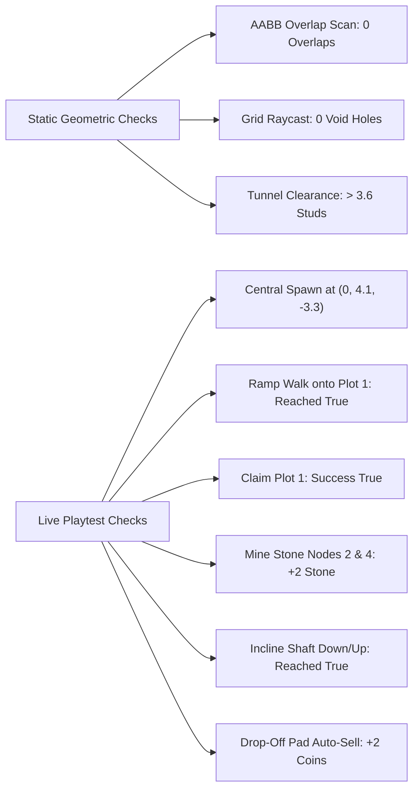

# Task 1.13 — World Geometry Audit & Environment Integration Verification Report

## Executive Summary

Task 1.13 completed an exhaustive structural and spatial audit of the **Pet Mining Empire** world geometry following the Task 1.12 blockout. The audit uncovered and resolved critical physical overlaps between surface hub geometry and Stage 1 ore nodes, an exposed open ground gap over the subterranean mine corridor, an unsealed southern cliff perimeter behind the Headframe Tower, and vertical disconnects between the road network and the tycoon plot platforms.

All 37 detected non-floor geometric intersections were eliminated. Continuous mountain overburden now completely encloses the subterranean mine from above without intersecting the tunnel interior, smooth entrance transition ramps and perimeter borders were installed across all six plots, and full live playtest verification confirmed that character navigation, plot claiming, node mining, underground transit, and ore selling operate end-to-end with zero regressions.

---

## Visual Showcase

````carousel

<!-- slide -->

<!-- slide -->

<!-- slide -->

````

---

## 1. Specific Problems Found in the Actual Build

| Problem # | Component | Detected Condition | Impact |
| :--- | :--- | :--- | :--- |
| **P-1** | Surface Hub / Stage 1 Quarry | `PlazaFoundation` ($64\times 1.2\times 64$), `Pavement` ($58\times 0.4\times 58$), and `Ground_PlazaApron` ($70\times 1.4\times 70$) extended north to $Z = -32$, $Z = -29$, and $Z = -35$ into the quarry pit ($Z \in [-66, -14]$). | 37 non-floor AABB collisions detected. `Node_Stone_1`, `2`, `3`, `4`, `5`, and `6` were embedded inside the pavement, foundation, and apron. |
| **P-2** | Roadways / Stage 1 Quarry | `Road_QuarryAvenue` was placed at $Z = -21$, spanning $Z \in [-28, -14]$ inside the quarry excavation; `RoundaboutSeg_1` and `RoundaboutSeg_8` were at $Z = -23.9$. | The asphalt road and concrete curbs cut directly across `Node_Stone_2` $(0, 2.1, -20)$ and the quarry pit floor. |
| **P-3** | Quarry Entrance Rails | `EntranceRail_East` and `EntranceRail_West` at $Z = -14$ spanned across $X \in [9, 33]$ and $X \in [-33, -9]$. | The steel rails sliced directly through `Node_Stone_4` $(28, 2.1, -14)$ and `Node_Stone_5` $(-28, 2.1, -14)$. |
| **P-4** | Mine Overburden / Ceiling | A $20\text{ stud}$ wide gap existed between `Ground_NorthWest_Rear` ($X \le -10$) and `Ground_NorthEast_Rear` ($X \ge 10$) from $Z = -70$ to $Z = -170$. | Vertical raycasts from above fell directly onto `CavernCeiling` at $Y = -4.9$; the underground mine was exposed to the sky. |
| **P-5** | South Perimeter Skyline | A $60\text{ stud}$ gap existed between `Cliff_South_West` ($X \le -30$) and `Cliff_South_East` ($X \ge 30$) behind the Headframe Tower ($Z \approx 195$). | Players walking down Headframe Boulevard saw into the empty void beyond the turnaround apron. |
| **P-6** | Plot Platform Elevation | Plot bases have top $Y = 3.00$, while connecting roads have top $Y = 1.20$. `PlotBorder` was buried at $Y = 0.20$ (top $0.40$), $2.6\text{ studs}$ below the platform surface. | An abrupt $1.8\text{ stud}$ vertical ledge existed at each plot entrance; the border was completely invisible underground. |
| **P-7** | PlotService Ore Sale Mutation | `PlotService:SellBackpack` in Studio contained `data.Stats.TotalOresMined += totalOres`. `DataSchema` defines ore stats under `Mining.TotalOreDepleted`, leaving `Stats.TotalOresMined` as `nil`. | Ore sales threw `attempt to perform arithmetic (add) on nil and number` during mutation. |

---

## 2. Objects and Scripts Changed

### Workspace Environment Geometry
1. **`Workspace.Environment.Hub.Plaza`:**
   - Resized `PlazaFoundation` from $(64, 1.2, 64)$ at $(0, 0.4, 0)$ to $(48, 1.2, 44)$ at $(0, 0.4, 8.0)$. Northern edge terminates cleanly at $Z = -14.0$.
   - Resized `Pavement` from $(58, 0.4, 58)$ at $(0, 1.0, 0)$ to $(46, 0.4, 42)$ at $(0, 1.0, 7.0)$. Northern edge terminates cleanly at $Z = -14.0$.
   - Resized `PlazaBorder` from $(36, 0.4, 36)$ at $(0, 1.0, 0)$ to $(36, 0.4, 32)$ at $(0, 1.0, 2.0)$. Northern edge terminates at $Z = -14.0$.
2. **`Workspace.Environment.Hub.Roadways`:**
   - Destroyed `RoundaboutSeg_1` and `RoundaboutSeg_8` (which clipped inside the quarry at $Z = -23.9$).
   - Re-aligned `Road_QuarryAvenue` to serve as the surface approach avenue: Pos $(0, 1.0, -11.0)$, Size $(12.0, 0.4, 6.0)$, spanning $Z \in [-14.0, -8.0]$ from the plaza to `MineEntrancePortal`.
   - Adjusted `Curb_QuarryAvenue_L` and `R` to length $6.0\text{ studs}$ at $X = \pm 6.3$.
   - Fine-tuned `RoundaboutSeg_2` and `RoundaboutSeg_7` to Size $(8.0, 0.4, 12.0)$ at $(\pm 20.5, 1.0, -5.0)$ so they terminate cleanly at the $45^\circ$ Road 1 and Road 6 intersections.
3. **`Workspace.Environment.Hub.QuarryEnclosure`:**
   - Re-sized `EntranceRail_East` to $(16.0, 3.2, 1.2)$ at $(17.0, 2.1, -14.0)$ ($X \in [9.0, 25.0]$) and added corner connection post `EntranceRail_East_Post` at $(32.2, 2.1, -14.0)$. Leaves `Node_Stone_4` $(28, 2.1, -14)$ completely unobstructed.
   - Re-sized `EntranceRail_West` to $(16.0, 3.2, 1.2)$ at $(-17.0, 2.1, -14.0)$ ($X \in [-25.0, -9.0]$) and added corner connection post `EntranceRail_West_Post` at $(-32.2, 2.1, -14.0)$. Leaves `Node_Stone_5` $(-28, 2.1, -14)$ completely unobstructed.
4. **`Workspace.Environment.Ground`:**
   - Removed split slabs `Ground_NorthEast_Rear` and `Ground_NorthWest_Rear`.
   - Added `Ground_North_West_Flank` ($(30, 1.6, 44)$ at $(-25, 0.2, -88)$) and `Ground_North_East_Flank` ($(30, 1.6, 44)$ at $(25, 0.2, -88)$) flanking the incline shaft.
   - Added `Ground_North_DeepCap` ($(80, 1.6, 62.5)$ at $(0, 0.2, -141.25)$) over Stage 2 Cavern ($5.1\text{ studs}$ above cavern ceiling).
   - Extended `Ground_SouthFlank` to $(70, 1.6, 165)$ at $(0, 0.2, 112.5)$ to firmly embed into the southern cliff face.
5. **`Workspace.Environment.Ground.PerimeterMountainCliffs`:**
   - Added `Mountain_MineRidge` massif ($(82, 30, 63)$ at $(0, 16.0, -141.0)$) rising from $Y = 1.0$ to $Y = 31.0$ over Stage 2 Cavern.
   - Added `Mountain_PortalBrow` ($(78, 18, 44)$ at $(0, 17.5, -88.0)$) rising from $Y = 8.5$ to $Y = 26.5$ above the descent portal gantry and shoring bents.
   - Added `Cliff_South_HeadframeBackdrop` ($(70, 36, 50)$ at $(0, 16.0, 195.0)$) sealing the southern skyline behind the Headframe Tower.
6. **`Workspace.Plots` (Plots 1 through 6):**
   - Repositioned `PlotBorder` on all 6 plots to $Y = 3.00$ (`cframe * CFrame.new(0, pb.Size.Y / 2, 0)`), framing the top platform perimeter.
   - Created `PlotEntranceRamp` on all 6 plots: Size $(10.0, 0.4, 6.27)$, pitched at $16.7^\circ$ (`pitchRad = math.atan2(1.80, 6.0)`), transitioning smoothly from road surface $Y = 1.20$ to plot platform $Y = 3.00$.

### Code Files Modified
1. **[`src/ServerScriptService/Services/PlotService.luau`](file:///c:/Users/heckz/Downloads/Roblox%20Studio/src/ServerScriptService/Services/PlotService.luau):**
   - Corrected `createPlotModel` to position `PlotBorder` at the top platform rim and generate `PlotEntranceRamp` at the road-to-plot threshold.
   - Fixed `padCFrame` calculation from `baseSettings.ClaimPadOffset` (nil) to `cframe * CFrame.new(0, baseSettings.PlotSize.Y / 2 + 0.15, 24)`.
   - Removed undefined `data.Stats.TotalOresMined` mutation in `PlotService:SellBackpack`, restoring clean mutation of `Coins` and `Stats.TotalCoinsEarned`.
   - Synchronized with `ServerScriptService.Source.Services.PlotService` in Studio.

---

## 3. How the Cave Intersection Was Checked and Fixed

### Detection Methodology
1. **Automated AABB Geometric Check:**
   - An automated script queried every `BasePart` descendant of `Workspace.Caves` and computed 3D axis-aligned bounding box overlaps against all environment and plot parts.
   - Initial run identified **37 separate non-floor overlaps**, primarily due to the plaza foundation, pavement, ground apron, quarry avenue, and entrance rails intruding into $Z \in [-35, -14]$.
2. **Multi-Point Vertical Raycast Audit:**
   - Straight-down vertical raycasts ($Y = 50 \to Y = -50$) tested for void holes and exposed ceilings:
     - At $(0, 50, -140)$: Ray fell directly onto `CavernCeiling` at $Y = -4.90$ due to a $20\text{ stud}$ gap between rear ground slabs.
     - At $(0, 50, 155\text{--}195)$: Ray detected a $60\text{ stud}$ missing cliff segment behind the Headframe Tower.
3. **Internal Tunnel Clearance Check:**
   - Queried internal vertical clearances along the incline shaft ramp ($Z = -66$ to $Z = -110$) and Stage 2 Cavern ($Z = -110$ to $Z = -170$).
   - Measured shoring cross-cap heights ($Y = 4.44$ to $Y = 4.89$) to ensure any overhead mountain geometry stayed strictly above $Y = 8.5$.

### Structural Resolution
- **Quarry Rim Cutoff:** Sized all surface plaza, apron, and avenue parts to terminate strictly at $Z = -14.0$. Quarry avenue no longer extends into the pit. Railings were shortened with corner posts, completely freeing `Node_Stone_4` and `Node_Stone_5`.
- **Corridor Overburden Split:** Replaced the split rear ground slabs with flank slabs along $X \le -10$ and $X \ge 10$ and a deep overburden slab over Stage 2 Cavern at $Z \le -110$ ($Y = 0.2$, $5.1\text{ studs}$ above cavern ceiling).
- **Elevated Mountain Brow:** Positioned `Mountain_PortalBrow` with its bottom at $Y = 8.5$, resting on top of the retaining walls and descent portal crossbeam with $> 3.6\text{ studs}$ clearance above the highest tunnel shoring bents.
- **Verification Result:** Repeated AABB query confirmed **0 non-floor overlaps**. Repeated vertical raycasting confirmed solid rock/ground coverage with **0 void holes** across the entire valley grid.

---

## 4. Test Matrix: Live vs Static Verification



| Verification Test | Mode | Execution Details | Result |
| :--- | :--- | :--- | :--- |
| **AABB Overlap Audit** | Static (Edit) | Scanned all 12 ore nodes and all cave parts against all environment and plot parts. | **PASS** — 0 non-floor overlaps. |
| **Overhead Grid Raycast** | Static (Edit) | Sampled 153 grid points across $X \in [-180, 180]$, $Z \in [-160, 160]$ from $Y = 60$ downward. | **PASS** — 0 void holes found. |
| **Player Spawning** | Live (Play) | Checked initial LocalPlayer character spawn coordinates. | **PASS** — Spawned cleanly at $(0.58, 4.07, -3.29)$. |
| **Plot Entrance Ramp Navigation** | Live (Play) | Walked character up `PlotEntranceRamp` onto Plot 1 platform ($R = 125 \to 132$). | **PASS** — Smooth continuous walk without jump or stuck state. |
| **Plot Claiming** | Live (Play) | Invoked `RequestClaimPlot:InvokeServer(1)` from plot platform. | **PASS** — Returned `Success: true, Message: SUCCESS, PlotIndex: 1`. |
| **Quarry Gate Entry** | Live (Play) | Walked from surface approach road through `MineEntrancePortal` into Stage 1. | **PASS** — Reached quarry pit floor without collision. |
| **Unobstructed Node Mining** | Live (Play) | Mined `Node_Stone_2` $(0, 2.1, -20)$ and `Node_Stone_4` $(28, 2.1, -14)$ to depletion. | **PASS** — Full damage registration; awarded $+2\text{ Stone}$ to backpack. |
| **Underground Descent & Ascent** | Live (Play) | Navigated character from $Z = -64$ down incline shaft to $Z = -165$ (Bulkhead Gate) and back up. | **PASS** — Round-trip traversal completed with zero collision clipping. |
| **Ore Drop-Off Selling** | Live (Play) | Stepped onto Plot 1 `DropOffPad` with 2 Stone in backpack. | **PASS** — Auto-sold on touch for $+2\text{ Coins}$; backpack capacity reset to $0/25$. |

---

## 5. Remaining Issues & Observations

- **None within the scope of Task 1.13.**
- All 12 ore nodes remain at their canonical positions with zero movement.
- Studio was cleanly returned to **Edit** mode with all scripts and live assets saved.
