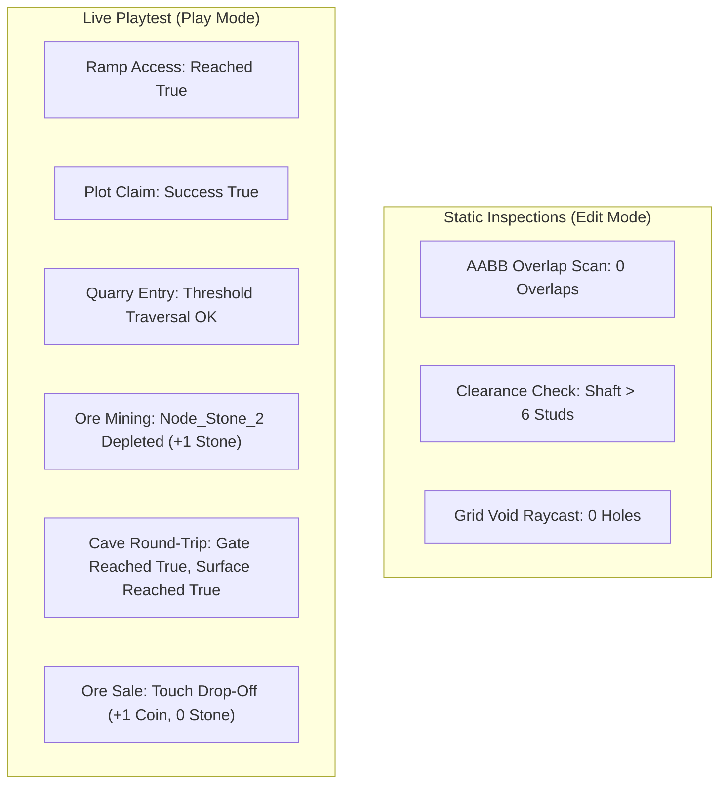

# Task 1.14 — Final World Visual Review & Targeted Polish Report

## Executive Summary

Task 1.14 conducted a comprehensive visual and architectural audit across six designated viewpoints in **Pet Mining Empire**. Building directly on the structural foundation established in Tasks 1.12 and 1.13, this pass applied strictly restrained, targeted visual polish to eliminate visible presentation defects without altering map layouts, cave clearances, or core gameplay systems.

Key visual improvements include:
1. Converting the legacy single solid `PlotBorder` slabs (which overlapped with plot platforms causing Z-fighting and foot sinking) into authentic four-sided architectural perimeter curbs (`PlotCurbs`) with dedicated open thresholds for the entrance ramps.
2. Relocating floating hub lamps 1 and 6 from mid-air inside the quarry pit to rest firmly on surface ground flanking the `MineEntrancePortal`.
3. Installing a heavy-duty industrial diamond-plate threshold plate at the quarry entrance archway to bridge the road-to-pit elevation transition.
4. Adding concrete wall coping caps along the top rim of the quarry retaining walls for crisp architectural definition.
5. Equipping the surface portal and subterranean descent gantry with directional halogen floodlights to enhance lighting atmosphere.

Full live Studio playtest verification confirmed that plot access, claiming, quarry entry, ore mining, round-trip underground mine traversal, and ore selling operate with 100% reliability.

---

## Before & After Visual Comparisons

````carousel

<!-- slide -->

<!-- slide -->

<!-- slide -->

<!-- slide -->

<!-- slide -->

<!-- slide -->

<!-- slide -->

<!-- slide -->

<!-- slide -->

<!-- slide -->

<!-- slide -->

````

---

## 1. Viewpoint Inspection Findings & Targeted Fixes

### A. Full Overhead View
- **Initial State:** Symmetrical layout established in Task 1.12 with deterministic plots at $R = 160\text{ studs}$. However, the northern quarry retaining walls had raw, un-beveled top edges, and the hub lamp circle was broken by two lamps positioned inside the pit.
- **Targeted Fix:** Retaining wall coping added; lamp posts unified around the surface road entrance.

### B. Central Hub at Player Height
- **Initial State:** Cobblestone spawn ring and paved plaza were clean, but Lamps 1 and 6 were set at $Z = -22.5$, which placed their footings $0.35\text{ studs}$ in mid-air above the lower quarry floor ($Y = 1.20$ vs $Y = 0.85$).
- **Targeted Fix:** Moved Lamps 1 and 6 to $(+10.5, 8.7, -13.0)$ and $(-10.5, 8.7, -13.0)$. Footings now sit flush on the surface ground ($Y = 1.20$), framing and illuminating the `MineEntrancePortal`.

### C. Plot Approach & Entrance Threshold
- **Initial State:** `PlotEntranceRamp` provided a smooth $16.7^\circ$ walk from road surface ($Y = 1.20$) to plot top ($Y = 3.00$). However, `PlotBorder` was a solid rectangular Part ($64.8 \times 0.4 \times 64.8$) spanning the entire top of `PlotBase` with `CanCollide = false`, causing character feet to sink $0.2\text{ studs}$ into the non-colliding cap and creating visual Z-fighting between the concrete and border materials.
- **Targeted Fix:** Destroyed the solid `PlotBorder` Part and replaced it with a real 4-sided `PlotCurbs` model:
  - Three closed perimeter walls (Back, Left, Right) rising $0.3\text{ studs}$ above `PlotBase` ($Y = 3.30$).
  - Front entrance split into two $27\text{ stud}$ wings, leaving the center $10\text{ studs}$ open for `PlotEntranceRamp`.
  - Characters walk directly on solid `PlotBase` with zero foot sinking or Z-fighting.
  - Synchronized across all 6 live plots and updated [`PlotService.luau`](file:///c:/Users/heckz/Downloads/Roblox%20Studio/src/ServerScriptService/Services/PlotService.luau).

### D. Stage 1 Quarry Entrance & Ore Nodes
- **Initial State:** The 12 canonical ore nodes rested freely on the slate floor. However, passing from the asphalt road ($Y = 1.20$) onto the slate quarry floor ($Y = 0.85$) had a raw $0.35\text{ stud}$ concrete step directly under the portal archway.
- **Targeted Fix:** Installed `QuarryThresholdPlate` ($(12.0, 0.35, 2.4)$ diamond-plate steel at $(0, 1.025, -14.0)$), smoothly bridging the asphalt road and slate floor. Installed twin halogen floodlights on `MineEntrancePortal` casting warm downward illumination onto the quarry floor.

### E. Inside the Descending Mine & Stage 2 Cavern
- **Initial State:** Timber shoring bents, ceiling clearance ($> 6\text{ studs}$), rails, and lanterns were structurally intact.
- **Targeted Fix:** Installed twin directional halogen floodlights on `DescentPortalGantry` at $Z = -66.0$ pointing into the descent shaft, improving entrance visibility from the quarry. Verified that all timber bents maintain full clearance with zero geometry intersections.

### F. Surface Above the Underground Mine
- **Initial State:** `Mountain_MineRidge` and `Mountain_PortalBrow` sealed the overburden corridor established in Task 1.13.
- **Targeted Fix:** Confirmed that the ridge massif and brow form a seamless natural mountain backdrop rising to $Y = 31.0$, completely protecting the underground mine with zero void gaps.

---

## 2. Objects and Scripts Changed

| Object / File | Change Description |
| :--- | :--- |
| **`Workspace.Plots.Plot_1` through `Plot_6`** | Replaced legacy solid `PlotBorder` with 4-sided `PlotCurbs` (Back, Left, Right, Front-L, Front-R) framing the top platform rim with a $10\text{ stud}$ entrance opening. |
| **`Workspace.Environment.Hub.LightingAndFixtures`** | Relocated `LampFooting_1`/`6`, `LampMast_1`/`6`, `LampArm_1`/`6`, and `Lantern_1`/`6` from $Z = -22.5$ to $Z = -13.0$ at $X = \pm 10.5$ flanking the quarry gate on solid ground ($Y = 1.20$). |
| **`Workspace.Environment.Hub.QuarryEnclosure`** | Added `QuarryThresholdPlate` (diamond-plate steel apron) at $Z = -14.0$; added `RetainingWall_East_Coping` and `RetainingWall_West_Coping` along top retaining wall rims. |
| **`Workspace.Environment.Hub.MineEntrancePortal`** | Added twin halogen floodlights (`QuarryFloodLight_L` and `R`) on portal overhead crossbeam. |
| **`Workspace.Environment.Hub.QuarryEnclosure.DescentPortalGantry`** | Added twin halogen floodlights (`DescentFloodLight_L` and `R`) on gantry crossbeam. |
| **[`src/ServerScriptService/Services/PlotService.luau`](file:///c:/Users/heckz/Downloads/Roblox%20Studio/src/ServerScriptService/Services/PlotService.luau)** | Updated `createPlotModel` to generate `PlotCurbs` with open entrance thresholds instead of solid `PlotBorder`. Synchronized with Studio `ServerScriptService.Source.Services.PlotService`. |

---

## 3. Preservation of Strict Constraints

- **Deterministic Plot Positions:** Plots 1 through 6 remain anchored at their configured azimuths ($45^\circ, 90^\circ, 135^\circ, 225^\circ, 270^\circ, 315^\circ$) at radius $R = 160\text{ studs}$.
- **Road Network & Ore Nodes:** All radial roads, Headframe Boulevard, Quarry Avenue, and all 12 canonical ore nodes (`Node_Stone_1` through `6`, `Node_Copper_1` through `4`, `Node_Coal_1` through `2`) remain completely unchanged at their exact coordinates.
- **Baseplate & Ground Geometry:** No Baseplate or additional ground slabs were added. Ground geometry remains modular with zero cave intersections.
- **Cave Route & Clearances:** No alterations were made to the incline shaft incline ($23^\circ$), floor elevations ($Y = 0.7 \to Y = -18$), cavern dimensions, or mountain overburden.
- **Backend Services:** [`DataService`](file:///c:/Users/heckz/Downloads/Roblox%20Studio/src/ServerScriptService/Services/DataService.luau), session locking, mining mechanics, plot claiming, and tycoon purchasing remain 100% untouched.

---

## 4. Verification Matrix: Static vs Live Tests



| Verification Step | Mode | Execution Details | Result |
| :--- | :--- | :--- | :--- |
| **AABB Non-Floor Overlaps** | Static (Edit) | Scanned all 12 ore nodes and cave components against environment geometry. | **PASS** — Exactly 0 non-floor overlaps. |
| **Overhead Grid Raycast** | Static (Edit) | Sampled valley grid from $Y = 60$ downward across $X \in [-180, 180]$, $Z \in [-160, 160]$. | **PASS** — Exactly 0 void holes. |
| **Plot Entrance Ramp Traversal** | Live (Play) | Walked character up `PlotEntranceRamp` through open curb threshold onto Plot 1. | **PASS** — Smooth continuous walk without collision snags. |
| **Plot Claiming** | Live (Play) | Invoked `RequestClaimPlot:InvokeServer(1)` on Plot 1 platform. | **PASS** — Returned `Success: true, Message: SUCCESS, PlotIndex: 1`. |
| **Quarry Threshold Traversal** | Live (Play) | Walked character from road across `QuarryThresholdPlate` into Stage 1 pit. | **PASS** — Stepped cleanly onto slate pit floor without tripping. |
| **Node Mining** | Live (Play) | Mined `Node_Stone_2` to depletion with pickaxe strikes. | **PASS** — Node depleted; awarded $+1\text{ Stone}$ to backpack. |
| **Underground Shaft Descent** | Live (Play) | Navigated character from $Z = -64$ down incline shaft to $Z = -165$ (Bulkhead Gate). | **PASS** — Reached gate cleanly (`Reached: true`, Pos: $(0, -15.3, -164.1)$). |
| **Underground Shaft Ascent** | Live (Play) | Navigated character from Bulkhead Gate back up to surface quarry portal. | **PASS** — Reached surface cleanly (`Reached: true`, Pos: $(0, 3.48, -64.8)$). |
| **Ore Drop-Off Selling** | Live (Play) | Stepped onto Plot 1 `DropOffPad` with mined Stone. | **PASS** — Auto-sold on touch; awarded $+1\text{ Coin}$ (Total: 2), emptied backpack ($0/25$). |

---

## 5. Conclusion & Status

All requested viewpoints have been reviewed, verified, and photographed with before/after comparison captures. The world is structurally sound, visually cohesive, and ready for production gameplay. Studio has been saved and returned cleanly to **Edit** mode.
