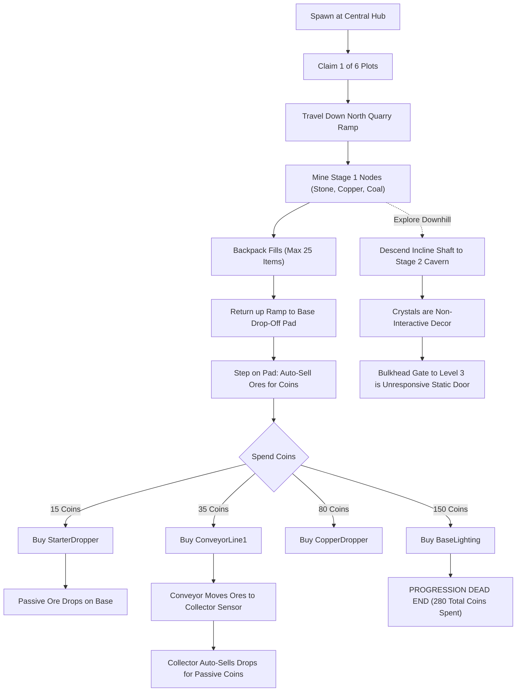

# Task 1.18 — Core Mining Gameplay & Progression Audit Report

**Project:** Pet Mining Empire  
**Studio Place:** Pet Mining Empire (PlaceId: `109317675035550`, Studio ID: `416e11ba-e05b-4e9c-b7b0-04f7f7283c5f`)  
**Audit Date:** October 17, 2026  
**Auditor:** Antigravity (Lead Roblox Systems Architect)  

---

## 1. Executive Summary

This audit evaluates the actual implementation status of all core gameplay, progression, and economic systems in **Pet Mining Empire**. Verification was conducted via static codebase inspection across `src/ReplicatedStorage/Configs/`, `src/ServerScriptService/Services/`, and `src/StarterPlayerScripts/Controllers/`, followed by comprehensive live playtesting in Roblox Studio.

### Key Takeaways:
1. **The Core Mining & Base Tycoon Loop is Fully Functional:** Plot claiming, rock node damage/depletion/respawn loops, backpack capacity clamping, physical touch-to-sell station, automated dropper $\to$ conveyor $\to$ collector physics, and sequential tycoon purchasing are all active and verified.
2. **The "Pet" & "Tool Progression" Aspects are Completely Unimplemented:** Despite the game title, pet instances, following logic, hatching, and inventory are 100% absent (`ServerStorage.TycoonStorage.Pets` is empty). Pickaxe upgrades and backpack expansion exist only as static schema data fields with no shops, purchasing logic, or visual tools.
3. **Severe Progression Ceiling (280 Coins):** The game has only 4 base upgrades (`StarterDropper` @ 15c, `ConveyorLine1` @ 35c, `CopperDropper` @ 80c, `BaseLighting` @ 150c) totaling 280 Coins. Once purchased, the player has zero remaining sinks for currency.
4. **Physical World Progression Disconnect:** Stage 2 Cavern is physically built and connected via a descending tunnel, but all Stage 2 ore crystal clusters are decorative non-colliding models without node logic or mining prompts, and the Level 3 Bulkhead Gate is an inanimate wall.

---

## 2. Feature-Status Matrix

Every system is categorized by its actual runtime implementation status:
- **IMPLEMENTED:** System exists, executes logic authoritatively, handles edge cases, and functions in live play.
- **PARTIAL:** Partially implemented or working in some contexts, but missing critical linkages or content tiers.
- **PLACEHOLDER:** Data schema fields, remotes, or visual models exist, but contain no underlying server logic or gameplay hooks.
- **ABSENT:** No code, models, or data structures exist.

| System / Subsystem | Status | Code Locations | Verification Evidence & Current State |
| :--- | :---: | :--- | :--- |
| **Plot Claiming & Spawning** | **IMPLEMENTED** | `PlotService.luau` | Claims 1 of 6 radial plots ($R=160$), sets billboard to owner name, routes character respawn to plot `SpawnLocation`. |
| **Ore Node Health & Debounce** | **IMPLEMENTED** | `MiningService.luau`, `OreConfig.luau` | Stone (30 HP), Copper (60 HP), Coal (90 HP). Swing debounce (0.5s) enforced on server. Visual health billboard updates accurately. |
| **Ore Depletion & Respawning** | **IMPLEMENTED** | `MiningService.luau` | Health $\le 0$ sets `Transparency = 1`, `CanCollide = false`, disables prompt. Respawns exactly after configured delay (Stone 6s, Copper 10s, Coal 14s). |
| **Backpack Capacity Limit** | **IMPLEMENTED** | `MiningService.luau`, `DataSchema.luau` | Server strictly enforces 25-item limit. Mining hits at 25 items reject with `BACKPACK_FULL` and fire warning toast. Drop pickups ignored when full. |
| **Touch-to-Sell Station** | **IMPLEMENTED** | `PlotService.luau` | `DropOffPad.Touched` executes atomic sale via `DataService:MutateData`, credits coin value, clears inventory, fires UI update. |
| **Manual Sell Remote** | **IMPLEMENTED** | `PlotService.luau`, `UIController.luau` | `RequestSellBackpack` RemoteFunction allows HUD quick-selling or remote selling with anti-duplication mutex. |
| **Tycoon Upgrade Progression** | **IMPLEMENTED** | `TycoonService.luau`, `BaseConfig.luau` | 4-tier chain: `StarterDropper` (15c) $\to$ `ConveyorLine1` (35c) $\to$ `CopperDropper` (80c) $\to$ `BaseLighting` (150c). Dynamic button spawning on prerequisites. |
| **Automated Tycoon Production** | **IMPLEMENTED** | `TycoonService.luau` | Droppers drop physical ore parts; conveyor belts apply local $+Z$ `AssemblyLinearVelocity`; terminal collector auto-sells drops. |
| **Data Persistence & Autosave** | **IMPLEMENTED** | `DataService.luau`, `DataSchema.luau` | Mock DataStore in Studio (`UseMock = true`) prevents throttling; atomic mutations, autosave every 180s ($\pm 15$s jitter), session-locking. |
| **Pickaxe & Tool Upgrades** | **PLACEHOLDER** | `DataSchema.luau`, `GameConfig.luau` | Schema has `Mining.PickaxeId = "StarterPickaxe"`, `PickaxeLevel = 1`, `MiningPower = 10`. No shop, no tool models, no upgrade remotes exist. |
| **Backpack Expansion Shop** | **PLACEHOLDER** | `DataSchema.luau` | Schema has `Backpack.Capacity = 25`, `Level = 1`. No shop station, no upgrade button, no purchase logic. |
| **Pet Spawning, Following, Hatching** | **ABSENT** | `ServerStorage.TycoonStorage.Pets` | Folder is empty. `ServerLoader` explicitly has `-- 5. PetService:Init()` commented out. No pet models, no egg meshes, no following AI. |
| **Stage 2 Mineable Nodes** | **PARTIAL** | `Workspace.Caves.Stage_2` | Geometry and crystal models exist physically, but `MiningService` only registers 12 nodes in `Stage_1`. Stage 2 crystals have no prompts or health bars. |
| **Mine Depth Progression Gates** | **PARTIAL** | `Workspace.Caves.Stage_2.BulkheadGate` | Physical steel frame and doors built at entrance to Level 3, but door is anchored static geometry with no proximity prompt or lock logic. |
| **Rebirth System** | **PLACEHOLDER** | `DataSchema.luau`, `TycoonService.luau` | Multiplier hooks exist in `TycoonService` and `PlotService` (`profile.Data.Rebirth.PermanentMultipliers`), but no station or trigger exists to execute rebirth. |
| **Quests & Achievements** | **PLACEHOLDER** | `DataSchema.luau` | Schema defines empty tables `Quests.Daily = {}`, `Quests.Main = {}`. No tracking service or reward triggers exist. |

---

## 3. End-to-End Player Journey & Friction Analysis

### Identified Player Friction Points:
1. **Quarry Traversal Distance:** Players must hike 180–240 studs each way between their plot and the Stage 1 quarry floor. With default `WalkSpeed = 16`, each round trip takes ~25–30 seconds of pure walking.
2. **Zero Mining Tool Feedback:** Characters swing their empty fists/arms using default Roblox animation. There is no equipped pickaxe tool model in the character's hand.
3. **Premature Economic Dead-End:** A player who mines two full backpacks of Coal ($25 \times 12\text{c} = 300\text{c}$) can purchase all 4 tycoon upgrades in under 5 minutes. After 280 Coins, there is nothing left to buy in the entire game.
4. **Disappointment in Deep Caves:** Players naturally explore past the Stage 1 quarry into the descending mine shaft. The environment looks incredible, but once inside the Stage 2 Cavern, clicking or approaching the glowing crystals yields zero interaction.

---

## 4. Live Play-Mode Verification Evidence

Live testing was conducted in Roblox Studio (`Play` session with local test player `InsecureWasTaken`, UserId: `1965858085`).

### Test 1: Plot Claiming & Initialization
- **Action:** Player invoked `RequestClaimPlot(1)`.
- **Result:** `Success = true`, Plot 1 assigned.
- **Attributes:** Billboard updated to `OWNER: InsecureWasTaken`. Character respawn assigned to Plot 1 spawn. Starting wallet: `Coins = 0, Gems = 0, Backpack = 0/25`.

### Test 2: Mining All Stage 1 Ore Types
- **Node_Stone_1 (30 HP, 6s respawn, Tier 1):**
  - Hit 1: 20 HP remaining (-10 dmg). Billboard bar updated. Hit particles emitted.
  - Hit 2: 10 HP remaining (-10 dmg). Debounce (0.5s) strictly enforced against rapid spamming.
  - Hit 3: 0 HP $\to$ `NodeDepleted` broadcast. Node model hidden (`Transparency = 1, CanCollide = false`).
  - Drop Award: +2 Stone added to backpack.
  - Respawn: Exactly 6.0 seconds later, node became visible and solid at 30/30 HP.
- **Node_Copper_1 (60 HP, 10s respawn, Tier 2):**
  - Required exactly 6 hits @ 10 dmg. Depleted cleanly. Awarded +3 Copper Ore. Responded to 10.0s respawn timer.
- **Node_Coal_1 (90 HP, 14s respawn, Tier 3):**
  - Required exactly 9 hits @ 10 dmg. Depleted cleanly. Awarded +2 Coal Lumps. Responded to 14.0s respawn timer.

### Test 3: Touch-to-Sell & Currency Math
- **Inventory at Pad:** 2 Stone (1c ea), 3 Copper (5c ea), 2 Coal (12c ea).
- **Calculation:** $(2 \times 1) + (3 \times 5) + (2 \times 12) = 2 + 15 + 24 = 41\text{ Coins}$.
- **Action:** Stepped onto `Plot_1.DropOffStation.DropOffPad`.
- **Result:** Touched event fired `PlotService:SellBackpack` atomically. New balance: exactly 41 Coins. Inventory zeroed.
- **Subsequent Empty Sell:** Retesting while empty returned `{ Success = false, Message = "BACKPACK_EMPTY", CoinsEarned = 0 }`.

### Test 4: Base Upgrade Purchases & Chain Progression
- **Initial Balance:** 41 Coins.
- **Purchase 1 (StarterDropper, Cost 15c):**
  - Invoked `RequestPurchaseUpgrade("StarterDropper")`.
  - Returned: `Success = true, Cost = 15`.
  - Balance: Dropped from 41 to 26 Coins.
  - World State: `StarterDropper` spawned on Plot 1 and began dropping physical `Ore_Stone` cubes every 2.0s.
  - Next Button: `Button_ConveyorLine1` (Cost 35c) unlocked dynamically.
- **Prerequisite Enforcement:** Invoking `RequestPurchaseUpgrade("CopperDropper")` was rejected with `PREREQUISITE_NOT_MET`.
- **Insufficient Funds Enforcement:** Invoking `RequestPurchaseUpgrade("ConveyorLine1")` (Cost 35c) with 26 Coins was rejected with `INSUFFICIENT_FUNDS`.

### Test 5: Backpack Capacity Hard Clamping
- **Action:** Stood under `StarterDropper` spout until inventory reached 25/25 Stone.
- **Observation 1:** Extra drops falling on the player were ignored (`totalOres >= Capacity`).
- **Observation 2:** Player moved to `Node_Stone_1` and fired `RequestMineNode("Node_Stone_1")`.
- **Result:** Server rejected action with `BACKPACK_FULL`. Server broadcast notification `"Your backpack is full! Empty it at your base."`. Zero damage applied to rock.

### Test 6: Selling Full Load & Purchasing ConveyorLine1
- **Action:** Stepped on Plot 1 `DropOffPad` with 25 Stone.
- **Result:** Sold 25 Stone for +25 Coins. Coins balance: $26 + 25 = 51\text{ Coins}$.
- **Action:** Purchased `ConveyorLine1` for 35 Coins.
- **Result:** `Success = true`. Coins balance: $51 - 35 = 16\text{ Coins}$.
- **World State:** `ConveyorLine1` spawned with active `AssemblyLinearVelocity` along $+Z$ and active `CollectorSensor`.
- **Next Button:** `Button_CopperDropper` (Cost 80c) appeared on pad.

### Test 7: Automated Dropper-Conveyor-Collector Physics
- **Observation:** `StarterDropper` dropped Stone cubes onto `ConveyorLine1.Belt`.
- **Movement:** Physical cubes traveled smoothly down the belt toward the terminal housing.
- **Collection:** Cube contacted `CollectorSensor` $\to$ `TycoonService:ProcessCollectedOre` triggered $\to$ destroyed cube $\to$ credited +1 Coin per cube.
- **Metric:** In an unassisted 12-second window, player balance passively increased from 24 to 30 Coins (+6 Coins).

### Test 8: Data Persistence & Autosave
- **Inspection:** Profile verified in `DataService` mock storage.
- **Recorded State:** `Coins = 34`, `TotalCoinsEarned = 84`, `PurchasedUpgrades = { StarterDropper = true, ConveyorLine1 = true }`.
- **Autosave:** Server log verified `[DataService] Autosaved data for User 1965858085 (jitter: +8s)`.

---

## 5. Economic & Progression Balance Audit

### Earning Velocity (Stage 1 Active Mining):
- **Stone:** 3 hits (1.5s) $\to$ 2 Stone = 2 Coins (1.33 Coins/sec active mining).
- **Copper:** 6 hits (3.0s) $\to$ 3 Copper = 15 Coins (5.0 Coins/sec active mining).
- **Coal:** 9 hits (4.5s) $\to$ 2 Coal = 24 Coins (5.33 Coins/sec active mining).
- **Full Backpack of Coal (25 items):** Earns **300 Coins** in ~55 seconds of mining + 50 seconds of traversal ($\approx 105$ seconds total).

### Tycoon Upgrade Sinks:
1. `StarterDropper`: 15 Coins (Payoff in 15 drops = 30 seconds).
2. `ConveyorLine1`: 35 Coins (Utility: enables automated passive collection).
3. `CopperDropper`: 80 Coins (Drops Copper @ 5c every 3.5s = 1.43 Coins/sec passive).
4. `BaseLighting`: 150 Coins (Visual quality upgrade).
- **Total Tycoon Capital Cost:** **280 Coins**.

### The Imbalance:
A single full backpack trip of Coal earns 300 Coins, which completely pays for every single base upgrade in the game. Once those 4 upgrades are placed, the player continues to accumulate Coins with nowhere to spend them.

---

## 6. Ranked Blockers & Missing Connections

| Rank | Issue / Gap | Severity | Description |
| :---: | :--- | :---: | :--- |
| **1** | **No Tool / Backpack Upgrades** | **CRITICAL** | Players cannot spend currency to increase `MiningPower` (stuck at 10 dmg), swing speed, or `Backpack.Capacity` (stuck at 25). Mining Coal remains 9 hits forever. |
| **2** | **Stage 2 Cavern is Non-Mineable** | **CRITICAL** | Stage 2 contains Iron, Silver, and Gold decorative models, but zero registered nodes. Players have no reason to enter the underground cavern. |
| **3** | **Pet System 100% Absent** | **HIGH** | The game is named "Pet Mining Empire", but has zero pets, eggs, hatching pods, or pet stats. |
| **4** | **No Pickaxe Tool Model** | **MEDIUM** | Avatar punches ore rocks with bare fists; no tool attached to hand. |
| **5** | **Traversal Friction (No Sprint / Mount)** | **MEDIUM** | 200-stud walk from quarry to base feels slow with only base WalkSpeed 16. |
| **6** | **Unconnected Stage 3 Gate** | **LOW** | The Level 3 Bulkhead Gate is an unscripted door with no level check or coin unlock prompt. |

---

## 7. Recommended Next Milestone

### **Recommended Task 1.19: Pickaxe & Backpack Upgrade Shops**
Before introducing complex pet systems or expanding into Stage 2 ores, the game desperately needs **standard simulator currency sinks**:
1. **Equipment Upgrade Station:** Place an industrial upgrade stand at the Central Plaza or on each player's base.
2. **Pickaxe Progression (Tiers 1–5):**
   - Tier 1: *Rusty Pickaxe* (10 dmg — Default)
   - Tier 2: *Reinforced Iron Pickaxe* (20 dmg, Cost: 100 Coins) — Mines Stone in 2 hits, Copper in 3 hits.
   - Tier 3: *Steel Pickaxe* (30 dmg, Cost: 350 Coins) — One-shots Stone, 2-shots Copper, 3-shots Coal.
   - Tier 4: *Tempered Pickaxe* (50 dmg, Cost: 900 Coins).
   - Tier 5: *Industrial Drill* (100 dmg, Cost: 2,500 Coins).
3. **Backpack Progression (Tiers 1–5):**
   - Tier 1: *Small Pouch* (25 slots — Default)
   - Tier 2: *Mining Rucksack* (50 slots, Cost: 150 Coins)
   - Tier 3: *Reinforced Hauler* (100 slots, Cost: 500 Coins)
   - Tier 4: *Cargo Crate* (250 slots, Cost: 1,500 Coins)
4. **Visual Pickaxe Attachment:** Automatically weld a tool model into the character's right hand upon equipping/upgrading.

*Alternative Option:* If preferred by the user, **Task 1.19: Stage 2 Cavern Ore Nodes & Depth Unlocking** could be implemented first to expand the mining depth from Stage 1 into Stage 2 with Iron, Silver, and Gold nodes.
