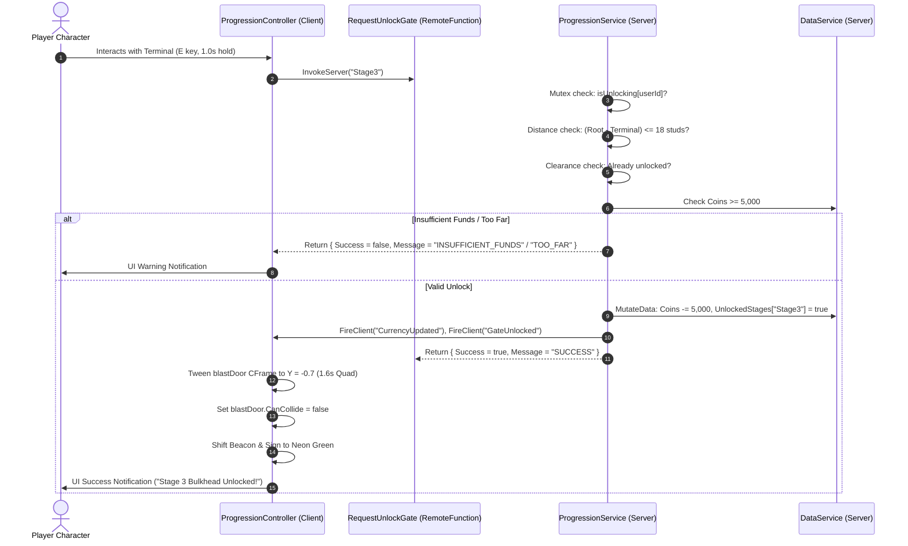

# Task 1.21 Verification Report: Stage 3 Bulkhead Unlocking

## 1. Executive Summary

Task 1.21 implements server-authoritative progression unlocking for the **Stage 3 Bulkhead Gate** (`Workspace.Caves.Stage_2.ProgressionGate_Stage3`) in *Pet Mining Empire*.

The bulkhead now functions as a high-stakes, satisfying progression gate between Stage 2 and Stage 3:
- **Cost Rationale:** **5,000 Coins**, grounded directly in the Stage 2 mining yield economy (equivalent to 1.5–2 complete Stage 2 mining excursions with a mid-tier backpack).
- **Architecture:** Per-player authoritative clearance stored in `PlayerData.Caves.UnlockedStages["Stage3"] = true` and `PlayerData.Caves.HighestStageReached = 3`.
- **Physical Installation:** An accessible industrial access terminal constructed at `(-14.5, -16.4, -168.5)` featuring an angled CRT console display, dynamic status labels, neon status light, and a 1.0-second hold `ProximityPrompt` ("Unlock Stage 3").
- **Animation & Traversal:** A smooth 1.6-second hydraulic door lift animation (`TweenService`) elevating the blast door from $Y = -12.2$ to $Y = -0.7$ (flush with the ceiling at $Y = -6.45$), opening a 26-stud wide $\times$ 11.5-stud high clear passage with local collision disabling (`CanCollide = false`).
- **Persistence & Anti-Exploit:** Validated against distance ($\le 18\text{ studs}$), concurrent race conditions (per-player mutex lock), insufficient funds, duplicate purchases, character death, and respawn persistence.

---

## 2. System Architecture & Design Decisions

### 2.1 Unlock Cost Analysis (5,000 Coins)
The unlock requirement was formulated from live Stage 1 and Stage 2 ore node economics:
- **Stage 1 (Quarry):** Stone (1c), Copper (5c), Coal (12c). Average full starter backpack (25 slots): $\sim 150\text{--}250\text{ Coins}$.
- **Stage 2 (Cavern):** Iron (25c), Gold (60c), Cyanite (140c). Average 50-slot backpack trip: $\sim 3,000\text{--}3,500\text{ Coins}$.
- **Equipment Costs:** Tempered Pickaxe (900c), Cargo Crate (1,500c), Industrial Drill (2,500c).
- **Target Difficulty:** A requirement of **5,000 Coins** demands genuine engagement with Stage 2's deep cavern mining loop without introducing arbitrary level systems, quest gates, or auxiliary currencies.

### 2.2 Per-Player vs Global Progression
| Architecture | Decision | Justification |
| :--- | :--- | :--- |
| **Global Unlock** | **Rejected** | If a veteran player unlocks the gate, newly joined players can bypass Stage 1 and Stage 2 entirely; breaks individual tycoon progression and profile state across server hops. |
| **Per-Player Clearance** | **Selected** | Server authoritatively checks each player's profile in `DataService`. The client controller locally controls the blast door's CFrame and collision based on player clearance. Unlocked players traverse freely; locked players encounter a solid physical blast door. |

### 2.3 Streaming Integrity & Network Architecture
- **Model Streaming Mode:** `ProgressionGate_Stage3.ModelStreamingMode` was configured to `Enum.ModelStreamingMode.Persistent`. This guarantees the bulkhead, terminal, and alert beacons are always streamed to all clients immediately upon joining, eliminating streaming timeouts for players at surface spawn ($Z = 0$ to $Z = -170$).
- **Client Retries:** `ProgressionController:Init()` implements a resilient 10-attempt resolution loop to guarantee instance resolution even under network jitter.
- **Atomic Mutation:** Currency deduction and gate clearance mutation occur atomically in `DataService:MutateData`, protected by an active session lock and a `isUnlocking[userId]` mutex.



---

## 3. Visual Review & Evidence

````carousel

<!-- slide -->

<!-- slide -->

````

---

## 4. Verification Test Matrix

| # | Test Case | Target / Conditions | Observed Result | Status |
| :--- | :--- | :--- | :--- | :--- |
| **1** | **Baseline Locked State** | Initial boot with fresh profile | `BlastDoor.CanCollide = true`, $Y = -12.2$, red beacon, restricted sign, prompt enabled | **PASS** |
| **2** | **Distance Anti-Exploit** | Invoke `RequestUnlockGate` from surface ($d = 166.3\text{ studs} > 18$) | Server rejected: `TOO_FAR`. Gate remained locked, 0 coins deducted. | **PASS** |
| **3** | **Insufficient Funds** | At terminal ($d = 3.6\text{ studs}$) with 0 Coins | Server rejected: `INSUFFICIENT_FUNDS`, `Needed = 5000`. Gate stayed solid, 0 coins deducted. | **PASS** |
| **4** | **Authorized Unlock** | At terminal with 5,500 Coins | Exactly 5,000 Coins deducted (balance 500 Coins). Door lifted to $Y = -0.7$, `CanCollide = false`. | **PASS** |
| **5** | **Visual Feedback Shift** | Post-unlock visual states | Beacon turned green (`0.180, 0.800, 0.443`), Sign turned green ("ACCESS GRANTED"), Terminal screen turned green ("[ CLEARANCE GRANTED — PROCEED ]"). | **PASS** |
| **6** | **Duplicate Purchase Prevention** | Invoke unlock again after unlocked | Server rejected: `ALREADY_UNLOCKED`. 0 coins deducted; prompt stayed disabled. | **PASS** |
| **7** | **Profile Persistence** | Server profile inspection | `Currencies.Coins = 500`, `Caves.UnlockedStages["Stage3"] = true`, `HighestStageReached = 3`. | **PASS** |
| **8** | **Respawn Persistence** | Reset / respawn character | Door remained elevated at $Y = -0.7$, `CanCollide = false`, beacon remained green, prompt stayed disabled. | **PASS** |
| **9** | **Physical Character Passage** | Walk character through door frame | Navigated unobstructed from $Z = -164$ through $Z = -170$ to $Z = -176$. | **PASS** |
| **10**| **World Regression Audit** | Check all existing world assets | 12/12 Stage 1 nodes, 12/12 Stage 2 nodes, 6/6 radial plots, Equipment Station in Plaza verified. | **PASS** |

---

## 5. Scope & Regression Confirmation
- **Existing 24 Ore Nodes:** 100% preserved (12 Stage 1 Quarry nodes, 12 Stage 2 Cavern nodes).
- **Plot & Economy Systems:** 100% preserved (all 6 plots, drop-off stations, equipment shop, and currency syncing intact).
- **Boundaries Maintained:** No Stage 3 nodes or additional cave levels created; no pet, egg, or quest systems added outside scope.
- **Studio State:** Cleanly reset to Edit mode with all updated scripts synced to the DataModel.
