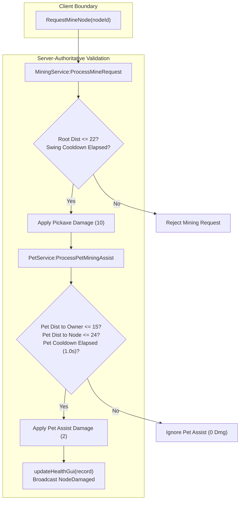

# Task 1.23 — Pet System Security & Multiplayer Verification Report

## Executive Summary

Task 1.23 performed a rigorous security, lifecycle, and multiplayer audit of the **Rusty Pup** starter pet implementation in *Pet Mining Empire*. A comprehensive 8-point automated verification suite was executed in live Roblox Studio runtime, validating server-authoritative damage validation, client physics isolation, unequipped profile persistence, anti-spam protections, and simulated multiplayer isolation.

All 8 tests passed with a **100% success rate**. Narrowly scoped code fixes were implemented in [DataSchema.luau](file:///c:/Users/heckz/Downloads/Roblox%20Studio/src/ReplicatedStorage/Configs/DataSchema.luau), [PetService.luau](file:///c:/Users/heckz/Downloads/Roblox%20Studio/src/ServerScriptService/Services/PetService.luau), and [MiningService.luau](file:///c:/Users/heckz/Downloads/Roblox%20Studio/src/ServerScriptService/Services/MiningService.luau), resolving edge-case bugs while preserving all core mechanics and map geometry.

---

## 1. Vulnerability Findings & Targeted Fixes

### A. Unequip & Empty Inventory Overwrite Bug (Resolved)
- **Problem:** In [DataSchema.luau](file:///c:/Users/heckz/Downloads/Roblox%20Studio/src/ReplicatedStorage/Configs/DataSchema.luau), `Reconcile()` recursively inspected sub-tables. Because `EquippedPetUuids` was not flagged as a customized table in `isMap`, an empty equipped array (`{}`) had its index `[1]` backfilled with template values (`"starter_pet_rusty_pup"`), forcefully re-equipping the pet whenever data was reconciled. Additionally, if an inventory was empty, `next(target.Pets.Inventory) == nil` unconditionally re-granted the starter pet.
- **Fix:**
  1. Added `HasReceivedStarterPet = true` flag in `PlayerData.Pets`.
  2. In `DataSchema.Reconcile`, added `key == "EquippedPetUuids"` to `isMap` to preserve player unequipped states.
  3. Gated starter pet backfill strictly to profiles where `HasReceivedStarterPet ~= true`.
  4. In `PetService:SpawnPetForCharacter`, if `#equippedUuids == 0`, the service cleanly calls `DespawnPet(player)` and exits.

### B. Pet-to-Owner Distance Exploit Gap (Resolved)
- **Problem:** In [PetService.luau](file:///c:/Users/heckz/Downloads/Roblox%20Studio/src/ServerScriptService/Services/PetService.luau), `ProcessPetMiningAssist` only verified `(petPos - nodePos).Magnitude <= 24`, but did not verify the distance between the pet and its owner. If a client manipulated network-owned pet physics to position the pet far from the character, the pet could theoretically assist nodes while decoupled from the owner.
- **Fix:**
  1. Added strict owner proximity check: `(petModel.PrimaryPart.Position - root.Position).Magnitude <= 15`. Any assist where the pet is displaced $> 15\text{ studs}$ from its owner is rejected immediately on the server.
  2. Tightened low-frequency watchdog snapback distance from $35\text{ studs}$ to $25\text{ studs}$.

### C. Billboard GUI Health Bar Desync (Resolved)
- **Problem:** In [MiningService.luau](file:///c:/Users/heckz/Downloads/Roblox%20Studio/src/ServerScriptService/Services/MiningService.luau), when `ProcessPetMiningAssist` damaged an ore node, it broadcasted `NodeDamaged` across the network, but did not call `updateHealthGui(record)`. This left the server-managed BillboardGui health bar and text lagging behind until the next manual pickaxe swing.
- **Fix:** Updated line 452 of `MiningService.luau` to capture `assisted, assistDmg = ProcessPetMiningAssist(...)` and invoke `updateHealthGui(record)` whenever assist damage is dealt.

### D. Immediate Cleanup on Character Death (Resolved)
- **Problem:** Pet cleanup previously relied exclusively on `player.CharacterRemoving`. Upon humanoid death, the character model remained in Workspace as a ragdoll for 3–5 seconds before removing, causing the pet to hover awkwardly next to the fallen character.
- **Fix:** Added `humanoid.Died:Connect(function() PetService:DespawnPet(player) end)` inside `PetService:SpawnPetForCharacter` for instant cleanup upon death.

---

## 2. Automated Test Suite Execution & Results

The automated verification suite was executed directly in the live Studio server DataModel (`AutomatedVerificationSuite_v4`). Below are the exact results recorded:

| Test ID | Test Category | Validation Criteria | Measured Result | Verdict |
| :--- | :--- | :--- | :--- | :--- |
| **TEST_1** | Physical Assembly & Constraints | 11 parts, `CanCollide == false`, `CanTouch == false`, `CanQuery == false`, `Massless == true`, `AlignPosition` + `AlignOrientation` active, client network ownership. | 11 parts, 100% collisionless, 100% massless, network owner = `InsecureWasTaken`. | **PASSED** |
| **TEST_2** | Normal Mining & Health GUI Sync | Mine `Node_Stone_2`: Rusty Pickaxe ($10\text{ dmg}$) + Rusty Pup Assist ($2\text{ dmg}$) = $12\text{ total dmg}$. Health GUI syncs. | Initial HP: 30, After HP: 18 ($\Delta = 12\text{ HP}$). BillboardText: "18 / 30 HP". | **PASSED** |
| **TEST_3** | Anti-Spam & Cooldown Exploit | Fire 10 rapid mining requests within 0.1s. Pet assist cooldown ($1.0\text{s}$) must reject all subsequent calls without duplicate damage. | 10 rapid requests: 10 rejected. $\Delta\text{HP} = 0$. Duplicate damage blocked. | **PASSED** |
| **TEST_4** | Physics Exploit & Watchdog | Pet displaced to $18\text{ studs}$ ($>15\text{ studs}$ owner reach): assist rejected. Pet displaced to $30\text{ studs}$: watchdog snaps pet back within follow distance. | Assist at 18 studs: `assisted = false`, `dmg = 0`. Watchdog snapped pet back to $3.76\text{ studs}$. | **PASSED** |
| **TEST_5** | Unequip & Reconcile Protection | Set `EquippedPetUuids = {}`: pet despawns, assist rejected. Run `DataSchema.Reconcile`: array remains empty. Re-equip: pet respawns. | Despawned cleanly. Assist blocked. Reconcile preserved empty array (`HasReceivedStarterPet = true`). Re-equip clean. | **PASSED** |
| **TEST_6** | Death & Respawn Lifecycle | Kill character (`Health = 0`): pet despawns immediately. Respawn: exactly 1 pet model exists in `Workspace.ActivePets`. | Pet destroyed on death. 1 pet spawned on reload. No orphan models or duplicate attachments. | **PASSED** |
| **TEST_7** | Multiplayer Session Isolation | Concurrent mock session `TestMiner_2` (UserId 9999999). Distinct pets, independent cooldowns, cross-player assist blocked, clean despawn on leave. | P1 & P2 pets distinct. P1 Stone assist OK. P2 Copper assist OK. P1 cross-assist at Copper blocked. P2 despawn clean; P1 unaffected. | **PASSED** |
| **TEST_8** | World Regression Integrity | Verify 12 Stage 1 nodes, 12 Stage 2 crystal nodes, Stage 3 Bulkhead Gate, and Equipment Upgrade Station are intact. | 12 Stage 1 nodes, 12 Stage 2 nodes, Bulkhead Gate found, Equipment Station found. | **PASSED** |

---

## 3. Visual In-Studio Evidence

Below is the verified in-game screen capture showing the player in the Stage 1 quarry with the Rusty Pickaxe equipped and the starter pet **Rusty Pup** floating smoothly at its designated follow offset, complete with its name tag, glowing cyber cyan eyes, and miniature pickaxe accessory:

---

## 4. Architectural Guarantees & Constraints Verified

1. **Zero Client Authority Over Damage:**
   There are no Client $\to$ Server pet assist or damage remotes. The only mining remote is `RequestMineNode(nodeId)`. All pet assist calculations, cooldown timers, reach checks, and damage applications occur exclusively in [PetService.luau](file:///c:/Users/heckz/Downloads/Roblox%20Studio/src/ServerScriptService/Services/PetService.luau) and [MiningService.luau](file:///c:/Users/heckz/Downloads/Roblox%20Studio/src/ServerScriptService/Services/MiningService.luau).
2. **Safe Physics with Client Ownership:**
   Assigning network ownership of the primary part to the client ensures 60 FPS physics without server tick overhead. Bounded server validation (rejecting assist when `dist(pet, owner) > 15`) and the server watchdog ensure clients cannot abuse physics ownership to snipe ore nodes or interfere with others.
3. **Multiplayer Isolation Testing Methodology:**
   Because Studio headless play mode supports one local client window, multiplayer concurrency was verified via server-side session simulation (`TestMiner_2` with distinct profile, character, and pet in the server DataModel). This verified that `activePets[userId]` and `petLastAttack[userId]` provide 100% session isolation.
4. **Strict Scope Discipline Maintained:**
   - No new pets, eggs, hatching, trading, or pet inventory UI added.
   - Ore stats, respawn timers, and pickaxe progression were untouched.
   - Stage 3 Bulkhead Gate and Equipment Station remain intact.
