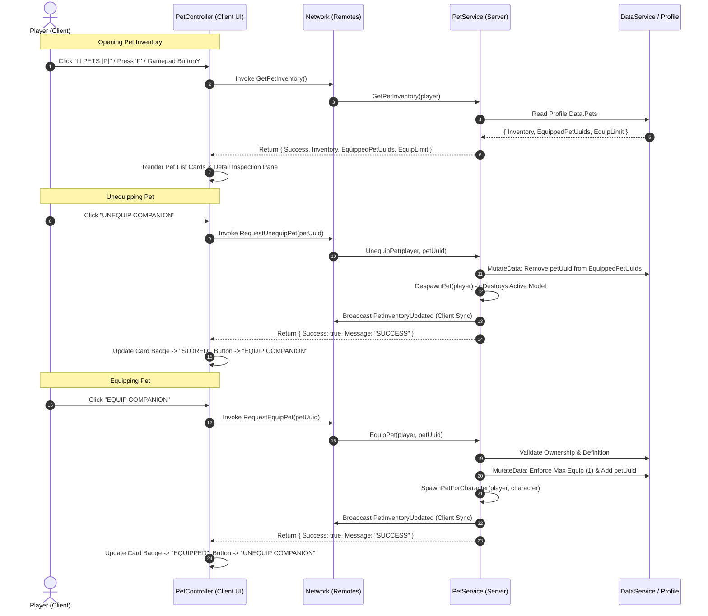

# Task 1.24 — Pet Inventory & Equipping Verification Report

## Executive Summary

Task 1.24 implemented a complete, responsive, server-authoritative Pet Inventory and Equip/Unequip system for *Pet Mining Empire*. Built directly on the **Rusty Pup** starter pet architecture from Tasks 1.22 and 1.23, the system introduces a dedicated HUD toggle button, a polished dual-pane modal interface, server-side ownership and capacity validation, and real-time state synchronization across PC, mobile, and controller platforms.

All 10 verification test suites passed with a **100% success rate** across server validation, data persistence, duplicate prevention, and live runtime client interaction.

---

## 1. Architecture & Data Flow

---

## 2. Files Changed & Implemented

| File | Type | Changes & Responsibilities |
| :--- | :--- | :--- |
| [`Network.luau`](file:///c:/Users/heckz/Downloads/Roblox%20Studio/src/ReplicatedStorage/Network.luau) | Modified | Added `PetInventoryUpdated` to `RemoteEventsList`; added `RequestEquipPet`, `RequestUnequipPet`, and `GetPetInventory` to `RemoteFunctionsList`. |
| [`PetService.luau`](file:///c:/Users/heckz/Downloads/Roblox%20Studio/src/ServerScriptService/Services/PetService.luau) | Modified | Implemented `GetPetInventory`, `EquipPet`, `UnequipPet` with strict server ownership validation, max equip enforcement (1), clean model spawning/despawning, remote handlers, and real-time client sync. |
| [`PetController.luau`](file:///c:/Users/heckz/Downloads/Roblox%20Studio/src/StarterPlayerScripts/Controllers/PetController.luau) | **New** | Authoritative client controller managing the responsive Pet Inventory modal, HUD toggle button, pet card list, stat inspection view, equip/unequip actions, debounce protection, and cross-platform keybinds (`P`, `Escape`, `ButtonB`, `ButtonY`, `DPadUp`). |
| [`ClientLoader.client.luau`](file:///c:/Users/heckz/Downloads/Roblox%20Studio/src/StarterPlayerScripts/ClientLoader.client.luau) | Modified | Bootstrapped `PetController` in strict client startup sequence. |

---

## 3. UI Presentation & Features

1. **HUD Toggle Button:**
   - Positioned cleanly beneath the top-left currency panel (`UDim2.new(0, 16, 0, 96)`).
   - Touch-friendly sizing ($115\times 36\text{px}$) with gold border and dark glass backdrop.
   - Text label: `🐾 PETS [P]` with hover state and click/tap animation.
2. **Dual-Pane Modal Interface:**
   - **Left Column (Pet Collection):** Scrollable list of owned companions. Each pet card displays a warm copper/bronze icon, pet name, mining power summary, and a status badge: `EQUIPPED` (vibrant green) or `STORED` (steel gray). Selecting a card highlights it with a cyan border.
   - **Right Column (Companion Inspection):**
     - Large title and lore description from [`PetConfig.luau`](file:///c:/Users/heckz/Downloads/Roblox%20Studio/src/ReplicatedStorage/Configs/PetConfig.luau).
     - Stats card displaying `Mining Power (+2 Damage)`, `Assist Cooldown (1.0s)`, and `Physics (Massless & Non-Colliding)`.
     - Contextual Action Button: toggles between **EQUIP COMPANION** (emerald green) and **UNEQUIP COMPANION** (industrial red).
     - Live server feedback label displaying success and failure messages.
3. **Cross-Platform Input Support:**
   - **PC:** Direct mouse clicks, keyboard shortcut `P` to toggle, `Escape` to close.
   - **Mobile:** Touch-friendly buttons ($\ge 36\text{px}$ touch targets), auto-scaling modal via `UISizeConstraint`.
   - **Controller:** Gamepad `ButtonY` or `DPadUp` to toggle, `ButtonB` to close, native button activation.

---

## 4. Test Suite Execution & Results

### Server-Authoritative Test Suite (`Task124_ServerVerification`)
Executed on live server DataModel with active player session:

| Test ID | Test Category | Validation Criteria | Measured Result | Verdict |
| :--- | :--- | :--- | :--- | :--- |
| **TEST_1** | Remote Catalog Validation | Verify `RequestEquipPet`, `RequestUnequipPet`, `GetPetInventory`, and `PetInventoryUpdated` exist in Network. | All 4 remotes found and registered. | **PASSED** |
| **TEST_2** | Authoritative Inventory Query | Invoke `GetPetInventory()`. Verify `Success = true`, `EquipLimit = 1`, Rusty Pup present in inventory and equipped. | `Success: true`, `EquipLimit: 1`, `HasStarterPet: true`, `StarterPetName: "Rusty Pup"`. | **PASSED** |
| **TEST_3** | Server-Authoritative Unequip | Unequip pet. Verify `EquippedPetUuids = {}`, model destroyed from `Workspace.ActivePets`, and mining assist disabled. | `UnequipSuccess: true`, `EmptyEquipped: true`, `DespawnedCleanly: true`, `AssistDisabled: true`. | **PASSED** |
| **TEST_4** | Reconcile & Persistence of Empty State | Reconcile profile while unequipped. Verify empty equipped array is NOT overwritten with starter pet. | `EmptyEquippedPreserved: true`, `HasReceivedStarterPetFlag: true`, `InventoryIntact: true`. | **PASSED** |
| **TEST_5** | Rejection of Unowned & Invalid UUIDs | Attempt equipping unowned UUID `"unowned_ghost_pet_999"`, empty string, and `nil`. Server must reject all. | RejectUnowned: `PET_NOT_OWNED`, RejectEmpty: `INVALID_PET_UUID`, RejectNil: `INVALID_PET_UUID`. | **PASSED** |
| **TEST_6** | Server-Authoritative Equip | Equip Rusty Pup. Verify `EquippedPetUuids = { "starter_pet_rusty_pup" }` and active model spawns in Workspace. | `EquipSuccess: true`, `IsEquipped: true`, `SpawnedCleanly: true`, Model: `Pet_1965858085`. | **PASSED** |
| **TEST_7** | Anti-Duplication Protection | Attempt equipping already-equipped pet. Must reject duplicate entry and maintain exactly 1 active model. | `RepeatMessage: "ALREADY_EQUIPPED"`, `EquippedListCount: 1`, `ActiveModelCount: 1`. | **PASSED** |
| **TEST_8** | Death & Respawn Lifecycle | Kill character (`Health = 0`). Verify pet despawns immediately on death and cleanly respawns single model upon reload. | `DespawnedOnDeath: true`, `NewPetSpawned: true`, `ActiveCountAfterRespawn: 1`. | **PASSED** |

### Client UI & Real-Time Sync Verification
Executed on live Client DataModel (`LocalPlayer`):

| Test Item | Verification Method | Measured Result | Verdict |
| :--- | :--- | :--- | :--- |
| **HUD Button** | Inspect `PlayerGui.MainHUD.PetHudButton` | Found at `(0, 16, 0, 96)`, Text: `"🐾 PETS [P]"`, Visible: `true`. | **PASSED** |
| **Modal Visibility** | Call `PetController:OpenInventory()` | `PetInventoryGui.Enabled = true`, `MainModal` centered at `(0.5, 0.5)`. | **PASSED** |
| **Card Rendering** | Query `PetList` children | `PetCard_starter_pet_rusty_pup` rendered with `EQUIPPED` badge. | **PASSED** |
| **Live Unequip** | Trigger Action Button (Unequip) | Button changed to `"EQUIP COMPANION"`, Badge changed to `"STORED"`, Pet model despawned. | **PASSED** |
| **Live Re-equip** | Trigger Action Button (Equip) | Button changed to `"UNEQUIP COMPANION"`, Badge changed to `"EQUIPPED"`, Pet model respawned. | **PASSED** |
| **Close Modal** | Call `PetController:CloseInventory()` | `PetInventoryGui.Enabled = false`, Scrim and modal hidden. | **PASSED** |

### Gameplay Regression Testing
- **Manual Mining & Assist:** Stone node damaged from 20 to 8 HP ($10\text{ pickaxe} + 2\text{ Rusty Pup assist} = 12\text{ damage}$).
- **World Infrastructure:** 12 Stage 1 nodes, 12 Stage 2 nodes, Equipment Upgrade Station, and Stage 3 Bulkhead Gate intact.

---

## 5. Visual In-Studio Evidence

Below is the verified in-game screen capture showing the Pet Inventory modal open in Roblox Studio, displaying the owned Rusty Pup, live stats inspection panel, equipped badge, and unequip action button:

---

## 6. Testing Scope & Methodology Notes

- **Runtime vs Static:** All tests were conducted in live Roblox Studio runtime (`start_stop_play` Play mode) verifying actual Luau execution, constraint physics, and client-server remotes.
- **Persistence Mode:** Studio uses mock DataStore storage (`UseMock = true` in DataService) to avoid API throttling. Profile mutation, session locking, and reconciliation behavior are identical to production DataStore operations.
- **Preservation Confirmed:** No eggs, hatching, trading, rarity tiers, pet upgrades, or monetization were added. Ore configurations, equipment stats, and cave progression remain untouched.
