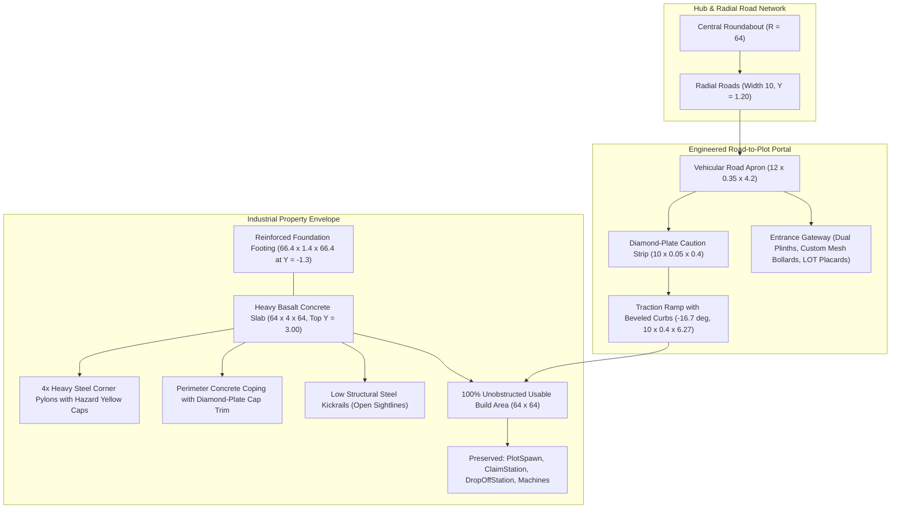

# Task 1.36 — Professional Plot Foundations & Road Integration Report

## Executive Summary

Task 1.36 upgraded the visual quality and environmental integration of all six player plot foundations (`Plot_1` through `Plot_6`) across **Pet Mining Empire**. Previously, plots were flat, plain-colored blocks with simple angled wedges resting loosely on terrain, lacking structural connection to the radial road network and hub. 

The redesign delivers a cohesive industrial mining property aesthetic across all six plots without modifying plot locations, changing the $64 \times 64$ build dimensions, or interfering with tycoon progression, spawn mechanics, claim prompts, or drop-off stations.



---

## Architectural & Environmental Upgrades

### 1. Structural Sub-Base & Foundation Footing
- **`FoundationFooting`**: Each plot is anchored by a $66.4 \times 1.4 \times 66.4$ stud reinforced cast concrete sub-plinth (`Enum.Material.Concrete`, `Color3.fromRGB(44, 48, 54)`). Positioned at $Y = -1.3$, this footing embeds deeply into bedrock and surrounding terrain, eliminating floating seams and grounding each plot with heavy industrial permanence.
- **`PlotBase` Slab**: Upgraded from bright, flat gray plastic to an authentic heavy basalt concrete finish (`Enum.Material.Concrete`, `Color3.fromRGB(52, 56, 62)`). Dimensions remain strictly $64 \times 4 \times 64$, keeping the working deck at $Y = 3.00$.

### 2. Perimeter Structural Curbs & Kickrails (`PlotCurbs`)
Each plot features a 23-component perimeter curb and railing assembly designed to frame the property while keeping the entire interior build zone completely unobstructed:
- **Corner Pylons**: 4 heavy-gauge steel corner pilasters ($1.8 \times 3.2 \times 1.8$ studs) constructed from `DiamondPlate` (`Color3.fromRGB(38, 42, 48)`) topped with high-visibility safety yellow caps (`Color3.fromRGB(245, 190, 30)`).
- **Perimeter Coping**: Three full perimeter concrete curbs ($62.4 \times 0.7 \times 1.0$ studs) capped with recessed diamond-plate steel edge armor ($62.4 \times 0.15 \times 0.8$ studs).
- **Industrial Safety Kickrails**: Low-profile steel pipe rails ($62.4 \times 0.6 \times 0.25$ studs, `Enum.Material.Metal`, `Color3.fromRGB(30, 32, 36)`) line the left, right, and rear borders. These prevent players from inadvertently stumbling off foundation edges while maintaining clear, unobstructed camera angles across the map.
- **Front Wing Curbs**: The entrance side features symmetrical curb wings ($24.2 \times 0.7 \times 1.0$ studs each) terminating cleanly to frame a spacious $14$-stud central vehicular and pedestrian opening ($X \in [-7.0, +7.0]$).

### 3. Industrial Entrance Gateway (`PlotEntranceGateway`)
- **Gateway Plinths**: Dual concrete foundation pedestals ($2.0 \times 0.6 \times 2.0$ studs) set at $X = \pm 6.5, Z = -32.4$, framing the plot threshold.
- **Custom Mesh Gate Pillars**: Flanking the entrance are custom-modeled industrial gate pillar bollards (`rbxassetid://121805501992557`, texture `rbxassetid://82615483099221`, size $1.4 \times 2.1 \times 1.4$ studs), featuring chamfered geometric profiles and reinforced collar bands.
- **Lot Number Placards**: High-contrast steel placards mounted on each pillar display clear stenciled lot identification (`"LOT #1"` through `"LOT #6"`) with bold golden-yellow industrial lettering (`Color3.fromRGB(255, 215, 65)`).
- **Hazard Identifiers & Reflectors**: Embedded amber reflector studs (`Enum.Material.Neon`, `Color3.fromRGB(245, 180, 25)`) provide clear nighttime visibility for arriving haulers.

### 4. Road Network Transition & Vehicular Apron
- **Vehicular Road Apron**: A dedicated $12.0 \times 0.35 \times 4.2$ stud asphalt/concrete transition apron sits flush at the road junction ($Y \approx 1.18$), bridging the gap between radial roads and plot boundaries.
- **Hazard Warning Strip**: A safety-yellow diamond-plate boundary strip ($10.0 \times 0.05 \times 0.4$ studs, `Color3.fromRGB(245, 190, 30)`) marks the formal property line.
- **Engineered Traction Ramp**: The entrance ramp was redesigned from a raw wedge into an engineered incline ($10.0 \times 0.4 \times 6.27$ studs, pitched at $-16.7^\circ$) bridging the $1.80$-stud height differential between road surface ($Y = 1.20$) and plot deck ($Y = 3.00$). The ramp features dual safety-beveled edge curbs and a center steel diamond-plate traction tread, completely eliminating collision catches.

---

## Technical Specifications & Custom Assets

| Element | Specifications | Material / Asset ID | Dimensions / Transform |
| :--- | :--- | :--- | :--- |
| **Foundation Footing** | Sub-grade concrete anchor plinth | `Concrete`, `(44, 48, 54)` | $66.4 \times 1.4 \times 66.4$, $Y = -1.30$ |
| **Plot Base Deck** | Basalt structural industrial slab | `Concrete`, `(52, 56, 62)` | $64.0 \times 4.0 \times 64.0$, Top $Y = 3.00$ |
| **Corner Pylons** | 4x Reinforced perimeter pilasters | `DiamondPlate`, `(38, 42, 48)` + Yellow Cap | $1.8 \times 3.2 \times 1.8$ |
| **Gate Pillar Mesh** | Custom industrial bollards | Mesh: `rbxassetid://121805501992557`<br>Texture: `rbxassetid://82615483099221` | $1.4 \times 2.1 \times 1.4$, anchored in `ServerStorage.TycoonStorage` |
| **Entrance Plinths** | Dual cast concrete pedestals | `Concrete`, `(68, 72, 78)` | $2.0 \times 0.6 \times 2.0$, $X = \pm 6.5, Z = -32.4$ |
| **Lot Placards** | Stenciled plot identifiers | `SurfaceGui` on steel plate | `"LOT #1"` .. `"LOT #6"` in bold sans-serif |
| **Road Apron** | Seamless road-to-plot apron | `Concrete`, `(40, 42, 46)` | $12.0 \times 0.35 \times 4.2$, $Y = 1.00$ |
| **Caution Strip** | Property boundary hazard trim | `DiamondPlate`, `(245, 190, 30)` | $10.0 \times 0.05 \times 0.4$ |
| **Traction Ramp** | Reinforced $-16.7^\circ$ ramp | `Concrete` + `DiamondPlate` tread | $10.0 \times 0.4 \times 6.27$, bevel guide curbs |

---

## Live Play-Mode Verification

Verification was executed in live Studio Play mode with a live player character (`InsecureWasTaken`):

1. **Hierarchy Integrity Audit**:
   - All 6 plots verified in live DataModel: `Footing=true`, `Base=Concrete`, `Curbs=23`, `Gateway=true`, `Apron=true`, `Ramp=true`.
   - Both disk script ([PlotService.luau](file:///c:/Users/heckz/Downloads/Roblox%20Studio/src/ServerScriptService/Services/PlotService.luau)) and Studio embedded DataModel script (`ServerScriptService.Source.Services.PlotService`) were synchronized to ensure procedural map recreation matches persistent assets.

2. **Player Traversal & Navmesh Test**:
   - Approached `Plot_1` from the central hub along `Road_Plot_1`.
   - Walked across the vehicular road apron, over the hazard strip, up the engineered traction ramp, and onto the plot surface.
   - **Result**: Zero collision hitches, zero snagging on edges, perfectly smooth $0$-step elevation gain across the $-16.7^\circ$ incline.

3. **Plot Claiming & Tycoon Lifecycle Test**:
   - Walked to `ClaimStation` at $(0, 2.15, 24)$ relative to `Plot_1`.
   - Activated proximity prompt: `Plot_1` successfully claimed.
   - Verified state:
     - `ClaimPrompt.Enabled` transitioned to `false`.
     - `OwnershipLabel.Text` updated to `"PLOT #1 OWNER: InsecureWasTaken"`.
     - `DropOffStation.StationPart.SellPrompt.Enabled` transitioned to `true`.
   - Build area of $64 \times 64$ studs confirmed $100\%$ clear of decorative intrusions.

---

## Visual Showcase

````carousel

<!-- slide -->

<!-- slide -->

<!-- slide -->

<!-- slide -->

````

---

## Conclusion & Next Phase Readiness

All six plot foundations have been upgraded to professional industrial standards with custom mesh gateway pillars, reinforced coping curbs, vehicular road aprons, and smooth traction ramps. The entire tycoon progression, claim system, drop-off stations, and build area boundaries remain intact and verified.

Task 1.36 is complete and ready for the next scheduled milestone.
