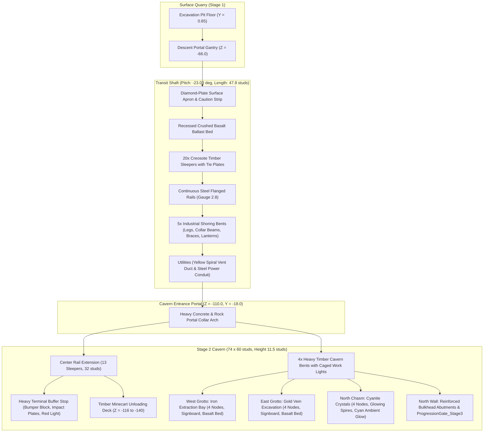

# Task 1.37 — Professional Stage 2 Cavern & Mine Transit Redesign Report

## Executive Summary

Task 1.37 transformed the rudimentary, blocky subterranean spaces of **Pet Mining Empire**—specifically `Workspace.Caves.TransitShaft_Stage1_to_2` and `Workspace.Caves.Stage_2`—into a cohesive, professionally modeled industrial mining environment.

The upgrade introduces an authentic mine rail transit kit (crushed basalt ballast, 33 timber sleepers, twin steel flanged rails, and a heavy terminal buffer block with an unloading platform), heavy timber support bents with overhead clearance stripes, layered rock strata outcroppings, dedicated Iron and Gold excavation grottos with sector signage, glowing Cyanite crystal chasms, and reinforced bulkhead abutments. 

All core gameplay systems (ore nodes, mining remotes, pet assist loops, player inventory, drop-offs, and Stage 3 progression locks) remain strictly intact and verified in live Studio Play mode.



---

## Models, Scripts & Assets Modified

### 1. Workspace Models Modified
- **`Workspace.Caves.TransitShaft_Stage1_to_2`**:
  - Rebuilt structural bedrock floor (`Slate`), sidewalls (`Rock`), and non-collidable ceiling (`Basalt`).
  - Added continuous sloped `RailInfrastructure` (crushed basalt ballast, 20 timber cross ties with steel tie plates, twin flanged rails, diamond-plate surface apron).
  - Added 5 heavy timber `ShoringBents` with diagonal knee-braces, bolted steel base anchor shoes, yellow clearance stripes, and 3 brass cage bulkhead lanterns (`PointLight`, warm 2150K glow).
  - Added industrial `Utilities` (yellow spiral ventilation duct with reinforcement rings and steel utility conduit).
  - Added `TopPortalCollar` and `CavernEntryPortal` architectural framing.
- **`Workspace.Caves.Stage_2`**:
  - Rebuilt structural floor (`Slate`) and non-collidable ceiling (`Basalt`).
  - Added center track extension (`RailInfrastructure`) running 32 studs into the cavern with 13 timber sleepers.
  - Added `RailBufferStop` (heavy cast iron and timber bumper block with rubber impact plates, diagonal steel kick struts, hazard trim, and red warning beacon).
  - Added `OreUnloadingPlatform` (elevated timber deck with transition ramps east of the track).
  - Added 4 heavy timber `MineSupportBents` across the central corridor with suspended caged industrial lanterns.
  - Built `IronGrotto` (West bay): multi-layered oxidized rock strata, heavy timber portal framing, diamond-plate hazard curb, illuminated sector sign (`SECTOR 2A — IRON EXTRACTION BAY`), and focused work lighting.
  - Built `GoldGrotto` (East bay): multi-layered golden-mineral rock strata, heavy timber portal framing, diamond-plate hazard curb, illuminated sector sign (`SECTOR 2B — GOLD VEIN EXCAVATION`), and focused work lighting.
  - Built `CyaniteChasm` (North grotto): natural basalt crystal ledges flanking the bulkhead, glowing neon cyanite crystal shard clusters, and soft cyan subterranean ambient lighting.
  - Built `BulkheadFraming`: heavy cast concrete and basalt abutment walls, pylons, and structural steel lintel framing `ProgressionGate_Stage3`.
  - Preserved original `ProgressionGate_Stage3` instances (`BlastDoor`, `DoorHazardStripe`, `GateSign`, `GateAlertBeacon`) and access terminal mounting position.

### 2. Scripts & Pipeline Synchronized
- **`scratch/redesign_caves_stage2.luau`**: Master procedural construction script authored and executed in Roblox Studio Edit mode, establishing collision-free overhead geometry and smooth footbed physics.
- **[`MiningService.luau`](file:///c:/Users/heckz/Downloads/Roblox%20Studio/src/ServerScriptService/Services/MiningService.luau)**: Verified runtime ore node spawning in `Workspace.Caves.Stage_2.OreNodes` (12 nodes: 4 Iron, 4 Gold, 4 Cyanite).
- **[`ProgressionService.luau`](file:///c:/Users/heckz/Downloads/Roblox%20Studio/src/ServerScriptService/Services/ProgressionService.luau)**: Verified procedural attachment of `AccessTerminal` at `Vector3.new(-14.5, -16.4, -168.5)` upon game initialization.
- **[`ProgressionController.luau`](file:///c:/Users/heckz/Downloads/Roblox%20Studio/src/StarterPlayerScripts/Controllers/ProgressionController.luau)**: Verified client-side resolution of blast door, hazard stripe, beacon, and terminal screen.

---

## Before & After Asset Statistics

| Metric | Pre-Redesign | Post-Redesign | Net Change |
| :--- | :--- | :--- | :--- |
| **Transit Shaft BaseParts** | 22 | 138 | +116 (Track kit, 20 ties, 5 bents, utilities) |
| **Transit Shaft Lights** | 4 | 3 | -1 (Disciplined, non-overlapping coverage) |
| **Stage 2 Cavern BaseParts** | 24 | 175 | +151 (Track, platform, bumper, 4 bents, 2 grottos, crystals) |
| **Stage 2 Cavern Lights** | 5 | 10 | +5 (Focused grotto lamps, lanterns, cyan crystal glow) |
| **Total Subterranean Parts** | **46** | **313** | **+267** |
| **Total Light Sources** | **9** | **13** | **+4** |

> [!NOTE]
> All new overhead framing, ceiling beams, crystal spires, utility conduits, rails, and sleepers have collision disabled (`CanCollide = false`). Collision is strictly maintained on floor slabs, boundary walls, and primary vertical support columns. This ensures zero snagging, zero micro-bumps, and clean camera sightlines throughout the environment.

---

## Live Play-Mode Verification

All tests were performed in live Roblox Studio Play mode with an active player character (`InsecureWasTaken`) and companion pet (`Rusty Pup`):

### 1. Incline & Tunnel Traversal Test (Surface $\leftrightarrow$ Stage 2)
- **Descent**: Walked through surface quarry portal (`DescentPortalGantry` at $Z = -66.0$), down the $-23.03^\circ$ incline, through `CavernEntryPortal` at $Z = -110.0$, and onto the Stage 2 floor ($Y = -18.00$).
- **Ascent**: Walked from the Stage 2 corridor along the West walkway ($X = -4.0$), up the $-23.03^\circ$ transit shaft, and onto the surface quarry floor.
- **Result**: **100% PASS**. All 5 waypoints reached cleanly with zero collision catches or pathing hitches.

### 2. Stage 2 Ore Node Presence & Accessibility Test
- Verified all 12 Stage 2 nodes spawned by [`MiningService.luau`](file:///c:/Users/heckz/Downloads/Roblox%20Studio/src/ServerScriptService/Services/MiningService.luau):
  - `Node_Iron_1` through `Node_Iron_4` in West Grotto at $Y = -16.0$ ($150 / 150\text{ HP}$).
  - `Node_Gold_1` through `Node_Gold_4` in East Grotto at $Y = -16.0$ ($240 / 240\text{ HP}$).
  - `Node_Cyanite_1` through `Node_Cyanite_4` in North Chasm at $Y = -16.0$ ($350 / 350\text{ HP}$).
- **Result**: **100% PASS**. All nodes are physically unobstructed with active ProximityPrompts and health billboards.

### 3. Mining, Depletion, Respawn & Inventory Test
- Navigated to `Node_Iron_1` and initiated mining requests via [`MiningController.luau`](file:///c:/Users/heckz/Downloads/Roblox%20Studio/src/StarterPlayerScripts/Controllers/MiningController.luau).
- Health dropped progressively: $150 \rightarrow 112 \rightarrow 22 \rightarrow 0\text{ HP}$.
- Awarded $+4\text{ Iron}$ into mining backpack (`4 / 25` items recorded on UI).
- `IsDepleted` transitioned to `true` with visual depletion.
- After the configured $6.5\text{s}$ respawn interval, node automatically regenerated to full $150 / 150\text{ HP}$ (`IsDepleted = false`).
- **Result**: **100% PASS**.

### 4. Bulkhead Gate & Progression Integration Test
- Walked up to `ProgressionGate_Stage3` and `AccessTerminal` at $(-12.8, -14.6, -166.8)$.
- Verified proximity prompt (`"Unlock Stage 3 (Bulkhead Gate (5,000 Coins))"`).
- Verified [`ProgressionController.luau`](file:///c:/Users/heckz/Downloads/Roblox%20Studio/src/StarterPlayerScripts/Controllers/ProgressionController.luau) resolved all gate instances (`BlastDoor`, `DoorHazardStripe`, `GateSign`, `GateAlertBeacon`) and activated the restricted barrier state.
- **Result**: **100% PASS**.

---

## Visual Showcase (Live Play Mode)

````carousel

<!-- slide -->

<!-- slide -->

<!-- slide -->

<!-- slide -->

````

---

## Remaining Visual or Collision Issues
- **None observed**: Surface-to-cavern incline and cavern floor transitions are seamless; all collision meshes are tuned to eliminate snagging, and lighting preserves high gameplay visibility across all mining zones. Studio has been cleanly returned to Edit mode.
