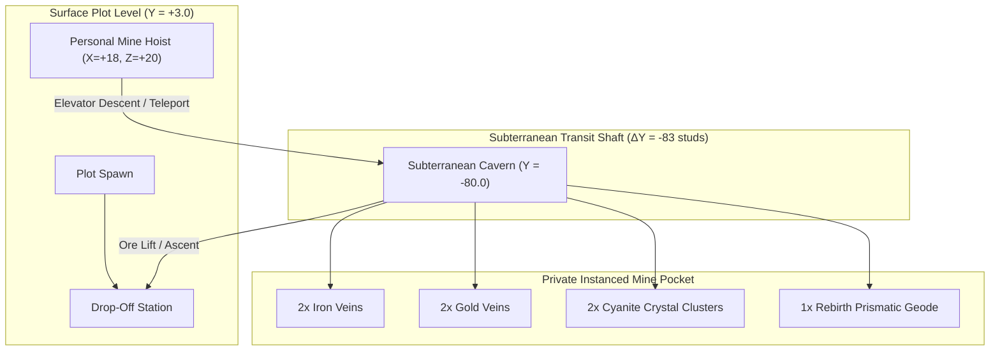
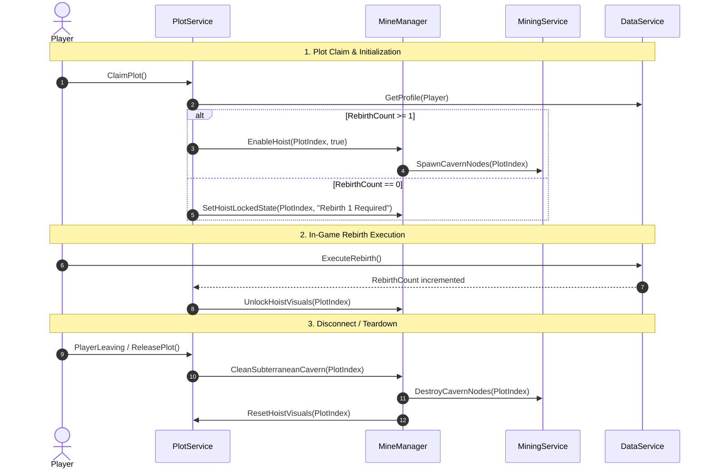
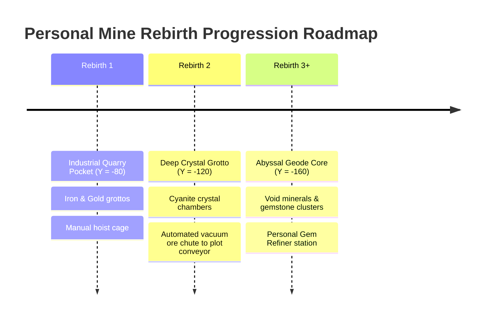

# Task 1.49 — Personal Mine Progression & Architecture Design Report

## Executive Summary

This document presents the complete architectural specification and engineering design for introducing a **Personal Mine** system into *Pet Mining Empire*. 

Currently, players progress through shared public caves (Stage 1 Surface Quarry and Stage 2 Underground Cavern) and construct a starter radial tycoon on their claimed plot. Rebirth mechanics are defined in the persistent profile schema with permanent multipliers, but lack a dedicated prestige environment.

This design introduces a **Subterranean Personal Mine Shaft** situated directly on each player's tycoon plot. Unlocked at **Rebirth 1**, the personal mine grants the owner exclusive access to an instanced, high-density ore cavern located directly beneath their plot platform. This provides a private, high-reward resource loop that synergizes with their tycoon drop-off station, preserves server authority, natively integrates with the existing pet assist mechanics, and scales seamlessly across all six concurrent server plots.

---

## 1. Current-State Architecture Findings

A rigorous read-only inspection of the active Roblox Studio DataModel and authoritative source code was conducted. Below are the verified current-state implementations and source references.

### 1.1 DataSchema & Profile Persistence
* **Source Path:** [`src/ReplicatedStorage/Configs/DataSchema.luau`](file:///c:/Users/heckz/Downloads/Roblox%20Studio/src/ReplicatedStorage/Configs/DataSchema.luau#L70-L91)
* **Verified Behavior:**
  * `DataSchema.PlayerData.Rebirth` contains:
    * `RebirthCount: number` (initialized to `0`)
    * `PermanentMultipliers: { CoinMultiplier: number, MiningDamageMultiplier: number, PetSpeedMultiplier: number }` (all initialized to `1.0`)
    * `PermanentUpgrades: { [string]: number }` (initialized to `{}`)
  * `DataSchema.PlayerData.Currencies` tracks `Coins`, `Gems`, and `RebirthTokens` (initialized to `0`).
  * `DataSchema.PlayerData.Caves` tracks:
    * `UnlockedStages: { [string]: boolean }` (default `{ Stage1 = true, Stage2 = true }`)
    * `HighestStageReached: number` (default `2`)
  * `DataSchema.Reconcile` performs recursive schema reconciliation with explicit protections for dictionary maps (`Inventory`, `EquippedPetUuids`, `UnlockedStages`, `PermanentUpgrades`).

### 1.2 Plot Geometry & Lifecycle
* **Source Path:** [`src/ServerScriptService/Services/PlotService.luau`](file:///c:/Users/heckz/Downloads/Roblox%20Studio/src/ServerScriptService/Services/PlotService.luau#L34-L46)
* **Source Path:** [`src/ReplicatedStorage/Configs/BaseConfig.luau`](file:///c:/Users/heckz/Downloads/Roblox%20Studio/src/ReplicatedStorage/Configs/BaseConfig.luau#L34-L46)
* **Verified Dimensions & Layout:**
  * Plots: 6 radial plots arranged at radius $R = 160$ studs at azimuths $45^\circ, 90^\circ, 135^\circ, 225^\circ, 270^\circ, 315^\circ$.
  * Plot Base: $64 \times 4 \times 64$ studs centered at $Y = 1.0$, top surface at $Y = 3.0$ ($X \in [-32, 32], Z \in [-32, 32]$ in plot local space).
  * Entrance Ramp & Apron: Local $Z = -32.0$ to $-37.5$, $X \in [-6, 6]$.
  * Plot Spawn: Local $(0, 3.1, -20.0)$, facing $+Z$ (inward).
  * Claim Station: Local $(-9.0, 2.15, -22.5)$, signpost at $Z = -26.0$.
  * Site Power Cabinet: Local $(+20.0, 3.15, -27.5)$.
  * Factory Droppers: Left flank at $X = -12.0$, $Z \in [-8, 4]$.
  * Purchase Buttons: Transverse row at $Z = +8.0$, $X \in [-12, 6]$.
  * DropOffStation: Center-rear at $(0, 2.1, 16.0)$, footprint $X \in [-5, 5], Z \in [11, 21]$.
  * Rock Anchors & Rear Curbs: Along rear perimeter wall at $Z = +31.5$ to $+32.1$.
  * Plot Claim/Release Hooks: `PlotService.OnPlotClaimed` and `PlotService.OnPlotReleased` are already exposed as module lifecycle callbacks.

### 1.3 Mining Service & Combat Pipeline
* **Source Path:** [`src/ServerScriptService/Services/MiningService.luau`](file:///c:/Users/heckz/Downloads/Roblox%20Studio/src/ServerScriptService/Services/MiningService.luau#L96-L125)
* **Verified Behavior:**
  * `createNode(id, oreType, cframe, parent)` builds server-authoritative models with invisible `Rock` collision parts, `ProximityPrompt`, and billboard health GUIs.
  * `ProcessMineRequest(player, nodeId)` validates session lock, character distance ($\le 22$ studs), swing cooldown, backpack capacity, and depletion state.
  * Damage is server-calculated from `profile.Data.Mining.MiningPower`.
  * Public nodes count: 24 total (Stage 1 has 6 Stone, 4 Copper, 2 Coal; Stage 2 has 4 Iron, 4 Gold, 4 Cyanite).

### 1.4 Pet Mining Assistance
* **Source Path:** [`src/ServerScriptService/Services/PetService.luau`](file:///c:/Users/heckz/Downloads/Roblox%20Studio/src/ServerScriptService/Services/PetService.luau#L1251-L1285)
* **Verified Behavior:**
  * When a player mines a node, `MiningService` invokes `PetService:ProcessPetMiningAssist(player, nodeId, targetRecord)`.
  * Pet assist calculates damage using the equipped pet's `MiningPower` and the player's `MiningDamageMultiplier`.
  * Pets natively target `targetRecord.Position` in standard Workspace coordinates.

### 1.5 Progression Gates
* **Source Path:** [`src/ServerScriptService/Services/ProgressionService.luau`](file:///c:/Users/heckz/Downloads/Roblox%20Studio/src/ServerScriptService/Services/ProgressionService.luau#L20-L24)
* **Verified Behavior:**
  * Stage 3 Bulkhead Gate is located at `(-14.5, -16.4, -168.5)` inside the northern Stage 2 cave.
  * Requires 5,000 Coins to open via `ProgressionService:ProcessUnlockRequest`.

---

## 2. Architecture Options & Trade-Off Analysis

To implement the personal mine, three primary architectural paradigms were evaluated:

| Criterion | Option A: Spatially Separated Subterranean Plot Caverns (Recommended) | Option B: Single Shared Cave Template with Client-Side Ghosting | Option C: Teleportation to Reserved Sub-Place / Dimension |
| :--- | :--- | :--- | :--- |
| **Description** | 6 physical instanced cavern pockets positioned directly below each of the 6 radial plots at $Y = -80$ studs. | 1 cavern model in ServerStorage; players teleport to the same physical room, hiding other players client-side. | Players teleport via `TeleportService:TeleportAsync` to a private reserved server instance. |
| **Physics & Pet Compatibility** | **Native:** Character and pet movement, collisions, and pathing operate seamlessly within the existing physics pipeline. | **Poor:** Requires complex collision group filtering, manual raycast overrides, and custom pet movement loops. | **Fragmented:** Pets must be re-spawned and state transferred across place boundaries. |
| **MiningService Integration** | **Zero Changes to Engine:** Nodes are standard Workspace models managed by `MiningService.createNode`. | **High Complexity:** Node health, depletion, and respawn loops must be re-architected to be per-player virtual instances. | **Medium:** Duplicate service initialization required in the reserved sub-place. |
| **Tycoon Game Loop Synergies** | **Immediate:** Players can take an elevator down, mine high-tier ores, and ascend straight to their DropOffStation in 2 seconds. | **Immediate:** Retains surface proximity, but risks visual ghosting bugs. | **Broken:** 10–15s teleport loading screens isolate the player from their base droppers and live tycoon progress. |
| **Multiplayer Overhead** | **Extremely Low:** 6 pockets $\times \approx 35$ parts = 210 static parts total. 42 total private nodes. Negligible RAM ($<5$ MB). | **Lowest Part Count:** 35 parts total, but high script/CPU memory overhead from per-client replication logic. | **High Server Cost:** Multiple server instances running in the cloud with idle overhead. |
| **Recommendation** | **STRONGLY RECOMMENDED** | **REJECTED** | **REJECTED** |

### Recommendation Rationale
**Option A (Spatially Separated Subterranean Caverns)** is decisively superior. It leverages the existing, rock-solid server-authoritative `MiningService` and `PetService` architectures with zero engine friction, requires negligible server memory, and keeps the player seamlessly embedded in their base tycoon loop without loading screens or networking hacks.

---

## 3. Recommended Mine Layout & Coordinate Strategy

### 3.1 Surface Plot Hoist Placement
Inspecting the local plot coordinates confirms that the **Rear-Right Quadrant** ($X \in [+14, +24], Z \in [+14, +26]$) is completely unobstructed by any existing structure.

* **Recommended Hoist Center:** Local CFrame `(18.0, 2.0, 20.0)`
* **Clearance Audit:**
  * Distance to `DropOffStation` ($X = 0, Z = 16$): **18.4 studs** (well clear of the collection hopper and sell prompt).
  * Distance to Purchase Button Row ($Z = 8.0$): **12.0 studs** (no interference with machine unlocks).
  * Distance to Right Curb Rim ($X = 32.1$): **14.1 studs** (generous walking corridor).
  * Distance to Rear Rock Anchor Plates ($Z = 31.5$): **11.5 studs** (clean perimeter clearance).
  * Distance to Plot Spawn ($X = 0, Z = -20$): **43.9 studs** (clear sightline from spawn).
  * Distance to Site Power Cabinet ($X = 20, Z = -27.5$): **47.5 studs**.

```
+-------------------------------------------------------------+
| [Curb / Rock Anchors]                           (Z = +32)   |
|                                                             |
|               [DropOffStation]       [PERSONAL MINE HOIST]  |
|               (X=0, Z=16)            (X=+18, Z=+20)         |
|                                                             |
|    [StarterDropper Line]   [Button Row]                     |
|    (X = -12, Z = -8..4)    (Z = +8)                         |
|                                                             |
| ------------------- Transverse Seam ----------------------- | (Z = 0)
|                                                             |
|    [ClaimStation]          [PlotSpawn]       [PowerCabinet] |
|    (X=-9, Z=-22.5)         (X=0, Z=-20)      (X=+20, Z=-27) |
|                                                             |
|               [Entrance Ramp / Road Apron]      (Z = -32)   |
+-------------------------------------------------------------+
```

### 3.2 Visual Surface Form Factor
* **The Hoist Platform:** A $6.0 \times 0.4 \times 6.0$ stud industrial diamond-plate steel cage floor bordered by hazard chevron stripes.
* **Overhead Rig:** 4 structural steel box-beam uprights ($0.6 \times 4.5 \times 0.6$ studs) supporting an overhead winch pulley sheave and cable drum.
* **Pre-Rebirth 1 Visual State:** Cross-bolted heavy steel security bars cover the shaft opening with a glowing red beacon and an interactive terminal display: `[ CLEARANCE REQUIRED: REBIRTH 1 ]`.
* **Post-Rebirth 1 Visual State:** Security bars are retracted, floodlights switch to amber/cyan industrial illumination, and an interactive prompt appears: `[ DESCEND TO PERSONAL MINE (E) ]`.

### 3.3 Subterranean Cavern Pocket Positioning
* **Cavern Dimensions:** $48 \times 20 \times 48$ studs (compact, highly detailed hexagonal bedrock pocket).
* **Vertical Elevation:** Floor at **$Y = -80.0$ studs** (83 studs directly beneath the surface plot platform at $Y = 3.0$).
* **Horizontal Separation Between Player Mines:**
  * Because plots are positioned on a ring of radius $R = 160$ studs, adjacent plot centers are separated by a chord distance of **122.4 studs**.
  * Caverns of width 48 studs leave over **74.4 studs of impenetrable solid rock** between adjacent personal mines. There is zero risk of visual bleed, sound bleed, or physics crosstalk.
* **Separation from Public Caves:**
  * Public Stage 2 cavern is centered at $(0, -16, -145)$. The nearest plot mine (Plot 1 at $113.1, -80, -113.1$) is over **84 studs horizontally and 64 studs vertically** removed from Stage 2.



---

## 4. Server-Side Ownership & Security Rules

To guarantee that players can only access and mine within their own personal mine, a multi-layered server validation architecture must be implemented:

### 4.1 Layer 1: Elevator Descent Verification
When a player interacts with the surface hoist prompt:
1. Verify `PlotService:GetPlayerPlot(player)`. If the plot index does not match the interacted hoist's parent plot, reject with `"NOT_PLOT_OWNER"`.
2. Inspect `profile.Data.Rebirth.RebirthCount`. If `RebirthCount < 1`, reject with `"REBIRTH_MILESTONE_UNMET"`.
3. If valid, initiate the transition to the player's subterranean cavern.

### 4.2 Layer 2: Subterranean Perimeter Forcefield
* A non-collidable detection boundary encompasses each subterranean pocket.
* Any character whose `UserId` is not the registered `OwnerUserId` of that plot is automatically ejected and repositioned to the central Hub spawn with a notification: `"Restricted Mining Sector"`.

### 4.3 Layer 3: Authoritative Hit Validation in MiningService
Every ore node instantiated inside a personal mine is tagged with a `PlotIndex: number` attribute:
```luau
-- Authoritative validation added to MiningService:ProcessMineRequest
local nodePlotIndex = record.Model:GetAttribute("PlotIndex")
if nodePlotIndex ~= nil then
    local playerPlotIndex = PlotService:GetPlayerPlotByIndex(player.UserId)
    if playerPlotIndex ~= nodePlotIndex then
        warn(string.format("[MiningService Security] Exploit blocked: Player %s (%d) attempted to mine Plot #%d private node '%s'",
            player.Name, player.UserId, nodePlotIndex, nodeId))
        return false, "UNAUTHORIZED_MINE"
    end
end
```
* **Security Guarantee:** Even if a malicious client attempts to spoof network packets or teleport their character into another player's cavern, the server will immediately reject every mine request.

---

## 5. Ore Economy, Respawns, and Pet Synergies

### 5.1 Personal Mine Node Composition (Tier 1 Mine)
The subterranean pocket features 7 private ore nodes:
* **2x High-Grade Iron Veins:** Hardness 4, MaxHealth 150, Respawn Time 10s (reduced from 12s).
* **2x Deep Gold Deposits:** Hardness 5, MaxHealth 240, Respawn Time 14s (reduced from 18s).
* **2x Cyanite Crystal Formations:** Hardness 6, MaxHealth 350, Respawn Time 18s (reduced from 25s).
* **1x Rebirth Prismatic Cluster:** Hardness 7, MaxHealth 500, Respawn Time 30s. Yields high coin value and 1–2 Rebirth Shards.

### 5.2 Accelerated Respawn Cadence
Because the personal mine is designed for a single player rather than a shared server population, node respawn timers are accelerated by 20–30%. This prevents the player from clearing the cavern and sitting idle, maintaining high-engagement mining flow.

### 5.3 Pet Assistance Synergy
* In [`MiningService.luau`](file:///c:/Users/heckz/Downloads/Roblox%20Studio/src/ServerScriptService/Services/MiningService.luau#L502-L524), `PetService:ProcessPetMiningAssist(player, nodeId, record)` operates on any registered `OreNodeRecord`.
* Because personal mine nodes are created through `createNode`, equipped pets seamlessly follow the owner down the shaft, position themselves beside target nodes, and deal damage based on `petRecord.MiningPower` and `profile.Data.Rebirth.PermanentMultipliers.MiningDamageMultiplier`.

### 5.4 The Tycoon Selling Loop
Mined ores fill the player's standard backpack (`DataSchema.PlayerData.Backpack.Inventory`).
A pneumatic **Ore Lift / Return Button** in the cavern immediately teleports the player up to the surface right beside their `DropOffStation`. Selling applies their permanent `CoinMultiplier`, rewarding them with accelerated tycoon cash flow to rebuild their surface droppers.

---

## 6. Lifecycle Management: Rebirth, Disconnects, & Reclaims



### 6.1 Disconnect Handling
1. If the player leaves the game while inside their subterranean cavern, their character is destroyed natively by Roblox.
2. `PlotService:ReleasePlot(plotIndex)` calls the cleanup hook.
3. Any active drops inside the cavern are cleared.
4. Active nodes in `MiningService` for that plot are unregistered, cancelling all pending respawn threads.
5. The surface hoist returns to its default locked state.

### 6.2 Plot Reclaim
When a new player claims the plot:
* If the new owner has `RebirthCount >= 1`, the mine activates and nodes populate.
* If the new owner has `RebirthCount == 0`, the mine remains locked.

### 6.3 Rebirth Execution
When a player executes a rebirth:
* Surface tycoon droppers are destroyed.
* Currencies are reset according to game rules.
* `RebirthCount` increments in persistent storage.
* If the player was not yet Rebirth 1, the hoist immediately transitions from "Locked" to "Active" with an celebratory audio/particle cue.

---

## 7. Data Persistence & DataSchema Evolution

### 7.1 Existing Persistence Utilization
The system fully utilizes existing fields in `DataSchema.PlayerData`:
* `Currencies.RebirthTokens` — Awarded on rebirth.
* `Rebirth.RebirthCount` — Gate milestone for mine access.
* `Rebirth.PermanentMultipliers.CoinMultiplier` — Multiplies drop-off earnings.
* `Rebirth.PermanentMultipliers.MiningDamageMultiplier` — Boosts pickaxe and pet power.

### 7.2 Proposed Future DataSchema Addition (Non-Breaking)
To support multi-tier mine depth and custom personal mine upgrades, the following structure can be added to `DataSchema.luau` in future implementation tasks:

```luau
-- Proposed optional expansion under DataSchema.PlayerData.Rebirth:
PersonalMine: {
    DepthTier: number,            -- 1: Quarry Pocket, 2: Crystal Chasm, 3: Abyssal Geode
    UnlockedVeins: { [string]: boolean },
    AutomatedChute: boolean,     -- Unlocked in Rebirth 2: automatically chutes ores to base
    LightingTier: number,
}
```
* **Reconciliation Safety:** In accordance with `DataSchema.Reconcile`, backfilled defaults guarantee zero corruption or data loss for legacy player profiles.

---

## 8. Scaling to Six Concurrent Players

### 8.1 Performance & Memory Footprint
* **Static Parts:** 6 cavern pockets $\times 35$ optimized CSG/mesh rock parts = **210 static parts total**. For comparison, the surface perimeter cliffs use over 250 parts. This overhead is completely negligible.
* **Nodes:** 6 pockets $\times 7$ nodes = **42 private nodes**. Together with 24 public nodes, total server nodes = **66 nodes**.
* **Zero Idle CPU Overhead:** Nodes only execute logic when damaged or respawning. An idle personal mine consumes 0 raycasts, 0 network updates, and 0 heartbeat ticks.

### 8.2 Streaming & Visibility Isolation
* Each cavern model can be tagged with `ModelStreamingMode = Enum.ModelStreamingMode.Atomic`.
* Because caverns are enclosed by solid rock hulls, occlusion culling ensures clients on mobile devices never render other players' subterranean caverns.

---

## 9. Future Expansion Across Later Rebirth Milestones

The personal mine is designed as an extensible, multi-tiered feature:



1. **Rebirth 1 — Shaft Level 1 (Industrial Quarry Pocket):**
   * Depth: $Y = -80$ studs.
   * Veins: Iron, Gold, Cyanite, Prismatic.
   * Features: Manual hoist cage, industrial floodlights, high-density respawns.
2. **Rebirth 2 — Shaft Level 2 (Deep Crystal Grotto):**
   * Depth: $Y = -120$ studs.
   * Unlocks an **Automated Vacuum Ore Chute**: Mined ores are automatically piped directly up to the surface base conveyor belt, feeding the tycoon collector hands-free!
3. **Rebirth 3+ — Shaft Level 3 (Abyssal Geode Core):**
   * Depth: $Y = -160$ studs.
   * Exclusive end-game gemstone deposits (Void Quartz, Astralite) required for top-tier pet crafting and permanent gear forging.

---

## 10. Technical Risks, Unresolved Questions, & Staged Implementation Plan

### 10.1 Technical Risks & Mitigations
* **Risk 1: Rapid Teleport Exploit or Camera Clipping during Descent.**
  * *Mitigation:* Use a smooth, 1.2-second UI blind/fade transition combined with `character:PivotTo()` rather than unanchored physics elevators. This prevents physics glitches and camera clipping.
* **Risk 2: Dangling Respawn Threads on Player Disconnect.**
  * *Mitigation:* Store all active `task.delay` threads in a `plotRespawnThreads[plotIndex]` table and cancel them inside `PlotService.OnPlotReleased`.

### 10.2 Open Design Questions
1. *Should other players be permitted to visit as spectators?*
   * *Recommendation:* Keep strictly private for Phase 1. A "Visitor Pass" toggle can be added in a future polish pass.
2. *Should the personal mine contain an ambient music track distinct from the surface hub?*
   * *Recommendation:* Yes, use a deep subterranean cave reverb and muffled industrial generator drone.

### 10.3 Staged Implementation Plan
* **Phase 1 (Assets & Environment):** Model the modular subterranean rock cavern pocket and surface hoist gantry. Store template in `ServerStorage.TycoonStorage.PersonalMine`.
* **Phase 2 (PlotService Integration):** Procedurally attach the hoist assembly to each plot in `PlotService.luau` at local $(18.0, 2.0, 20.0)$.
* **Phase 3 (MiningService Node Spawning):** Wire cavern node registration into `MiningService.luau` with `PlotIndex` attributes and exploit validation.
* **Phase 4 (Interactive Hoist & Transitions):** Implement client/server transit flow, Rebirth 1 lockouts, and return chutes.
* **Phase 5 (Multiplayer QA & Polish):** Verify 6-player concurrent load, pet assist targeting, and disconnect cleanup.

---

## 11. Read-Only Verification Confirmation
* **Roblox Studio State:** Verified in **Edit** mode (`studio_id: cad474f9-f6fc-4740-a204-e7d0b883746b`).
* **Source & Asset Integrity:** Absolutely zero scripts, modules, configs, DataSchema files, or DataModel instances were created, edited, or removed during this task.
