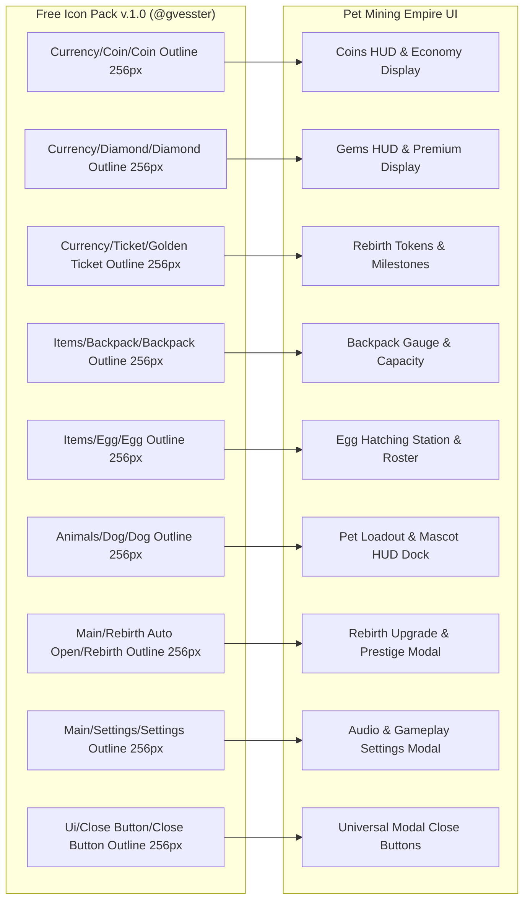

# Task 1.50 — Complete UI Audit & Visual Redesign Plan

## Executive Summary

This document presents a comprehensive, read-only audit of the entire existing user interface of **Pet Mining Empire**, coupled with an authoritative architectural redesign plan. 

The primary objective is to transform the game's presentation from an ad-hoc, text-heavy prototype into a high-production-value, cohesive industrial mining tycoon. The redesign leverages the user's available icon pack to establish consistent visual hierarchy, robust cross-platform responsiveness across PC, Mobile, and Controller, and tight synergy with the game's established steel, concrete, hazard-yellow, and cyanite art direction.

---

## 1. Existing UI Architecture Inventory

An exhaustive inspection of the active Roblox Studio DataModel and source code was performed. In the current build, all 2D screen interfaces are constructed procedurally at runtime in client controllers; `StarterGui` contains zero persistent template models.

```
PlayerGui (Runtime)
├── MainHUD (ScreenGui - DisplayOrder 10)
│   ├── CurrencyFrame (Top-Left: Coins & Gems Cards, Pet Dock Injection)
│   ├── BackpackCard (Bottom-Right: Progress Bar, 6-Ore Chip Grid, Quick Sell)
│   └── NotificationContainer (Top-Center: Toast Alert Stack)
├── PetInventoryGui (ScreenGui - DisplayOrder 20)
│   ├── Scrim (Dark Fullscreen Overlay)
│   └── MainModal (Companion Roster, 3D ViewportFrame, Stats, Equip/Unequip)
├── EggHatchGui (ScreenGui - DisplayOrder 25)
│   ├── Scrim (Dark Fullscreen Overlay)
│   ├── EggModal (Hatch Rates, Coin Balance, 3D Rotating Egg ViewportFrame)
│   └── EggRevealFrame (Celebratory Hatch Sequence with Particle Flash)
└── EquipmentShopGui (ScreenGui - DisplayOrder 20)
    ├── Scrim (Dark Fullscreen Overlay)
    └── MainModal (Pickaxe Tier Upgrades, Backpack Tier Upgrades, Stat Deltas)
```

### Detailed Component Inventory

| Interface | Component Type | Source File & Primary Class | Relevant Remotes / Handlers | Authoritative Server Service |
| :--- | :--- | :--- | :--- | :--- |
| **Coins & Gems Display** | `ScreenGui.MainHUD.CurrencyFrame` | [`src/StarterPlayerScripts/Controllers/UIController.luau`](file:///c:/Users/heckz/Downloads/Roblox%20Studio/src/StarterPlayerScripts/Controllers/UIController.luau#L83-L197) | `CurrencyUpdated` (RemoteEvent), `GetPlayerData` (RemoteFunction) | [`DataService.luau`](file:///c:/Users/heckz/Downloads/Roblox%20Studio/src/ServerScriptService/Services/DataService.luau) |
| **Backpack & Ore Grid** | `ScreenGui.MainHUD.BackpackCard` | [`src/StarterPlayerScripts/Controllers/UIController.luau`](file:///c:/Users/heckz/Downloads/Roblox%20Studio/src/StarterPlayerScripts/Controllers/UIController.luau#L201-L364) | `BackpackUpdated` (RemoteEvent), `RequestSellBackpack` (RemoteFunction) | [`PlotService.luau`](file:///c:/Users/heckz/Downloads/Roblox%20Studio/src/ServerScriptService/Services/PlotService.luau#L1083-L1150) |
| **Notification Toasts** | `ScreenGui.MainHUD.NotificationContainer` | [`src/StarterPlayerScripts/Controllers/UIController.luau`](file:///c:/Users/heckz/Downloads/Roblox%20Studio/src/StarterPlayerScripts/Controllers/UIController.luau#L459-L556) | `Notification` (RemoteEvent) | Broadcast by all services |
| **Pet Inventory & Loadout** | `ScreenGui.PetInventoryGui` | [`src/StarterPlayerScripts/Controllers/PetController.luau`](file:///c:/Users/heckz/Downloads/Roblox%20Studio/src/StarterPlayerScripts/Controllers/PetController.luau#L470-L850) | `GetPetInventory` (RemoteFunction), `EquipPet`, `UnequipPet` | [`PetService.luau`](file:///c:/Users/heckz/Downloads/Roblox%20Studio/src/ServerScriptService/Services/PetService.luau#L1300-L1420) |
| **Egg Hatching Station** | `ScreenGui.EggHatchGui` | [`src/StarterPlayerScripts/Controllers/PetController.luau`](file:///c:/Users/heckz/Downloads/Roblox%20Studio/src/StarterPlayerScripts/Controllers/PetController.luau#L1524-L1850) | `RequestHatchEgg` (RemoteFunction) | [`PetService.luau`](file:///c:/Users/heckz/Downloads/Roblox%20Studio/src/ServerScriptService/Services/PetService.luau#L1050-L1200) |
| **Equipment Upgrade Shop** | `ScreenGui.EquipmentShopGui` | [`src/StarterPlayerScripts/Controllers/EquipmentController.luau`](file:///c:/Users/heckz/Downloads/Roblox%20Studio/src/StarterPlayerScripts/Controllers/EquipmentController.luau#L59-L490) | `RequestEquipmentUpgrade` (RemoteFunction), `EquipmentUpdated` | [`EquipmentService.luau`](file:///c:/Users/heckz/Downloads/Roblox%20Studio/src/ServerScriptService/Services/EquipmentService.luau#L150-L280) |
| **Ore Node Health Bars** | `BillboardGui.HealthGui` | [`src/ServerScriptService/Services/MiningService.luau`](file:///c:/Users/heckz/Downloads/Roblox%20Studio/src/ServerScriptService/Services/MiningService.luau#L47-L58) | `RequestMineNode` (RemoteEvent), `NodeDamaged`, `NodeDepleted` | [`MiningService.luau`](file:///c:/Users/heckz/Downloads/Roblox%20Studio/src/ServerScriptService/Services/MiningService.luau#L394-L520) |
| **Stage 3 Gate Terminal** | `SurfaceGui.TerminalScreenGui` | [`src/ServerScriptService/Services/ProgressionService.luau`](file:///c:/Users/heckz/Downloads/Roblox%20Studio/src/ServerScriptService/Services/ProgressionService.luau#L68-L100) | `RequestUnlockGate` (RemoteFunction), `GateUnlocked` | [`ProgressionService.luau`](file:///c:/Users/heckz/Downloads/Roblox%20Studio/src/ServerScriptService/Services/ProgressionService.luau#L160-L252) |
| **Plot Claim & Owner Sign** | `BillboardGui.OwnershipBillboard` | [`src/ServerScriptService/Services/PlotService.luau`](file:///c:/Users/heckz/Downloads/Roblox%20Studio/src/ServerScriptService/Services/PlotService.luau#L501-L520) | `ClaimPlot` (RemoteFunction), `PlotClaimed`, `PlotReset` | [`PlotService.luau`](file:///c:/Users/heckz/Downloads/Roblox%20Studio/src/ServerScriptService/Services/PlotService.luau#L937-L1013) |
| **Drop-Off Station Sign** | `BillboardGui.DropOffBillboard` | [`src/ServerScriptService/Services/PlotService.luau`](file:///c:/Users/heckz/Downloads/Roblox%20Studio/src/ServerScriptService/Services/PlotService.luau#L554-L580) | `RequestSellBackpack` (RemoteFunction) | [`PlotService.luau`](file:///c:/Users/heckz/Downloads/Roblox%20Studio/src/ServerScriptService/Services/PlotService.luau#L1083-L1150) |
| **Tycoon Purchase Buttons** | `BillboardGui.ButtonBillboard` | [`src/ServerScriptService/Services/TycoonService.luau`](file:///c:/Users/heckz/Downloads/Roblox%20Studio/src/ServerScriptService/Services/TycoonService.luau#L422-L460) | `RequestPurchaseUpgrade` (RemoteFunction), `TycoonUpgraded` | [`TycoonService.luau`](file:///c:/Users/heckz/Downloads/Roblox%20Studio/src/ServerScriptService/Services/TycoonService.luau#L550-L650) |

### Missing Interfaces (Identified Gaps)
The following interfaces are referenced or implied by the underlying game systems but currently have **zero UI implementation**:
1. **Rebirth Interface:** Although [`DataSchema.PlayerData.Rebirth`](file:///c:/Users/heckz/Downloads/Roblox%20Studio/src/ReplicatedStorage/Configs/DataSchema.luau#L70-L78) and `Currencies.RebirthTokens` exist, there is no modal to preview multipliers, view costs, or initiate rebirth.
2. **Settings / Audio Controls:** Schema tracks `MusicVolume`, `SfxVolume`, `PetTradingEnabled`, and `AutoSellOres`, but no options modal or toggle buttons exist.
3. **Player Profile & Stats:** `Stats` tracks playtime, total coins earned, and total rebirths with no player-facing display.
4. **Onboarding / New Player Tutorial:** No quest tracker, arrow indicators, or welcome guidance exist.

---

## 2. UI Problems Ranked by Severity & Player Impact

### Critical / High Impact (P0)

1. **Mobile Controls Collide with Backpack Card**
   * **Defect:** `BackpackCard` is anchored at the bottom-right corner `UDim2.new(1, -16, 1, -16)` with a fixed width of `290px` and height of `154px`.
   * **Impact:** On mobile devices (iOS/Android), the bottom-right corner is reserved for the native Roblox Jump Button and dynamic thumbstick. The current card sits directly over the jump button, causing missed jumps, unintentional ore chip clicks, or accidental sell button activations.
2. **Fixed-Pixel Modals Clip on Mobile Viewports**
   * **Defect:** `EquipmentShopGui.MainModal` is fixed at `580 x 440` pixels.
   * **Impact:** On devices with viewport heights under 420px (e.g. iPhone SE, iPhone 12/13 mini landscape, budget tablets), the top header and bottom purchase buttons clip outside the visible screen, making purchases impossible.
3. **Incomplete Gamepad / Controller Navigation**
   * **Defect:** `GuiService.SelectedObject` is not initialized when opening `EquipmentShopGui` or navigating `MainHUD`.
   * **Impact:** Players using an Xbox or PlayStation controller are unable to navigate or focus on buttons with the D-pad/thumbstick, stranding them in open modals.

### Major / Usability (P1)

4. **Zero Icon Integration — Pure Text Badges & Unicode Emojis**
   * **Defect:** Currencies use plain text badges (`COINS`, `GEMS`). Equipment cards rely on raw Unicode emojis (`🎒 MINING BACKPACK`, `⛏️ MINING PICKAXE`). Modals use literal text `"X"` for close buttons.
   * **Impact:** Emojis render inconsistently across platforms (Apple iOS vs Android vs Windows Segoe UI) or appear as unrendered boxes (`[]`). The lack of stylized visual icons degrades the professional feel of the game.
5. **Awkward HUD Organization & Dock Injection**
   * **Defect:** `PetController.luau` injects the `PETS` modal button directly into the vertical `CurrencyFrame` list at the top-left of the screen.
   * **Impact:** A gameplay management button is visually conflated with passive currency counters, disrupting visual hierarchy and causing awkward vertical shifting when currencies update.
6. **Platform-Hardcoded Button Text**
   * **Defect:** The quick-sell button is hardcoded as `SELL ORES (AT BASE) [R]`.
   * **Impact:** Explicitly advertising the PC keyboard key `[R]` confuses mobile and console players who do not have a keyboard.

### Minor / Visual Polish (P2)

7. **Inconsistent Border Radii and Stroke Tokens**
   * **Defect:** Corners vary arbitrarily across files: `MainHUD` uses 8px/10px, `PetInventoryGui` uses 12px, `EquipmentShopGui` uses 14px. Stroke weights vary between 1.0px, 1.2px, 1.5px, and 1.6px.
   * **Impact:** Breaks visual harmony across the game's interfaces.
8. **Dense, Non-Visual Ore Chips**
   * **Defect:** The 6 ore inventory chips are crammed into a tiny 3x2 text grid (`TextSize = 10`) with plain text counts and no rock/ore icons.
   * **Impact:** Players cannot read their ore counts at a quick glance while mining.
9. **Screen Cutout / Notch Inset Vulnerability**
   * **Defect:** While `IgnoreGuiInset = false`, positions are hardcoded relative to screen borders without padding constraints. On phones with camera notches or dynamic islands, top-left currency badges can be partially obscured.

---

## 3. User's UI Asset Pack Audit

### 3.1 Asset Pack Accessibility & Path Verification
* **User Provided Path:** `C:\Users\heckz\Downloads\Free Icon Pack v.1.0. (Basic).zip\Free Icon Pack v.1.0`
* **Verification Status:** **100% Accessible on Local Disk.**
* **Structure:** The path corresponds to an uncompressed folder located inside the user's `Downloads` directory. All subfolders and files were inspected directly without modification.

### 3.2 License & Attribution Findings
* **Documentation:** `READ ME.txt` was located and reviewed.
* **Author:** `@gvesster`
* **Licensing Terms:**
  * Permitted: Full use in both **commercial** and **non-commercial** projects.
  * Permitted: Optional attribution to `@gvesster`.
  * Prohibited: Reselling, editing and reselling, or claiming copyright/original ownership of the raw icon pack assets.
* **Recommendation:** Include an unobtrusive credit line in the forthcoming Settings/Credits modal: *"UI Icons by @gvesster"*.

### 3.3 Asset Inventory & Format Specifications
* **Total Image Assets:** 611 PNG files.
* **Format:** Palette PNG (`mode=P`) and RGBA with full 8-bit alpha transparency (zero background artifacts).
* **Resolutions:** Every icon is systematically provided in two distinct resolutions:
  * **256px Master:** Typically $256 \times 220$ to $256 \times 320$ px preserving natural silhouette aspect ratios. Ideal for modal headers, hero cards, and purchase buttons.
  * **64px Chip:** Downscaled $64 \times 50$ to $64 \times 80$ px. Ideal for compact HUD badges, ore chips, and notification toasts.
* **Variants:** Every icon includes both an **Un-outlined** standard version and an **Outlined** version with a clean, dark outer stroke.
  * *Design Recommendation:* Always utilize the **Outlined** variants (`Outline 256px.png` / `Outline 64px.png`). The dark outer stroke provides crisp contrast against industrial dark-steel, concrete, and neon UI backdrops.

### 3.4 Suitability & Feature Mapping



#### Detailed Mapping Table

| Feature / UI Target | Recommended Asset Pack Icon | Variant & Resolution | Rationale & Replacement |
| :--- | :--- | :--- | :--- |
| **Coins Display** | `Currency/Coin/Coin Outline 256px.png` | Outlined, 256px & 64px | Replaces text badge `COINS` with vibrant gold coin icon. |
| **Gems Display** | `Currency/Diamond/Diamond Outline 256px.png` | Outlined, 256px & 64px | Replaces text badge `GEMS` with faceted cyan diamond icon. |
| **Rebirth Tokens** | `Currency/Ticket/Golden Ticket Outline 256px.png` | Outlined, 256px & 64px | Distinguishes prestige rebirth tokens from standard coins. |
| **Backpack Capacity** | `Items/Backpack/Backpack Outline 256px.png` | Outlined, 256px & 64px | Replaces Unicode emoji `🎒` with stylized industrial leather rucksack. |
| **Upgraded Backpack** | `Items/Backpack/Golden Backpack Outline 256px.png` | Outlined, 256px | Visual indicator for premium/high-tier capacity upgrades. |
| **Pet Dock Mascot** | `Animals/Dog/Dog Outline 256px.png` | Outlined, 256px | Mascot icon for the side HUD dock button; matches starter Rusty Pup. |
| **Egg Hatching** | `Items/Egg/Egg Outline 256px.png` | Outlined, 256px | Replaces plain text button at egg hatching station. |
| **Cracked Egg Reveal** | `Items/Cracked Egg/Cracked Egg Outline 256px.png` | Outlined, 256px | Hero icon during the egg hatch reveal sequence. |
| **Pet Mining Power** | `Main/Arm/Arm Outline 256px.png` | Outlined, 256px & 64px | Clear strength/power stat indicator on companion cards. |
| **Pet Mining Speed** | `Items/Clock/Clock Outline 256px.png` | Outlined, 256px & 64px | Cadence/speed stat indicator on companion cards. |
| **Rebirth Modal** | `Main/Rebirth Auto Open/Rebirth Outline 256px.png` | Outlined, 256px | Clean circular renewal arrows representing rebirth progression. |
| **Settings Modal** | `Main/Settings/Settings Outline 256px.png` | Outlined, 256px | Universal gear icon for audio and gameplay preferences. |
| **Equipment Upgrade** | `Main/Upgrade/Upgrade Outline 256px.png` | Outlined, 256px | Upward green arrows on equipment upgrade buttons. |
| **Modal Close Action** | `Ui/Close Button/Close Button Outline 256px.png` | Outlined, 256px | Replaces raw ASCII `"X"` across all modal header bars. |
| **Toast Notifications** | `Ui/Checkmark/Checkmark Outline 64px.png` | Outlined, 64px | Success toast indicator. |
| **Toast Warnings** | `Ui/Warning/Warning Outline 64px.png` | Outlined, 64px | Warning toast indicator (e.g. "Backpack Full!"). |
| **Toast Errors** | `Ui/X/X Outline 64px.png` | Outlined, 64px | Failure toast indicator (e.g. "Insufficient Coins"). |

### 3.5 Asset Gaps & Strategic Solutions
1. **Missing Pickaxe Icon:** The icon pack includes weapons (`Sword`) and physical power (`Arm`), but no dedicated mining pickaxe.
   * *Solution:* In Phase 1, leverage a crisp 3D `ViewportFrame` thumbnail of the actual in-game pickaxe mesh (`StarterPickaxe`, `IronPickaxe`), which guarantees 100% visual fidelity to the player's held tool.
2. **Missing Raw Ore Rocks (Stone & Coal):** The pack includes ingots (`Bronze`, `Silver`, `Gold`) and diamonds (`Cyanite`), but lacks raw unrefined stone and coal ore chunks.
   * *Solution:* Render the 6 ore inventory chips using miniature 3D `ViewportFrame` previews of the authoritative custom ore rock meshes already stored in `ServerStorage.TycoonStorage.Meshes.OreMesh`. This seamlessly connects the 2D inventory to the 3D quarry nodes.

### 3.6 Recommended Roblox Asset Import Workflow
Because Roblox cannot read local disk paths directly in live game servers, the assets must be imported into the cloud asset registry:
1. **Bulk Upload via Studio Asset Manager:**
   * In Roblox Studio: Open `View > Asset Manager > Bulk Import`.
   * Select the curated subset of 256px and 64px Outlined PNGs from `C:\Users\heckz\Downloads\Free Icon Pack v.1.0. (Basic).zip\Free Icon Pack v.1.0`.
   * Studio uploads the images and generates persistent `rbxassetid://<ID>` URLs.
2. **Centralized `IconConfig.luau` Module:**
   * Create an authoritative configuration module at `src/ReplicatedStorage/Configs/IconConfig.luau`:
     ```luau
     --!strict
     local IconConfig = {
         Currency = {
             Coins = "rbxassetid://XXXXXXXXXX",
             Gems = "rbxassetid://XXXXXXXXXX",
             RebirthTokens = "rbxassetid://XXXXXXXXXX",
         },
         HUD = {
             Backpack = "rbxassetid://XXXXXXXXXX",
             PetDock = "rbxassetid://XXXXXXXXXX",
             RebirthDock = "rbxassetid://XXXXXXXXXX",
             SettingsDock = "rbxassetid://XXXXXXXXXX",
         },
         Actions = {
             Close = "rbxassetid://XXXXXXXXXX",
             Upgrade = "rbxassetid://XXXXXXXXXX",
             Equip = "rbxassetid://XXXXXXXXXX",
         },
         Notifications = {
             Success = "rbxassetid://XXXXXXXXXX",
             Warning = "rbxassetid://XXXXXXXXXX",
             Error = "rbxassetid://XXXXXXXXXX",
             Info = "rbxassetid://XXXXXXXXXX",
         },
     }
     return IconConfig
     ```
   * *Benefit:* Decouples UI controllers from hardcoded asset IDs, allowing instant asset swapping without modifying GUI layout code.

---

## 4. Cohesive Visual Direction

The proposed visual redesign unifies the interface around an **Industrial Mining Company** aesthetic: heavy basalt concrete backing, steel structural frames, warning hazard stripes, and high-tech cyanite crystal illumination.

```
+---------------------------------------------------------------------------------------+
|  [COIN CARD]    [GEM CARD]    [REBIRTH CARD]                           [SETTINGS DOCK]|
|  (O) 124,500    (*) 350       (T) 12                                   (Gear) (Audio) |
|                                                                                       |
|  [SIDE ACTION DOCK]                                                                   |
|  (Dog) Pets                                                                           |
|  (Pick) Upgrades                                                                      |
|  (Arrows) Rebirth                                                                     |
|                                                                                       |
|                                                                [COLLAPSIBLE BACKPACK] |
|                                                                [Bag] 18/25 [Sell (R)] |
|                                                                ====================   |
|                                                                [St:8][Co:4][Fe:6]     |
|                                                                [Au:0][Cy:0][Pr:0]     |
|                                                                                       |
|                                                                 (Safe Mobile Jump Zone|
|                                                                  Kept Completely Clear|
+---------------------------------------------------------------------------------------+
```

### 4.1 Design System Tokens

#### Typography Hierarchy
* **Display & Station Headers:** `Enum.Font.GothamBlack`, TextSize: 18–22px, Uppercase.
* **Section Titles & Card Headers:** `Enum.Font.GothamBold`, TextSize: 14–16px.
* **Body, Stats & Item Descriptions:** `Enum.Font.GothamMedium`, TextSize: 12–13px.
* **Micro Badges & Timers:** `Enum.Font.GothamBold`, TextSize: 10–11px, All-Caps.

#### Semantic Color Palette
* **Deep Structural Background:** `Color3.fromRGB(16, 20, 26)` (Dark Basalt Metal, 10–15% transparency).
* **Card & Container Surface:** `Color3.fromRGB(24, 30, 40)` (Industrial Steel Concrete).
* **Structural Borders & Seams:** `Color3.fromRGB(44, 54, 70)` (1.2px thickness).
* **Gold / Economy Accent:** `Color3.fromRGB(255, 204, 0)` (Coins, Drop-off pads, high-value ore).
* **Cyanite / Technology Accent:** `Color3.fromRGB(0, 220, 255)` (Gems, energy shields, high-tech terminals).
* **Hazard / Action Warning:** `Color3.fromRGB(255, 160, 20)` (Full backpack alerts, restricted zones).
* **Success / Affordable State:** `Color3.fromRGB(46, 204, 113)` (Affordable buy buttons, equip confirmations).
* **Error / Locked State:** `Color3.fromRGB(231, 76, 60)` (Insufficient funds, locked gates, disabled buttons).
* **Prestige / Rebirth Accent:** `Color3.fromRGB(186, 85, 255)` (Rebirth tokens, permanent multiplier frames).

#### Geometry & Shape Language
* **Modal Frames:** CornerRadius = `12px`, Stroke = `1.6px`, Outer DropShadow = `4px` offset (via `ImageLabel` 9-slice shadow).
* **Cards & Action Buttons:** CornerRadius = `8px`, Stroke = `1.2px`.
* **Chips & Micro Badges:** CornerRadius = `5px`, Stroke = `1.0px`.

### 4.2 Interactive Button Affordances
Every interactive button must implement four distinct visual states:
1. **Normal / Affordable:** Full accent color, opaque label, subtle bevel stroke.
2. **Hovered:** +10% lightness tween, 2px scale pop (`Size` tween over 0.12s), audio click hover chirp.
3. **Pressed:** -10% darkness tween, 2px scale depression, haptic click cue.
4. **Disabled / Unaffordable:** 40% desaturated background `Color3.fromRGB(38, 44, 54)`, dark text `Color3.fromRGB(120, 130, 145)`, stroke opacity at 0.1.

---

## 5. Cross-Platform Usability & Hardware Adaptation

### 5.1 Mobile Phone & Tablet Optimization
1. **Clear Mobile Jump Button Corridor:**
   * Move the `BackpackCard` from the bottom-right corner up to the **Right Mid-Flank** (`UDim2.new(1, -16, 0.5, 0)` with AnchorPoint `(1, 0.5)`), or make it an expandable drawer anchored to the bottom edge.
   * Guarantees a minimum clearance radius of **120 pixels** around the bottom-right touch zone, completely freeing the native Roblox touch Jump button.
2. **Responsive Modal Scaling (`UISizeConstraint`):**
   * Replace all hardcoded pixel sizes with scale values bounded by constraints:
     * `Size = UDim2.new(0.85, 0, 0.82, 0)`
     * `UISizeConstraint.MaxSize = Vector2.new(620, 420)`
     * `UISizeConstraint.MinSize = Vector2.new(320, 280)`
   * Guarantees modals never clip off-screen on compact phones while remaining crisp on large monitors.
3. **Touch Target Sizing:**
   * All clickable buttons, close triggers, and dock icons must meet Apple/Google minimum touch target guidelines of at least **$44 \times 44$ screen pixels**.

### 5.2 Controller & Gamepad Navigation
1. **Explicit Focus Assignment:**
   * When opening any modal (`PetInventoryGui`, `EggHatchGui`, `EquipmentShopGui`), the controller must immediately assign focus to the primary action button:
     ```luau
     GuiService.SelectedObject = modalPrimaryButton
     ```
2. **Gamepad Navigation Paths (`NextSelectionUp/Down/Left/Right`):**
   * Configure explicit directional navigation links between grid items and buy buttons to prevent focus trapping in complex modals.
3. **Global Back Button Handling:**
   * Bind `Enum.KeyCode.ButtonB` to close whichever modal is currently active, returning focus cleanly to the gameplay viewport.

### 5.3 Dynamic Input-Agnostic Keybind Prompts
Replace hardcoded strings like `SELL ORES (AT BASE) [R]` with a dynamic label formatter that detects active input via `UserInputService:GetLastInputType()`:
* **Keyboard/Mouse Active:** `"SELL ORES [R]"`
* **Touch Active:** `"TAP TO SELL ORES"`
* **Gamepad Active:** `"SELL ORES (Y)"` (or mapped gamepad button)

---

## 6. Phased Implementation Plan

```mermaid
gantt
    title Pet Mining Empire UI Redesign Roadmap
    dateFormat  X
    axisFormat Phase %d

    section Phase 1: Foundation
    IconConfig & Asset Import        :active, 0, 1
    Design Tokens & Component Factory: 0, 1

    section Phase 2: Gameplay HUD
    Currency Cards & Icon Upgrades   : 1, 2
    Repositioned Backpack & Drawer   : 1, 2
    Toast Notification Stack         : 1, 2

    section Phase 3: Progression Modals
    Equipment Shop Redesign          : 2, 3
    Pet Companion Inventory Polish   : 2, 3
    Egg Hatching & Reveal Alignment  : 2, 3

    section Phase 4: Missing Menus
    Rebirth Modal Construction       : 3, 4
    Settings & Audio Preferences     : 3, 4

    section Phase 5: Cross-Platform QA
    Mobile Safe Area & Touch Tuning  : 4, 5
    Full Gamepad Navigation Pass     : 4, 5
```



### Phase 1 — Foundation: Tokens, Components, & Asset Pipeline
* **Target Files:**
  * `src/ReplicatedStorage/Configs/IconConfig.luau` (New)
  * `src/ReplicatedStorage/Configs/UITheme.luau` (New design tokens)
* **Scope:**
  * Import curated outlined icons from the asset pack into Roblox Studio Asset Manager.
  * Establish centralized theme tokens (Colors, Fonts, Sizes, Radii, Audio cues).
  * Build reusable helper constructors for styled panels, icon buttons, and badges.
* **Acceptance Criteria:**
  * All asset IDs resolve cleanly without missing texture warnings.
  * Theme module provides type-checked styling functions across all client controllers.

### Phase 2 — Core Gameplay HUD Overhaul
* **Target Files:**
  * [`src/StarterPlayerScripts/Controllers/UIController.luau`](file:///c:/Users/heckz/Downloads/Roblox%20Studio/src/StarterPlayerScripts/Controllers/UIController.luau)
* **Scope:**
  * Rebuild `CurrencyFrame` with 256px/64px coin and diamond icons.
  * Remove `PetController` dock button injection from `CurrencyFrame`; build a dedicated Left-Flank Action Dock.
  * Reposition `BackpackCard` away from the mobile jump button to the mid-right flank with an expandable ore drawer.
  * Add 3D ore rock thumbnails to the 6 ore inventory chips.
  * Convert notification toasts to use asset pack warning/checkmark icons.
* **Acceptance Criteria:**
  * Mobile jump button has 100% unobstructed touch clearance.
  * Currencies, backpack capacity, and ore counts sync accurately with existing server remotes.

### Phase 3 — Progression & Shop Modals Polish
* **Target Files:**
  * [`src/StarterPlayerScripts/Controllers/EquipmentController.luau`](file:///c:/Users/heckz/Downloads/Roblox%20Studio/src/StarterPlayerScripts/Controllers/EquipmentController.luau)
  * [`src/StarterPlayerScripts/Controllers/PetController.luau`](file:///c:/Users/heckz/Downloads/Roblox%20Studio/src/StarterPlayerScripts/Controllers/PetController.luau)
* **Scope:**
  * Replace Unicode emojis (`🎒`, `⛏️`) with asset pack rucksack icons and 3D pickaxe viewport previews.
  * Unify modal frames with standard 12px corners, 1.6px strokes, and asset pack Close buttons.
  * Standardize pet stat chips (Power muscle arm, Speed clock, Level star).
  * Align egg hatching modal and reveal sequence with the unified theme.
* **Acceptance Criteria:**
  * Modals scale responsively between 320px and 620px without vertical clipping.
  * Purchasing, equipping, and egg hatching remain 100% functional.

### Phase 4 — Missing Menus: Rebirth & Settings Interfaces
* **Target Files:**
  * `src/StarterPlayerScripts/Controllers/RebirthController.luau` (New)
  * `src/StarterPlayerScripts/Controllers/SettingsController.luau` (New)
* **Scope:**
  * Construct a dedicated **Rebirth Station / Modal** displaying current rebirth count, permanent multipliers, token balance, and rebirth initiation button.
  * Construct a **Settings Modal** providing sliders for `MusicVolume`, `SfxVolume`, and toggles for `AutoSellOres` and `PetTradingEnabled` wired to [`DataSchema.PlayerData.Settings`](file:///c:/Users/heckz/Downloads/Roblox%20Studio/src/ReplicatedStorage/Configs/DataSchema.luau#L79-L84).
  * Add creator attribution: *"UI Icons by @gvesster"*.
* **Acceptance Criteria:**
  * Settings mutations persist to server profile via `DataService`.
  * Rebirth unlocks the Personal Mine hoist (from Task 1.49 design).

### Phase 5 — Cross-Platform QA & Controller Certification
* **Target Files:**
  * All client controllers
* **Scope:**
  * Verify full Xbox/PlayStation gamepad navigation across all HUD elements and modals.
  * Test on mobile device emulators (iPhone SE, iPhone 14 Pro Dynamic Island, Samsung Galaxy Fold).
  * Verify zero text clipping, zero memory leaks from ViewportFrames, and smooth 60 FPS transitions.
* **Acceptance Criteria:**
  * The entire game is 100% playable and navigable using only a gamepad.
  * Zero touch overlaps on mobile touch devices.

---

## 7. Regression Safeguards & Critical Dependencies

During the eventual implementation of this redesign, the following existing systems and dependencies **must remain strictly intact**:
1. **Remote Signatures & Names:** Do not alter existing RemoteEvent/RemoteFunction names (`CurrencyUpdated`, `BackpackUpdated`, `RequestMineNode`, `RequestSellBackpack`, `RequestEquipmentUpgrade`, `GetPetInventory`, `EquipPet`, `UnequipPet`, `RequestHatchEgg`). All new UI code must consume the exact existing network protocol.
2. **DataSchema Reconciliation:** Never modify the structure of existing profile tables without backwards-compatible reconcilers in `DataSchema.Reconcile`.
3. **ViewportFrame Memory Leaks:** Ensure all dynamically cloned 3D preview models in ViewportFrames are explicitly destroyed upon modal closure to prevent client memory bloat.
4. **ProximityPrompt Triggers:** Existing station interaction distances and ProximityPrompts at the Hub Equipment Station and Egg Hatching Station must retain their authoritative linkage.

---

## 8. Verified State Confirmation

* **Roblox Studio Mode:** Verified in **Edit** mode (`studio_id: cad474f9-f6fc-4740-a204-e7d0b883746b`).
* **Source Code & DataModel Integrity:** Absolutely zero scripts, configs, assets, UI instances, remotes, or DataModel objects were modified, created, or deleted during this task.
* **Read-Only Verification:** Task completed strictly in audit and planning mode.
