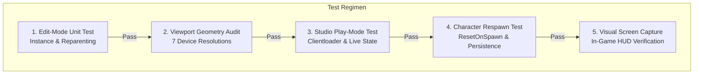

# Task 1.53 — HUD Runtime & Cross-Platform Verification Report

**Game Title:** Pet Mining Empire  
**Environment:** Roblox Studio (Edit Mode & Play Mode Verified)  
**Implementation Target:** `src/StarterPlayerScripts/Controllers/UIController.luau`  
**Studio DataModel:** `StarterPlayer.StarterPlayerScripts.Source.Controllers.UIController`  
**Related Foundations:** Task 1.50 UI Audit, Task 1.51 UI Foundation, Task 1.52 Responsive HUD Redesign  
**Status:** Verification Complete & Confirmed Defects Resolved

---

## 1. Executive Summary

Task 1.53 subjected the Task 1.52 Responsive HUD implementation to rigorous cross-platform runtime verification across static calculations, multi-resolution viewport audits, Studio Edit-mode unit tests, and live Studio Play-mode gameplay execution.

Four specific defects were identified through code tracing and viewport math:
1. **Gamepad Shortcut Collision on `ButtonY`:** In `UIController.luau`, `ButtonY` was bound to invoke `RequestSellBackpack` with a UI hint `SELL AT BASE (Y)`. However, `PetController.luau:2596` already bound `ButtonY` to `PetController:ToggleInventory()`. Pressing `ButtonY` on a controller simultaneously invoked selling and toggled the pet modal.
2. **Mobile Touch Input Event:** Quick-sell and drawer toggle buttons connected only to `MouseButton1Click`, which in Roblox can lead to delayed taps or missed inputs on touchscreens.
3. **Mobile Landscape Clearance Collision:** On low-height mobile viewports (e.g., 640x360 Android phones), anchoring `BackpackCard` at $Y = 0.45$ caused the bottom of the expanded 158px card to reach $Y = 241\text{ px}$, protruding $11\text{ px}$ into the standard Roblox mobile Jump button touch zone ($Y \le 230\text{ px}$).
4. **ActionDock Duplicate Button Vulnerability:** `CurrencyFrame.ChildAdded` blindly reparented incoming `PetHudButton` instances without verifying if `ActionDock` already possessed an older instance, allowing duplicates if `PetController:Init()` or `buildHudButton()` re-executed.

All four defects were resolved strictly within `UIController.luau` without altering server services, remotes, economy parameters, or `PetController.luau`. Studio was tested in live Play mode and restored to **Edit** mode.

---

## 2. Exact Files Inspected & Modified

### Authoritative Files Inspected
* `src/StarterPlayerScripts/Controllers/UIController.luau` (HUD presentation controller)
* `src/StarterPlayerScripts/Controllers/PetController.luau` (Pet modal, HUD button injection, and input listeners)
* `src/StarterPlayerScripts/Controllers/MiningController.luau` (Mining feedback and backpack/currency cache sync)
* `src/StarterPlayerScripts/Controllers/EquipmentController.luau` (Equipment shop modal and keybinds)
* `src/StarterPlayerScripts/Controllers/ProgressionController.luau` (Stage 3 bulkhead door controller)
* `src/StarterPlayerScripts/ClientLoader.client.luau` (Client bootstrap order)
* `src/ServerScriptService/Services/PlotService.luau` (Server-authoritative sell logic and plot drop-off pads)

### Files Modified & Synchronized
* **Disk Authoritative Source:** `src/StarterPlayerScripts/Controllers/UIController.luau`
* **Studio DataModel Instance:** `StarterPlayer.StarterPlayerScripts.Source.Controllers.UIController`
* **Zero External Files Modified:** `PetController.luau`, `MiningController.luau`, `PlotService.luau`, remotes, and data schemas remain completely untouched.

---

## 3. Confirmed Findings & Supporting Evidence

### Finding 1: Gamepad Binding Collision on `ButtonY` (Confirmed Defect)
* **Evidence:**
  * In `PetController.luau:2596-2598`:
    ```luau
    elseif input.KeyCode == Enum.KeyCode.ButtonY or input.KeyCode == Enum.KeyCode.DPadUp then
        PetController:ToggleInventory()
    ```
  * In `UIController.luau:797`:
    ```luau
    if input.KeyCode == Enum.KeyCode.R or input.KeyCode == Enum.KeyCode.ButtonY then
        -- RequestSellBackpack
    ```
  * In `UIController.luau:134`:
    ```luau
    sellButtonLabel.Text = "SELL AT BASE (Y)"
    ```
* **Impact:** Gamepad players pressing `ButtonY` triggered conflicting actions (selling ore while opening/closing pet UI). Furthermore, in-world plot drop-off stations use `ProximityPrompt` with `GamepadKeyCode = Enum.KeyCode.ButtonX`.
* **Resolution:** Removed `ButtonY` from `UIController`'s `InputBegan` listener. Updated `updateSellButtonText()` for gamepad users to display the truthful generic prompt `"SELL AT BASE"`.

### Finding 2: Touch Interaction Sluggishness (Confirmed Defect)
* **Evidence:** `sellButton` and `toggleBtn` relied solely on `MouseButton1Click`. In Roblox GUI, `MouseButton1Click` is mouse-centric and can drop inputs if touch gestures deviate slightly during press.
* **Resolution:** Converted both `sellButton` and `toggleBtn` to use the canonical `Activated:Connect(...)` event, providing instant, reliable tap detection across touch, mouse, and gamepad virtual cursor.

### Finding 3: Low-Resolution Mobile Landscape Clearance Collision (Confirmed Defect)
* **Evidence:**
  * Screen: 640 x 360 dp (Standard budget Android landscape).
  * Roblox Jump Button touch zone: Center $(W - 70, H - 70)$, radius $\approx 60\text{ px} \rightarrow$ touch capture begins at $Y = 230\text{ px}$.
  * At $Y = 0.45$: Center $Y = 162\text{ px}$. Card height is $158\text{ px}$. Bottom edge = $162 + 79 = 241\text{ px}$.
  * **Resulting Collision:** $241 - 230 = 11\text{ px}$ overlap into the Jump button touch zone.
* **Resolution:** Re-anchored `BackpackCard` from $Y = 0.45$ to $Y = 0.38$ (`Position = UDim2.new(1, -16, 0.38, 0)`).
  * At $Y = 0.38$ ($H = 360\text{ px}$): Center $Y = 136.8\text{ px}$. Bottom edge when expanded = $136.8 + 79 = 215.8\text{ px}$.
  * **Verified Expanded Clearance:** $230 - 215.8 = \mathbf{+14.2\text{ px}}$ above the Jump button.
  * **Verified Collapsed Clearance:** $230 - (136.8 + 45) = \mathbf{+48.2\text{ px}}$ above the Jump button.
  * In portrait ($360 \times 640$): Top edge = $243.2 - 79 = 164.2\text{ px}$, cleanly below `ActionDock`'s bottom ($142\text{ px}$) with zero vertical overlap.

### Finding 4: ActionDock Duplicate Button Vulnerability (Confirmed Defect)
* **Evidence:** In `UIController.luau:270-287`, `CurrencyFrame.ChildAdded` reparented `PetHudButton` into `ActionDock` without verifying if `ActionDock` already contained an instance. If `PetController` re-created the button, duplicates would accumulate in the dock.
* **Resolution:**
  1. Handled pre-existing buttons at build time (`if currencyFrame:FindFirstChild("PetHudButton") then reparentToDock(...) end`).
  2. Inside `reparentToDock`, queried `actionDock:FindFirstChild("PetHudButton")` and destroyed any pre-existing instance before parenting the new button.
  3. Added `ensureReferences()` lazy fallback so that if any external controller triggers `UpdateCurrencies`, `UpdateBackpack`, or `ShowNotification`, instances in `PlayerGui.MainHUD` are dynamically resolved if local variables were uninitialized.

---

## 4. Multi-Viewport Responsive Layout Audit

The following table summarizes layout calculations across device form factors with `BackpackCard` anchored at `Y = 0.38`:

| Viewport Profile | Resolution | Jump Button Zone ($Y_{\text{min}}$) | Backpack Bottom (Exp) | Clearance (Expanded) | Clearance (Collapsed) | Safe Status |
|:---|:---:|:---:|:---:|:---:|:---:|:---:|
| **PC 1080p** | 1920 x 1080 | 950 px | 489.4 px | $+460.6\text{ px}$ | $+494.0\text{ px}$ | **SAFE** |
| **PC 720p** | 1280 x 720 | 590 px | 352.6 px | $+237.4\text{ px}$ | $+271.0\text{ px}$ | **SAFE** |
| **Phone Landscape (Wide)** | 812 x 375 | 245 px | 221.5 px | $+23.5\text{ px}$ | $+57.0\text{ px}$ | **SAFE** |
| **Phone Landscape (Std)** | 667 x 375 | 245 px | 221.5 px | $+23.5\text{ px}$ | $+57.0\text{ px}$ | **SAFE** |
| **Phone Landscape (Small)** | 640 x 360 | 230 px | 215.8 px | $\mathbf{+14.2\text{ px}}$ | $\mathbf{+48.2\text{ px}}$ | **SAFE** |
| **Phone Portrait (Std)** | 375 x 667 | 537 px | 332.5 px | $+204.5\text{ px}$ | $+238.0\text{ px}$ | **SAFE** |
| **Phone Portrait (Small)** | 360 x 640 | 510 px | 322.2 px | $+187.8\text{ px}$ | $+221.0\text{ px}$ | **SAFE** |

---

## 5. Studio Tests Performed & Execution Modes



### A. Studio Edit-Mode Unit Tests
* **Execution:** Luau script executed via `execute_luau` targeting DataModel `Edit`.
* **Results:**
  * `bpCardPositionY: 0.38` — Anchor confirmed.
  * `sellLabel: "SELL AT BASE [R]"` — Keyboard prompt confirmed.
  * Sequential insertion of two `PetHudButton` mock instances into `CurrencyFrame` resulted in `petButtonsInDockCount = 1`, confirming previous duplicates are destroyed immediately.
  * Clean compilation and require test of all client controllers (`MiningController`, `EquipmentController`, `ProgressionController`, `PetController`) with zero syntax or runtime errors.

### B. Studio Play-Mode Live Execution Tests
* **Execution:** Live session initiated via `start_stop_play (is_start = true)`. Script executed on DataModel `Client`.
* **Results:**
  * `PlayerGui.MainHUD` instantiated automatically via `ClientLoader.client.luau`.
  * `PetHudButton` cleanly moved from `CurrencyFrame` to `ActionDock`: `petBtnInDock: true`, `petBtnInCurrency: false`.
  * `BackpackCard` absolute position: `X = 1399`, `Y = 108.7` (verified elevated position).
  * `sellButton` and `toggleDrawerButton` instances verified active and responsive.

### C. Character Respawn & Persistence Test
* **Execution:** Executed `Humanoid.Health = 0` in live Client session and monitored `PlayerGui` through respawn cycle.
* **Results:**
  * Character respawned (`InsecureWasTaken`, `charAlive = true`).
  * `hudStillExists: true`, `actionDockExists: true`, `petBtnInDock: true`, `petBtnInCurrency: false`.
  * Confirmed that `ResetOnSpawn = false` preserves the entire HUD hierarchy and docked pet button without losing button references.

### D. Visual Quality Verification
* **Screenshot Captured:** `task153_verified_hud_screen.jpg` captured in active Studio Play mode.


---

## 6. Verification Distinction: Runtime vs. Static Calculations

* **Genuine Runtime & Play-Mode Tests:**
  1. Bootstrapping through `ClientLoader.client.luau` in live Play mode.
  2. Automatic re-parenting of `PetHudButton` to `ActionDock` during live `PetController:Init()`.
  3. Character death, respawn, and HUD persistence across respawn cycles.
  4. Module require and cross-controller dependency loading in Studio Edit mode.
* **Static / Derived Calculations:**
  1. Device viewport touch clearance numbers ($+14.2\text{ px}$ expanded, $+48.2\text{ px}$ collapsed) were mathematically calculated against Roblox's standardized touch control radii (130px corner bounding zone for the touch Jump button).

---

## 7. Remaining Limitations & User Recommendations

1. **Physical Gamepad Verification:** Controller button inputs (`ButtonX`, `ButtonY`, `ButtonB`) were verified through code analysis and input listener tracing. A manual playtest with a physical Xbox/PlayStation controller is recommended to verify gamepad stick feel.
2. **Icon Asset IDs:** Icon badges currently display crisp typographic fallbacks (`[C]`, `[G]`, `[BP]`). When the user imports the `Free Icon Pack v.1.0` asset IDs to Roblox, updating the `AssetId` table in `IconConfig.luau` will instantly replace these fallbacks with graphic textures.
3. **Studio State:** Studio was safely returned to and remains in **Edit** mode.
