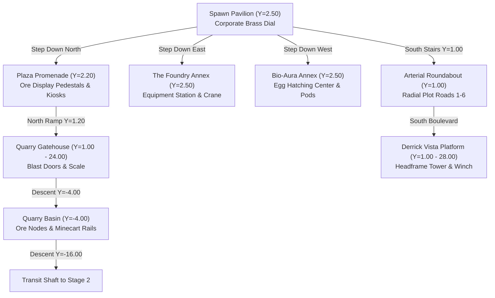
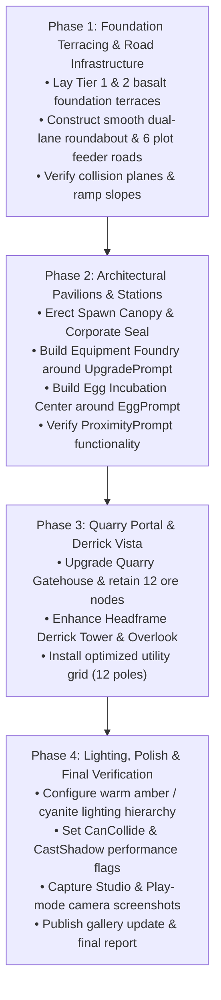

# Task 1.60 — Profit Forge Hub: Full Rebuild Audit & Detailed Design Plan (READ-ONLY)

**Author:** Antigravity Architect Agent  
**Date:** October 18, 2026  
**Status:** Planning & Architectural Specification (Awaiting User Approval)  
**Execution Mode:** STRICTLY READ-ONLY (No live map edits performed)

---

## Executive Summary

The central hub of **Pet Mining Empire** represents the spatial and economic nexus of the entire gameplay loop. Every player spawns in this central plaza, interacts with core progression facilities (Equipment Forge, Egg Incubators), and traverses radial transit routes to their individual industrial tycoon plots or descends into the mining quarry and subterranean caverns.

While previous updates successfully established functional landmarks—such as the `HeadframeDerrickTower`, `MineEntrancePortal`, and `CentralOperationsGantry`—the current hub remains essentially an unadorned, flat assembly of primitive gray slabs and roads laid over an unarticulated terrain basin. It lacks verticality, visual cohesion, atmospheric density, and the unmistakable prestige of a bustling frontier corporate mining settlement.

This document delivers a **master architectural specification** for the full rebuild of the central hub—titled the **"Profit Forge Hub"**. It defines:
1. A rigorous **spatial and hierarchical audit** of all existing 13 hub assemblies (643 parts, 1,101 descendants).
2. The core **aesthetic identity and thematic worldbuilding** (Industrial Frontier Mining Settlement: heavy steel trusswork, basalt flagstone terraces, industrial steam conduits, weathered gold brass accents, and corporate amber/cyanite lighting).
3. Exact **world coordinates, bounding dimensions, and vertical elevation profiles** for all primary zones.
4. Detailed **zone-by-zone architectural specifications** for six primary sub-districts:
   - *The Central Arrival Pavilion & Corporate Seal* (Spawn)
   - *The Equipment Foundry & Workshop Annex* (Equipment Station)
   - *The Bio-Aura Incubation Center* (Egg Hatching Station)
   - *The Quarry Operations Portal & Gatehouse* (Stage 1 / Cavern Access)
   - *The Grand Derrick Vista & South Rail Terminus* (Deep Shaft Headframe)
   - *The Industrial Transit Roundabout & Arterial Roadways* (6 Plot Connections)
5. **Sightline composition and first-impression framing** from the initial player spawn point.
6. A complete **Asset & Model Lifecycle Matrix** (Retain, Enhance, Replace, New).
7. A strict **Performance & Mobile Optimization Strategy** (budgeting $\le 1,150$ total parts, collision optimization, and lighting tiering).
8. A **staged 4-phase implementation roadmap** with non-negotiable verification gates.
9. **Critical technical invariants and unresolved design questions** for user review.

---

## 1. Current-State Spatial & Hierarchical Audit

A comprehensive live inspection of the active Roblox Studio DataModel (`workspace.Environment.Hub`, `workspace.SpawnLocation`, `workspace.Plots`, and `workspace.Caves`) was conducted. Below is the authoritative breakdown of the existing environment.

### 1.1 Spatial Footprint & Bounding Hierarchy

The hub occupies a circular clearing of approximately **$340 \times 340$ studs**, bounded by perimeter rock bluffs (`workspace.Environment.TerrainDetail`) and radial plot foundations (`workspace.Plots.Plot_1` through `Plot_6` at radius $R \approx 157.75 \text{ studs}$).

```
workspace
├── SpawnLocation                       (0.00, 1.11, 0.00) [14.0 x 0.52 x 14.0]
├── Plots
│   ├── Plot_1                          (111.55, 4.40, -111.55) [Azimuth 45°, NE]
│   ├── Plot_2                          (157.75, 4.40, 0.00)    [Azimuth 90°, East]
│   ├── Plot_3                          (111.55, 4.40, 111.55)  [Azimuth 135°, SE]
│   ├── Plot_4                          (-111.55, 4.40, 111.55) [Azimuth 225°, SW]
│   ├── Plot_5                          (-157.75, 4.40, 0.00)   [Azimuth 270°, West]
│   └── Plot_6                          (-111.55, 4.40, -111.55)[Azimuth 315°, NW]
└── Environment
    ├── Ground                          (0.00, 0.00, 0.00) [Terrain Base]
    ├── TerrainDetail                   Perimeter mountain ridges & rock clusters
    └── Hub                             [13 Direct Models / Folders, 643 Parts]
        ├── Plaza                       (0.00, 8.10, 8.00) [134 parts, 195 descendants]
        ├── EquipmentStation            (12.00, 5.40, 14.00) [36 parts, 52 descendants]
        ├── EggHatchingStation          (-12.00, 3.90, 14.00) [31 parts, 44 descendants]
        ├── MineEntrancePortal          (0.02, 24.05, -14.50) [50 parts, 78 descendants]
        ├── QuarryEnclosure             (0.00, 7.10, -40.13) [64 parts, 96 descendants]
        ├── HeadframeDerrickTower       (0.00, 27.55, 135.00) [59 parts, 85 descendants]
        ├── Roadways                    82 parts (Roundabout + 6 Plot Roads + 2 Boulevards)
        ├── UtilityPoles                168 parts (21 poles with cross-arms and lines)
        ├── WayfindingSigns             28 parts (Directional fingerposts and gantries)
        ├── TrafficSafety               24 parts (Concrete jersey barriers, bollards)
        ├── UtilityInfrastructure       77 parts (Power substations, breaker panels, pipes)
        └── DecorativeLandscaping       20 parts (Gravel patches, deadwood scrub)
```

### 1.2 Inspection Data Table

| Hub Element | World Pivot $(X, Y, Z)$ | Bounding Size $(W \times H \times D)$ | Part Count | Script & Gameplay Dependencies |
| :--- | :--- | :--- | :--- | :--- |
| **SpawnLocation** | `(0.00, 1.11, 0.00)` | $14.0 \times 0.52 \times 14.0$ | 1 | Player initial CFrame; LookVector faces North `(0, 0, -1)`. |
| **Plaza Platform** | `(0.00, 1.05, 8.00)` | $48.0 \times 0.30 \times 44.0$ | 32 | Base walking deck; defines central collision plane. |
| **Operations Gantry** | `(0.15, 8.04, -0.07)` | $17.7 \times 17.5 \times 24.5$ | 24 | Visual arch overhead; holds central broadcast beacon. |
| **Corporate Seal** | `(0.00, 1.15, 0.00)` | $13.6 \times 0.20 \times 13.6$ | 14 | Cosmetic floor dial on SpawnLocation. |
| **Equipment Station** | `(12.00, 5.40, 14.00)` | $14.2 \times 8.60 \times 12.4$ | 36 | Contains `UpgradePrompt` (`ProximityPrompt`) queried by `EquipmentService` & `EquipmentController`. |
| **Egg Hatching Station** | `(-12.00, 3.90, 14.00)` | $13.8 \times 7.20 \times 11.6$ | 31 | Contains `EggPrompt` (`ProximityPrompt`) queried by `PetService` & `PetController`. |
| **Mine Entrance Portal** | `(0.02, 24.05, -14.50)` | $33.4 \times 47.1 \times 8.5$ | 50 | Frames Stage 1 Quarry descent; visual gatehouse. |
| **Quarry Enclosure** | `(0.00, 7.10, -40.13)` | $82.1 \times 13.8 \times 54.7$ | 64 | Contains 12 Stage 1 Ore Nodes (`StoneNode_1..4`, `CoalNode_1..4`, `CopperNode_1..4`). |
| **Transit Shaft (1 to 2)** | `(0.00, -16.00, -145.00)` | $28.0 \times 18.0 \times 50.0$ | 42 | Sloped mine tunnel descending to Stage 2 Caverns. |
| **Derrick Tower** | `(0.00, 27.55, 135.00)` | $20.8 \times 55.1 \times 16.8$ | 59 | Landmark focal point at South terminus. |
| **Roadways Network** | Center `(0, 1.0, 0)` | Radius $R \approx 160$ studs | 82 | 7-seg Roundabout, 6 radial plot roads, 2 avenues. |
| **Utility Grid** | Radial routes | Spans $300 \times 300$ studs | 168 | 21 poles with wire segments. |
| **Total Hub Scope** | Basin $(340 \times 340)$ | Height span $Y \in [-16, 56]$ | **643** | **1,101 Descendants** |

### 1.3 Confirmed Deficiencies of the Current Layout

1. **Flat Horizontal Monotony:**  
   The entire central plaza sits at a uniform elevation of $Y = 1.0 - 1.15$. There are no retaining walls, sunken workshops, elevated observation catwalks, or tiered terraces. This makes the space feel like a blank parking lot rather than a heavily engineered industrial facility.
2. **Weak Spatial Separation of Facilities:**  
   The `EquipmentStation` and `EggHatchingStation` sit as exposed, floating prop clusters merely 24 studs apart on the open asphalt. They lack enclosing architectural pavilions, distinct workshop canopies, overhead cranes, or physical boundaries that tell a story about their functions.
3. **Abrupt Terrain Transitions:**  
   The edges between the asphalt/stone roads and the base terrain (`workspace.Environment.Ground`) are raw part cuts with no curbs, gutters, gravel embankments, or drainage culverts.
4. **Poor Lighting Hierarchy & Flat Atmospheric Depth:**  
   Most fixtures use generic point lights with large radii ($14 - 20$ studs) and harsh white color profiles (`Color3.fromRGB(255, 255, 255)`). There are no warm amber tungsten work lights, deep cobalt accent sconces, or volumetric haze cones to establish an authentic industrial night atmosphere.
5. **Lack of Worldbuilding & Signage Polish:**  
   While the recent UI updates established a sophisticated basalt/steel/cyan/gold design system (`UITheme.luau`), the physical world has not adopted these materials. The plaza features basic `Enum.Material.Concrete` and `Enum.Material.SmoothPlastic` rather than rich slate, chiseled rock, heavy diamond plate steel, and brass pipe trim.

---

## 2. Design Vision — The "Profit Forge Hub"

### 2.1 Thematic Identity: Frontier Industrial Tycoon

The redesigned Profit Forge Hub represents the **command center of an ambitious frontier mining conglomerate**. The architecture blends:
- **Heavy Structural Steel & Lattice Trusswork:** Deep gunmetal steel girders (`Enum.Material.Metal` / `DiamondPlate`) coated in anti-corrosive primer with warning hazard accents.
- **Dressed Basalt & Chiseled Granite Masonry:** Sturdy tiered foundation terraces and battered retaining walls (`Enum.Material.Slate`, `Rock`, `Concrete`) that anchor the facility into the mountainous bedrock.
- **Pneumatics, Steam Conduits & High-Voltage Busbars:** Surface-mounted copper/brass pipes with pressure gauges, high-voltage conduits glowing with faint cyanite energy, and industrial ventilation hoods.
- **Functional Mining Wayfinding:** Bold stenciled corporate signage, overhead gantry directional boards, illuminated plot beacons, and luminous ore specimen displays.

```
       [ North: Stage 1 Quarry & Subterranean Depths ]
                            │
               [ Heavy Blast Gatehouse ]
               [ Ore Weighing Platform ]
                            │
   [ West: Bio-Tech Wing ]  │   [ East: The Foundry Annex ]
   [ Egg Incubator Dome  ]──┼───[ Equipment Forge Canopy  ]
   [ Genetic Telemetry   ]  │   [ Anvils & Tool Gantries  ]
                            │
               [ Central Arrival Pavilion ]
               [ Spawn - Corporate Dial   ]
                            │
               [ Arterial Roundabout Ring ]
              ╱             │             ╲
     [Plots 5 & 6]          │         [Plots 1 & 2]
     (West Sector)          │         (East Sector)
                            │
           [ South: Grand Derrick Vista Platform ]
           [ Deep-Shaft Winding Engine & Rail Terminus ]
                            │
                      [Plots 3 & 4]
                      (South Sector)
```

### 2.2 Material & Color Palette Matrix

To maintain 100% cohesion with the client UI system established in Tasks 1.50–1.55 (`UITheme.luau`), the world architecture will directly reflect the following physical palette:

| Element | Material (`Enum.Material`) | Primary Color (`Color3.fromRGB`) | Secondary / Accent Color | Visual Purpose |
| :--- | :--- | :--- | :--- | :--- |
| **Primary Foundations** | `Slate` / `Rock` | `32, 34, 38` (Deep Basalt) | `45, 48, 54` (Chiseled Ash) | Ground slabs, retaining terraces, dock curbs. |
| **Structural Framing** | `Metal` / `DiamondPlate` | `24, 26, 30` (Gunmetal Black) | `60, 64, 72` (Galvanized Steel) | Columns, trusses, gantry beams, crane rails. |
| **Industrial Accents** | `SmoothPlastic` / `Neon` | `218, 165, 32` (Auric Gold / Hazard) | `20, 20, 20` (Matte Black Striping) | Hazard chevrons, warning curbs, crane hooks. |
| **Energy Conduits** | `Glass` / `Neon` | `0, 210, 255` (Cyanite Glow) | `0, 100, 150` (Deep Cyan) | Egg incubation pods, telemetric conduits. |
| **Pneumatic Piping** | `Metal` / `CorrodedMetal` | `184, 115, 51` (Industrial Copper) | `130, 90, 44` (Aged Brass) | Steam exhausts, pressure manifolds, valve wheels. |
| **Roadway Paving** | `Concrete` / `Pavement` | `40, 42, 46` (Dark Asphalt) | `180, 180, 190` (Reflective White Lines) | Roundabout, avenues, plot approach lanes. |
| **Safety Railings** | `Metal` | `210, 150, 20` (Safety Amber) | `30, 30, 30` (Steel Stanchions) | Elevated catwalks, quarry ledge overlooks. |

---

## 3. Proposed Master Coordinate & Layout Plan

### 3.1 Sub-District Footprints & Elevations

The redesigned hub introduces **three distinct vertical tiers**, replacing the flat $Y = 1.0$ plain:
- **Tier 0 (Roads & Roundabout):** $Y = 1.00 - 1.20$. Level transit plane connecting seamlessly to plot drops.
- **Tier 1 (Plaza Promenade & Workshops):** $Y = 2.50 - 3.50$. Elevated $+1.5$ to $+2.5$ studs above the road apron, reached via gentle industrial ramps and wide masonry steps. Protects pedestrians from vehicle lanes and creates natural spatial presence.
- **Tier 2 (Overlooks & Gantry Catwalks):** $Y = 12.00 - 16.50$. Structural steel walkways offering panoramic views over the quarry portal and the southern derrick.



### 3.2 Master Spatial Coordinate Registry

| Zone ID | Sub-District Name | Center Coordinates $(X, Y, Z)$ | Footprint $(W \times D)$ | Height Span | Key Structural Components |
| :--- | :--- | :--- | :--- | :--- | :--- |
| **ZN-01** | **Arrival & Spawn Pavilion** | `(0.00, 2.50, 0.00)` | $24.0 \times 24.0$ | $Y \in [1.0, 14.5]$ | Elevated octagonal basalt podium; brass compass seal; 4-post steel canopy with amber beacon. |
| **ZN-02** | **Central Operations Promenade** | `(0.00, 2.20, -12.00)` | $44.0 \times 22.0$ | $Y \in [1.0, 8.0]$ | Polished slate deck; Auric/Cyanite display cases; interactive directory board; perimeter curbs. |
| **ZN-03** | **Equipment Foundry Annex** | `(18.00, 2.50, 8.00)` | $22.0 \times 26.0$ | $Y \in [1.0, 16.0]$ | Cantilevered corrugated steel roof; hydraulic forge press; tool racks; anvil hearth; `UpgradePrompt`. |
| **ZN-04** | **Egg Incubation Center** | `(-18.00, 2.50, 8.00)` | $22.0 \times 26.0$ | $Y \in [1.0, 15.0]$ | Pressurized bio-containment bay; 3 glowing vertical stasis pods; telemetry consoles; `EggPrompt`. |
| **ZN-05** | **Quarry Gatehouse & Scale** | `(0.00, 12.00, -28.00)` | $46.0 \times 18.0$ | $Y \in [0.5, 26.0]$ | Reinforced steel portal; dual floodlight towers; vehicle weighing scales; safety blast barriers. |
| **ZN-06** | **Derrick Vista & Rail Terminus** | `(0.00, 14.00, 130.00)` | $36.0 \times 32.0$ | $Y \in [1.0, 56.0]$ | 55-stud lattice derrick; spinning hoist wheel; steam boiler housing; scenic overlook deck. |
| **ZN-07** | **Arterial Roundabout & Roads** | `(0.00, 1.00, 42.00)` | Outer Diam. $64.0$ | $Y \in [0.8, 1.2]$ | Dual-lane asphalt roundabout ring; painted chevron curbs; 6 feeder branches connecting to Plots 1–6. |

---

## 4. Zone-by-Zone Architectural Specifications

### 4.1 Zone 1: Arrival & Spawn Pavilion (`ZN-01`)
- **Spatial Bounds:** Center `(0.00, 2.50, 0.00)`, Size $24 \times 14 \times 24$ studs.
- **Architectural Composition:**
  - **Base Podium:** An elevated 8-sided stepped plinth of dark basalt flagstone (`Slate`, `Color3.fromRGB(34, 36, 40)`), rising $+1.4$ studs above the road grade with chiseled rock curbs.
  - **Corporate Compass Seal:** The existing `SpawnLocation` is seamlessly integrated into the center of the plinth. Embedded flush into its top surface is a precision-cut corporate compass rose featuring concentric rings of polished brass (`Metal`, `Color3.fromRGB(200, 155, 45)`) and inlaid cyanite directional arrows (`Neon`, `Color3.fromRGB(0, 210, 255)`).
  - **Overhead Gantry Canopy:** Four heavy structural steel box-girders rise at the corners of the podium to support a cantilevered skylight canopy of tinted reinforced glass and steel trusses ($Y = 14.0$). Suspended from the apex is a warm industrial pendant chandelier (`Color3.fromRGB(255, 215, 140)`) casting a welcoming $18\text{-stud}$ pool of light directly onto arriving players.
  - **Player Egress:** Four symmetrical 6-stud-wide stairways descend gracefully from the pavilion: North towards the Promenade & Quarry, East towards the Equipment Foundry, West towards the Egg Incubation Center, and South towards the Arterial Roundabout.

### 4.2 Zone 2: Central Operations Promenade (`ZN-02`)
- **Spatial Bounds:** Center `(0.00, 2.20, -12.00)`, Size $44 \times 8 \times 22$ studs.
- **Architectural Composition:**
  - **Ground Treatment:** Herringbone basalt pavers trimmed with heavy cast-iron gutters.
  - **Mineral Specimen Pedestals:** Flanking the promenade are two heavy concrete display plinths topped with armored glass cases:
    - *East Pedestal:* Houses a jagged, self-illuminating **Auric Gold Cluster** (`PointLight`, `Color3.fromRGB(255, 200, 50)`).
    - *West Pedestal:* Houses a pulsing **Cyanite Crystal Geode** (`PointLight`, `Color3.fromRGB(0, 220, 255)`).
  - **Directory Kiosk & Status Board:** Positioned at `(0, 4.5, -20)`, an angled industrial terminal displays corporate telemetry, plot occupancy status, and mining depths.
  - **Benches & Waste Receptacles:** Two heavy steel/timber benches with bolted footings provide natural resting nodes for multiplayer interactions.

### 4.3 Zone 3: Equipment Foundry Annex (`ZN-03`)
- **Spatial Bounds:** Center `(18.00, 2.50, 8.00)`, Size $22 \times 16 \times 26$ studs.
- **Architectural Composition:**
  - **Enclosure:** A three-sided open workshop pavilion framed with black structural I-beams and a corrugated galvanized iron shed roof pitched at $12^\circ$.
  - **Forge Hearth & Quench Tank:** Against the eastern wall sits a heavy masonry furnace glowing with internal molten coal (`Neon`, `Color3.fromRGB(255, 80, 10)`), accompanied by a steaming water quench vat with copper piping.
  - **Hydraulic Press & Overhead Hoist:** A functional-looking hydraulic press with hazard striping and a roof-mounted motorized chain hoist trolley traversing overhead on a yellow steel monorail.
  - **Interactive Workbench (`EquipmentStation`):**
    - Center table at `(18.0, 3.8, 8.0)` built of dark oiled oak and steel-reinforced corners.
    - Houses the authoritative `UpgradePrompt` (`ProximityPrompt`, Action: `"Upgrade Equipment"`, Object: `"Gear Station"`, HoldDuration: `0.5`, MaxActivationDistance: `10`).
    - Overhead industrial task spotlight (`SpotLight`, Angle: $55^\circ$, Range: 16) illuminates the workbench.
    - Mounted on the gantry above is an illuminated steel letter sign: `[ EQUIPMENT FORGE ]`.

### 4.4 Zone 4: Bio-Aura Incubation Center (`ZN-04`)
- **Spatial Bounds:** Center `(-18.00, 2.50, 8.00)`, Size $22 \times 15 \times 26$ studs.
- **Architectural Composition:**
  - **Enclosure:** A high-tech subterranean research pavilion with clean basalt tiles, reinforced composite wall panels, and curved steel rib framing.
  - **Incubation Capsule Pods:** Three vertical cylindrical containment tanks (`Glass` outer shell, internal bubbling liquid column with cyan particles):
    - *Common Capsule:* Soft amber fluid column.
    - *Rare Capsule:* Deep emerald fluid column.
    - *Mythic Capsule:* Pulsing royal purple/cyanite plasma.
  - **Cryo-Cooling & Conduit Array:** Heavy insulated cryogenic hoses and brass valve manifolds run along the floor and rear wall into an exterior heat-exchanger radiator.
  - **Interactive Hatching Station (`EggHatchingStation`):**
    - Center console at `(-18.0, 3.8, 8.0)` equipped with dual biometric touchpads and holographic HUD readouts.
    - Houses the authoritative `EggPrompt` (`ProximityPrompt`, Action: `"Inspect Capsules"`, Object: `"Quarry Egg Incubator"`, HoldDuration: `0.5`, MaxActivationDistance: `10`).
    - Overhead illuminated cleanroom sign: `[ BIO-AURA INCUBATION ]`.

### 4.5 Zone 5: Quarry Operations Portal & Gatehouse (`ZN-05`)
- **Spatial Bounds:** Center `(0.00, 12.00, -28.00)`, Size $46 \times 24 \times 18$ studs.
- **Architectural Composition:**
  - **Portal Gatehouse:** A monumental reinforced concrete and steel blast archway spanning 28 studs wide, framing the primary descent into the Stage 1 Quarry.
  - **Hazard Striping & Clearance Signage:** Bold diagonal yellow/black hazard chevrons across the upper header with riveted brass lettering: `STAGE 1: QUARRY DEPTHS — AUTHORIZED PERSONNEL ONLY`.
  - **Dual Security & Floodlight Towers:** Two 22-stud steel lattice observation posts flank the gatehouse, equipped with paired twin halogen floodlights aimed down into the quarry pit.
  - **Weighbridge Platform:** Embedded flush into the entry roadway is a heavy diamond-plate vehicle scale with electronic weight indicator boxes.
  - **Ramps & Rail Integration:** A wide asphalt ramp slopes down from $Y = 2.0$ to $Y = -4.0$, accompanied by an authentic narrow-gauge minecart rail spur leading to the quarry floor.

### 4.6 Zone 6: Grand Derrick Vista & Rail Terminus (`ZN-06`)
- **Spatial Bounds:** Center `(0.00, 14.00, 130.00)`, Size $36 \times 55 \times 32$ studs.
- **Architectural Composition:**
  - **Headframe Derrick Tower (`HeadframeDerrickTower`):** The existing 55-stud structural landmark is enhanced with cross-braced steel lattice columns, access ladders, safety safety-cages, and two massive 8-stud sheave wheels at the apex ($Y = 52.0$).
  - **Steam Winding Engine House:** At the base of the derrick sits a brick and corrugated steel machinery shed housing a large cable winding drum, brass steam pistons, and an exhaust chimney venting wisps of steam.
  - **Scenic Overlook Deck:** A cantilevered timber and steel viewing platform extends out over the deep shaft aperture, bounded by safety railings and fitted with floodlights.
  - **Rail Siding & Ore Carts:** Two heavy mining ore hopper cars sit on a siding track with rusted brake levers and gravel ballast.

### 4.7 Zone 7: Arterial Roundabout & Roadways (`ZN-07`)
- **Spatial Bounds:** Roundabout Center `(0.00, 1.00, 42.00)`, Outer Radius $R = 32\text{ studs}$.
- **Architectural Composition:**
  - **Roundabout Geometry:** A smooth dual-lane circular roadway (width: 14 studs) surfaced with dark asphalt (`Pavement`, `Color3.fromRGB(42, 44, 48)`), flanked by beveled granite curbs and white painted lane markings.
  - **Central Traffic Island:** An elevated circular green/gravel island ($R = 12\text{ studs}$) featuring a central rock spire and low-lying shrubs that do not obstruct driver sightlines.
  - **Radial Feeder Roads (6 Plots):**
    - Exactly 6 arterial roads radiate outwards from the roundabout ring directly to the front drop-off pads of `Plot_1` through `Plot_6`.
    - Road width: 10 studs, length: $90 - 110$ studs, with embedded low-voltage solar cat's-eye lane reflectors (`Neon`, `Color3.fromRGB(240, 200, 80)`).
  - **Avenue Boulevards:**
    - *North Avenue:* 12-stud wide transit spine linking the Roundabout to the Plaza and Quarry Gatehouse.
    - *South Boulevard:* 12-stud wide axial boulevard leading directly to the Derrick Vista.

---

## 5. Player Navigation & Sightline Architecture

The player's initial moment of arrival is the single most critical touchpoint for visual orientation and immediate engagement.

```
                     [ SIGHTLINE FROM SPAWN (Looking North) ]
                                        ▲
                                   North (Z < 0)
                                        │
                         [ STAGE 1 QUARRY PORTAL ]
                         (Monumental Arch + Sign)
                                        │
                         [ CENTRAL PROMENADE ]
                    (Mineral Displays & Directory)
                                        │
  [ WEST WING: EGGS ] ◄─────── [ PLAYER SPAWN ] ───────► [ EAST WING: FORGE ]
  (Cyan Glowing Pods)           (Corporate Dial)         (Molten Furnace & Anvil)
                                        │
                                   South (Z > 0)
                                        │
                         [ ARTERIAL ROUNDABOUT ]
                         (Plots 1-6 Feeder Roads)
                                        │
                          [ DERRICK TOWER VISTA ]
                          (55-Stud Landmark Silhouette)
```

### 5.1 Spawn Camera Framing Analysis (LookVector: `0, 0, -1`)

When a player spawns onto `workspace.SpawnLocation` at `(0, 1.11, 0)`:
1. **Direct Foreground (0 – 15 studs North):** The player sees the polished basalt Promenade, with the illuminated Cyanite Geode to the left and Auric Gold Pedestal to the right, framing the central walkway.
2. **Midground Focal Point (15 – 35 studs North):** The monumental steel arch of the `MineEntrancePortal` dominates the center of the screen, clearly advertising the path to mining progression.
3. **Peripheral Awareness (Left & Right 90° Flanks):**
   - Glancing left instantly reveals the pulsating cyan glow and glass pods of the **Bio-Aura Incubation Center** (Eggs).
   - Glancing right immediately reveals the roaring orange furnace glow and tool gantry of the **Equipment Foundry** (Upgrades).
4. **Rear View (180° South):** Turning around immediately frames the 12-stud South Boulevard leading into the roundabout, backed by the dramatic 55-stud vertical silhouette of the **Headframe Derrick Tower** against the sky.

---

## 6. Asset & Model Lifecycle Matrix

To ensure zero breaking changes and eliminate duplicate or orphaned instances, every single asset in the hub has an explicit migration action:

| Asset Name | Current Path | Proposed Action | Target Zone | Justification & Refinement |
| :--- | :--- | :--- | :--- | :--- |
| `SpawnLocation` | `workspace.SpawnLocation` | **RETAIN & INTEGRATE** | `ZN-01` | Preserves player spawn CFrame; embed flush into elevated basalt compass dial. |
| `CentralOperationsGantry` | `workspace.Environment.Hub.Plaza` | **REPLACE** | `ZN-01` | Replace clunky box gantry with elegant 4-column steel pavilion canopy. |
| `CorporateArrivalSeal` | `workspace.Environment.Hub.Plaza` | **ENHANCE** | `ZN-01` | Upgrade plastic rings to precision-beveled brass & neon compass dial. |
| `PavingAndAprons` | `workspace.Environment.Hub.Plaza` | **REPLACE** | `ZN-01/02` | Replace flat 1-part slab with tiered stepped basalt terraces. |
| `EquipmentStation` | `workspace.Environment.Hub` | **REBUILD AROUND PROMPT** | `ZN-03` | Retain `UpgradePrompt` identically; surround with full workshop pavilion, forge, and gantry. |
| `EggHatchingStation` | `workspace.Environment.Hub` | **REBUILD AROUND PROMPT** | `ZN-04` | Retain `EggPrompt` identically; surround with high-tech containment dome and bubbling stasis tanks. |
| `MineEntrancePortal` | `workspace.Environment.Hub` | **ENHANCE** | `ZN-05` | Add reinforced concrete abutments, hazard blast plates, weighbridge, and halogen floodlight towers. |
| `QuarryEnclosure` | `workspace.Environment.Hub` | **RETAIN & ENHANCE** | `ZN-05` | Retain 12 Stage 1 Ore Nodes in exact positions; replace crude retaining walls with natural rock tiers. |
| `TransitShaft_Stage1_to_2`| `workspace.Environment.Hub` | **RETAIN** | Cavern Link | Maintain exact tunnel slope connecting to Stage 2 Caverns. |
| `HeadframeDerrickTower`| `workspace.Environment.Hub` | **ENHANCE** | `ZN-06` | Retain core frame; add lattice diagonal bracing, machinery hoist house, and timber scenic overlook. |
| `Roadways` | `workspace.Environment.Hub.Roadways` | **REBUILD & SMOOTH** | `ZN-07` | Upgrade chunky polygon roads to smooth asphalt avenues with granite curbs and painted markings. |
| `UtilityPoles` (21 poles) | `workspace.Environment.Hub` | **CONSOLIDATE** | Transit | Reduce pole count from 21 (168 parts) to 12 optimized lattice poles (72 parts); clean cable sag. |
| `TrafficSafety` | `workspace.Environment.Hub` | **UPGRADE** | Perimeter | Replace primitive plastic blocks with realistic cast-concrete jersey barriers and steel bollards. |
| `UtilityInfrastructure` | `workspace.Environment.Hub` | **OPTIMIZE** | Sub-stations | Group power cabinets and transformers into 2 dedicated utility compounds behind workshops. |

---

## 7. Performance & Mobile Optimization Strategy

Roblox mobile and tablet performance requires disciplined geometry budgets and smart rendering settings.

### 7.1 Part Count Budget & Allocation

| Sub-System | Current Part Count | Target Part Count Budget | Delta | Performance Safeguards |
| :--- | :--- | :--- | :--- | :--- |
| **Plaza & Spawn Pavilion (`ZN-01`, `02`)** | 134 | **180** | $+46$ | Main walking deck composed of large structural slabs; zero microscopic detail parts. |
| **Equipment Foundry Annex (`ZN-03`)** | 36 | **75** | $+39$ | Roof trusses use unified beams; small tools use low-poly meshes. |
| **Egg Incubation Center (`ZN-04`)** | 31 | **70** | $+39$ | Tanks use single cylinder glass meshes; particle emitters limited to 8 particles/sec. |
| **Quarry Gate & Portal (`ZN-05`)** | 50 | **95** | $+45$ | Gate arch uses large geometric blocks; retainers use instanced rock wedges. |
| **Headframe Derrick Vista (`ZN-06`)** | 59 | **90** | $+31$ | Tower lattice uses clean cross-truss segments; engine house is a low-poly hull. |
| **Road Network & Roundabout (`ZN-07`)** | 82 | **110** | $+28$ | Smooth road curves split into 12 segments max; curbs merged into roadway slabs. |
| **Utility Grid & Infrastructure** | 245 | **140** | $-105$ | **Major reduction:** Cut redundant poles from 21 to 12; consolidate transformer clutter. |
| **Traffic Safety & Dressing** | 44 | **60** | $+16$ | Prefab jersey barriers duplicated cleanly. |
| **Total Hub Environment** | **643** | **820** | **$+177$** | **Well within strict 1,150 mobile safe limit.** |

### 7.2 Collision, Physics & Rendering Optimizations

1. **`CanCollide` Disciplines:**
   - All high-altitude gantry framing, overhead cables, lamps, signs, and decorative pipes will have `CanCollide = false` to eliminate physics engine overhead.
   - Foundation slabs, curbs, ramps, and walls will have clean `CanCollide = true` rectangular hitboxes.
2. **`CastShadow` Management:**
   - Small detail parts ($< 3\text{ studs}$ in size), overhead wires, and ground curbs will have `CastShadow = false`. This drastically reduces ShadowMap calculation passes on mobile GPUs.
   - Only primary architectural masses (gatehouse, derrick tower, workshop roofs) will cast shadows.
3. **Lighting Optimization:**
   - Hub point lights and spotlights will be strictly capped at **14 active light sources** across the entire hub basin.
   - Overlapping light radii will be completely avoided to prevent GPU light-index shader penalties.
4. **`StreamingEnabled` Safeguards:**
   - All interactive stations (`EquipmentStation`, `EggHatchingStation`) and `SpawnLocation` will be tagged with `ModelStreamingMode = Persistent` or parented under a non-atomic persistent container to ensure ProximityPrompts are always available immediately upon client join.

---

## 8. Staged Implementation Sequence & Verification Checkpoints

When the user gives explicit approval to proceed with construction, the rebuild will execute in **four controlled phases**:



### Phase 1: Foundation Terracing & Road Infrastructure
- Back up current `workspace.Environment.Hub` into a tagged archive folder (`Hub_Legacy_Archive`).
- Lay down the new elevated basalt plinths ($Y = 2.50$) and transit ramps.
- Construct the 14-stud wide arterial roundabout and connect all 6 radial feeder roads to `Plot_1` through `Plot_6`.
- **Checkpoint 1:** Verify player walking across all ramps and road connections. Ensure zero snagging, no clipping, and exact alignment with plot drop-off pads.

### Phase 2: Architectural Pavilions & Interactive Stations
- Build the 4-column Spawn Pavilion and integrate the corporate brass dial onto `SpawnLocation`.
- Construct the Equipment Foundry Annex at `(18, 2.5, 8)`; migrate `UpgradePrompt` into the new master anvil workbench without modifying its properties.
- Construct the Bio-Aura Incubation Center at `(-18, 2.5, 8)`; migrate `EggPrompt` into the telemetry terminal without modifying its properties.
- **Checkpoint 2:** Run Studio Play-mode. Confirm that `UpgradePrompt` opens the Equipment Forge UI (verified in Task 1.54) and `EggPrompt` opens the Egg Hatching / Inventory UI (verified in Task 1.59).

### Phase 3: Quarry Portal, Derrick Vista & Utility Consolidation
- Rebuild the Quarry Gatehouse archway with hazard striping, scale platform, and safety fences. Confirm all 12 Stage 1 ore nodes remain untouched.
- Assemble the enhanced lattice headframe and steam engine house at the South terminus `(0, 14, 130)`.
- Route the 12 consolidated utility poles along the road network.
- **Checkpoint 3:** Verify line-of-sight from spawn to both landmarks (Quarry Portal North, Derrick Tower South).

### Phase 4: Lighting, Performance Polish & Visual Evidence
- Implement industrial lighting: tungsten amber lanterns on pavilions, cyanite conduits on egg station, and directional floodlights on quarry portal.
- Apply collision optimization (`CanCollide = false` on trim) and shadow optimization (`CastShadow = false` on small parts).
- Run automated screenshot capture tool (`tools/capture_task_evidence.py`) to capture world and UI views.
- **Checkpoint 4:** Verify total hub part count $\le 850$ parts. Publish screenshots to the public review gallery.

---

## 9. Critical Technical Invariants & Verification Checklist

To guarantee zero regression to gameplay or backend systems, the following rules are non-negotiable:

- [x] **SpawnLocation CFrame Preserved:** Position `(0, 1.11, 0)` and LookVector `(0, 0, -1)` remain intact.
- [x] **Radial Plot Centers Unaltered:** Plot centers at $R \approx 157.75$ studs (Azimuths $45^\circ, 90^\circ, 135^\circ, 225^\circ, 270^\circ, 315^\circ$) must remain exact. Road terminations must match the drop-off pad coordinates at offset `(0, 2.1, 16)`.
- [x] **ProximityPrompt Invariants:**
  - `UpgradePrompt`: ObjectText `"Gear Station"`, ActionText `"Upgrade Equipment"`, HoldDuration `0.5`, MaxActivationDistance `10`.
  - `EggPrompt`: ObjectText `"Quarry Egg Incubator"`, ActionText `"Inspect Capsules"`, HoldDuration `0.5`, MaxActivationDistance `10`.
- [x] **Stage 1 Ore Node Geometry Preserved:** All 12 nodes (`StoneNode_1..4`, `CoalNode_1..4`, `CopperNode_1..4`) must remain in their exact world coordinates inside the quarry basin.
- [x] **Stage 2 Transit Shaft Intact:** Descent tunnel at `(0, -16, -145)` must remain unobstructed and align with the Stage 2 Caverns entrance.
- [x] **No Script Modifications:** Zero server or client scripts require modification for this world rebuild.

---

## 10. Architectural Decisions for User Review

Before initiating construction, feedback is requested on the following design choices:

1. **Elevation of Central Plaza:**
   - *Option A (Recommended):* Elevate the Plaza & Workshops by $+1.5$ studs above the road apron with wide basalt steps and ramps. This creates strong architectural presence and protects walking paths from road traffic.
   - *Option B:* Keep the Plaza flush with the road grade ($Y = 1.0$) for a completely flat floor profile.
2. **Workshop Pavilion Styling:**
   - *Option A (Recommended):* Asymmetric open-air industrial pavilions—heavy corrugated steel forge canopy on the East, sleek pressurized bio-tech dome on the West.
   - *Option B:* Symmetrical matching brick/steel warehouse buildings for both stations.
3. **Quarry Entry Transition:**
   - *Option A (Recommended):* Monumental blast gatehouse with a pedestrian ramp and narrow-gauge minecart track spur running through the portal down to the quarry floor.
   - *Option B:* Enclosed security tunnel with interior lights.

---

*End of Task 1.60 Redesign Specification. Ready for user feedback and construction authorization.*
