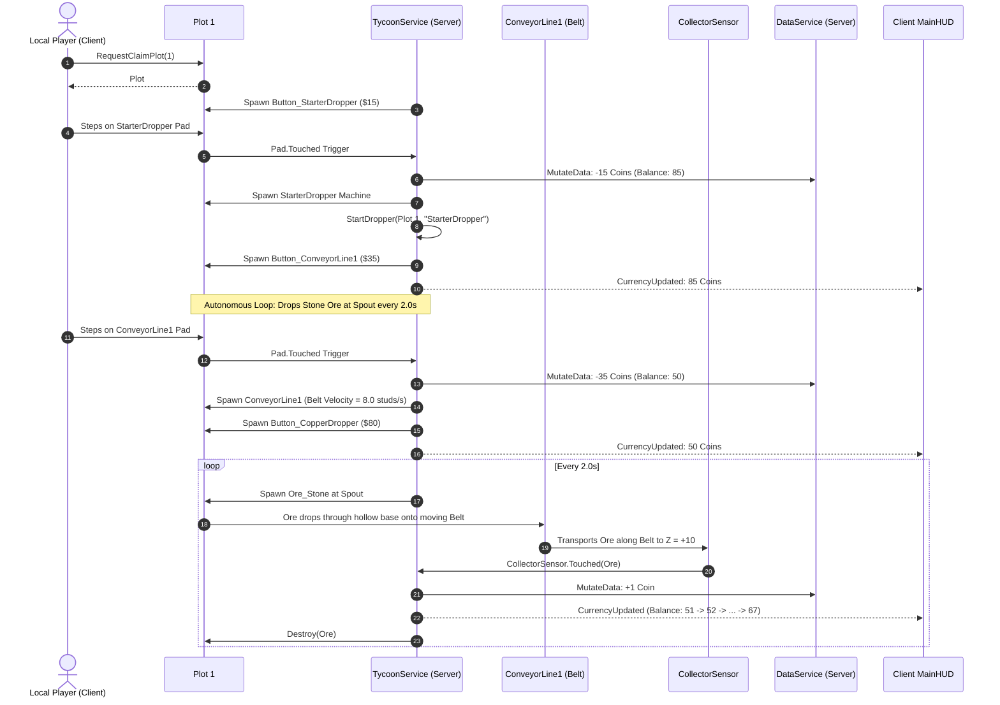

# Task 1.9 Verification & Implementation Report: Automated Machine Production & Conveyor Integration

## 1. Executive Summary

Task 1.9 — **Automated Machine Production & Conveyor Integration** has been implemented, synchronized into Roblox Studio, and verified through both a 10-assertion automated test suite in Edit mode and a live in-Studio playtest.

With this update:
1. Purchasing `StarterDropper` starts an autonomous, server-authoritative production loop that spawns physical Stone ore items (`1.0 x 1.0 x 1.0`) at the configured interval (2.0s) from the dropper spout.
2. The dropper frame has a hollow center (`Base.CanCollide = false`) allowing ores to fall cleanly through onto the conveyor belt below.
3. Purchasing `ConveyorLine1` spawns an anchored conveyor assembly with active physical velocity (`AssemblyLinearVelocity = 8.0 studs/s`) pointing along the conveyor's local $+Z$ axis directly toward the terminal collector, functioning identically across all 6 radial plots.
4. Ores moving down the conveyor enter the collector housing and contact the `CollectorSensor` receptor pad.
5. The server validates drop ownership, enforces an atomic anti-duplicate collection guard (`IsCollected = true`), credits Coins directly to the player's account via `DataService:MutateData`, fires `CurrencyUpdated`, updates the HUD (`CoinsValueLabel`), and destroys the physical drop.
6. A fallback manual pickup flow allows players to carry drops to their `DropOffStation` if touched before reaching the collector, respecting backpack capacity.
7. Active drops per plot are strictly bounded to 12 items to prevent physical clutter and lag.
8. Releasing a plot cancels all production threads immediately and clears all active drops. Rejoining or re-claiming restores purchased droppers and resumes exactly one production thread per dropper.

---

## 2. Architecture & File Modifications

### 2.1 Configuration: `ReplicatedStorage.Source.Configs.BaseConfig`
- Added production and conveyor settings to `BaseConfig.Settings`:
  - `MaxActiveDropsPerPlot = 12`
  - `ConveyorSpeed = 8.0` (studs/s)
  - `StarterDropRate = 2.0` (seconds)
- Extended `UpgradeDefinition` type with dropper metadata:
  ```luau
  export type UpgradeDefinition = {
      Id: string,
      DisplayName: string,
      Cost: number,
      PrerequisiteId: string?,
      ButtonOffset: Vector3,
      ModelOffset: Vector3,
      Category: string,
      Description: string,
      OreType: string?,
      DropRate: number?,
  }
  ```
- Configured upgrade definitions:
  - `StarterDropper`: `OreType = "Stone"`, `DropRate = 2.0`, `Cost = 15`.
  - `ConveyorLine1`: `Category = "Conveyor"`, `Cost = 35`, `Description = "Automates ore delivery into the Base Collector"`.
  - `CopperDropper`: `OreType = "Copper"`, `DropRate = 2.5`, `Cost = 80`, `ModelOffset = Vector3.new(-12, 2.0, 4)`.

### 2.2 Tycoon Service: `ServerScriptService.Source.Services.TycoonService`
- **Machine Templates (`EnsureTemplates`)**:
  - `StarterDropper` & `CopperDropper`: PrimaryPart `Base` made non-collidable (`CanCollide = false, Transparency = 1`) with 4 corner collidable legs so the center is hollow. Spout tagged with `IsDropperSpout = true` at height $Y = 3.2$.
  - `ConveyorLine1`: Base plate spanning $Z = -11$ to $Z = +11$ (length 22), 1-stud high guide rails (`LeftRail`, `RightRail`), back rail at $Z = -11$, end stop wall at $Z = +11.2$, non-collidable visual hood (`CollectorHousing`, `CanCollide = false`), overhead billboard (`"ORE COLLECTOR"`), and neon green `CollectorSensor` at $Z = +10.0$.
- **Conveyor Physics & Velocity**:
  - In `SpawnPurchasedUpgrade`:
    ```luau
    local speed = BaseConfig.Settings.ConveyorSpeed or 8.0
    belt.AssemblyLinearVelocity = belt.CFrame:VectorToWorldSpace(Vector3.new(0, 0, speed))
    ```
    Using `VectorToWorldSpace` ensures physical velocity always drives items toward the terminal collector regardless of plot radial rotation ($0^\circ, 60^\circ, 120^\circ, 180^\circ, 240^\circ, 300^\circ$).
- **Autonomous Production Engine**:
  - `StartDropper(plot, upgradeId)`: Deduplicates and cancels any previous thread for that upgrade, then spawns a loop checking active drop bounds ($< 12$) and dropping ore at configured interval.
  - `StopDropper(plotIndex, upgradeId)` & `StopPlotProduction(plotIndex)`: Explicitly cancel and clean up running threads.
  - `SpawnOreDrop(plot, machine, oreType)`: Creates physical Part (`1.0 x 1.0 x 1.0`, density 1.5, friction 0.05, elasticity 0.0), sets attributes (`OreType`, `BaseCoinValue`, `PlotIndex`, `OwnerUserId`, `IsCollected = false`), parents to `plot.ActiveDrops`, connects manual touch pickup fallback, and sets a 20s auto-despawn safety timer.
  - `ProcessCollectedOre(plot, hit)`: Enforces `hit:IsDescendantOf(plot.ActiveDrops)`, atomic `IsCollected` anti-duplicate guard, awards Coins via `DataService:MutateData`, fires `CurrencyUpdated` remote event, and destroys the hit part.
  - `ProcessManualOrePickup(plot, ore, hit)`: Allows owner to collect drop into backpack if touched before collector (respects capacity limit, updates HUD and backpack).
- **Lifecycle Integration**:
  - `OnPlotClaimed`: Spawns machines, calls `StartDropper` for each owned dropper, refreshes buttons.
  - `OnPlotReleased`: Calls `StopPlotProduction(plotIndex)`, clears `PurchasedObjects`, `PurchaseButtons`, and `ActiveDrops`.
  - `PurchaseUpgrade`: Calls `StartDropper` immediately when a dropper upgrade is purchased.

---

## 3. Verification Suite Part A: Edit-Mode Automated Assertions

Executed in Studio Edit mode via Luau test harness covering all functional boundaries:

| Test ID | Test Name | Assertion | Result | Detail |
| :--- | :--- | :--- | :---: | :--- |
| **T1** | Purchase Starts Production | Buying `StarterDropper` starts production thread | **PASS** | `StarterDropper` spawned into `PurchasedObjects` and 1 thread active |
| **T2** | Ore Spawn Positioning & Attributes | Drop spawns at spout CFrame in `ActiveDrops` | **PASS** | Distance from spout: 0.70 studs; `OreType = "Stone"`, `BaseCoinValue = 1`, `PlotIndex = 1`, `OwnerUserId = 10001` |
| **T3** | Conveyor Belt Velocity & Sensor | `ConveyorLine1` spawned with active velocity | **PASS** | `AssemblyLinearVelocity` magnitude = 8.00 studs/s, `CollectorSensor` present and non-collidable |
| **T4** | Collector Awards Coins & Destroys Ore | Touching `CollectorSensor` awards Coins | **PASS** | Balance increased 50 $\rightarrow$ 51 (+1 Coin), drop destroyed cleanly |
| **T5** | Anti-Duplicate Reward Guard | Guard prevents multiple rewards for single drop | **PASS** | First collection credited 5 coins, second call blocked by `IsCollected` guard |
| **T6** | Autonomous Production Interval | Thread continues dropping at configured rate | **PASS** | Autonomous thread produced 1 drop within 2.2s |
| **T7** | Max Active Drops Capacity Limit | Saturation cap (12 drops) halts production | **PASS** | `SpawnOreDrop` returned `nil` when `ActiveDrops` reached 12 |
| **T8** | Plot Release Cleans Threads & Drops | `ReleasePlot` cancels threads and clears drops | **PASS** | 0 threads running, 0 active drops, owner reset to 0 |
| **T9** | Cross-Player Collection Protection | Other players cannot take or credit drops | **PASS** | Player B cannot collect or receive coins from Player A's machine drops |
| **T10** | Re-Claim Restores Machine & Thread | Saved droppers resume exactly 1 thread | **PASS** | Machine restored, active threads = 1, re-start deduplicated to 1 |

---

## 4. Verification Suite Part B: Live Studio Playtest

Executed in live Studio play session using `start_stop_play`:



### Live Log Verification Highlights:
- `[TycoonService] InsecureWasTaken purchased Starter Ore Dropper for 15 Coins. Remaining balance: 85 Coins`
- `[MiningController] Currencies updated: 85 Coins, 0 Gems (Source: UpgradePurchase)`
- `[Notification - Success] Purchased Starter Ore Dropper for 15 Coins!`
- `[TycoonService] InsecureWasTaken purchased Basic Conveyor Belt for 35 Coins. Remaining balance: 50 Coins`
- `[MiningController] Currencies updated: 50 Coins, 0 Gems (Source: UpgradePurchase)`
- `[Notification - Success] Purchased Basic Conveyor Belt for 35 Coins!`
- `[MiningController] Currencies updated: 51 Coins, 0 Gems (Source: MachineProduction)`
- `[MiningController] Currencies updated: 52 Coins, 0 Gems (Source: MachineProduction)`
- `[MiningController] Currencies updated: 53 Coins, 0 Gems (Source: MachineProduction)`
- `...`
- `[MiningController] Currencies updated: 67 Coins, 0 Gems (Source: MachineProduction)`
- `HUD CoinsValueLabel Text: '67 Coins'`

---

## 5. Key Discoveries & Implementation Fixes

1. **Hollow Dropper Base Plate:**
   - In Task 1.8, the dropper base was a solid $(4, 0.4, 4)$ plate at ground level. Drops falling from the spout landed on the plate instead of passing through. Setting `Base.CanCollide = false` and `Base.Transparency = 1` while keeping the four corner pillars collidable creates a completely hollow center, allowing ores to fall cleanly through onto the conveyor belt below.
2. **Radial Plot Vector Translation:**
   - Plots are distributed radially around the hub ($0^\circ, 60^\circ, 120^\circ, 180^\circ, 240^\circ, 300^\circ$). Using `belt.AssemblyLinearVelocity = belt.CFrame:VectorToWorldSpace(Vector3.new(0, 0, speed))` translates the conveyor direction into the world coordinate space of each individual plot, guaranteeing items move towards the terminal collector regardless of plot orientation.
3. **Collector Housing Collision Optimization:**
   - During live playtesting, ores were found stopping at $Z = 8.8$ because the outer `CollectorHousing` block had `CanCollide = true`, occluding the entrance to `CollectorSensor` at $Z = 10.0$. Changing `CollectorHousing.CanCollide = false` allows ores to freely enter the housing, contact `CollectorSensor` for immediate crediting, and be stopped by `EndWall` ($Z = 11.2$, `CanCollide = true`) if any physics delay occurs.
4. **Dual Economy Alignment:**
   - Ores that stay on the conveyor move into `CollectorSensor` and auto-convert into Coins (`Source: MachineProduction`). If a player touches an ore before the collector, it falls back to manual backpack collection (if capacity permits). Both use the atomic `IsCollected` attribute to guarantee zero duplicate rewards.

---

## 6. Readiness for Next Phase

Task 1.9 is fully complete, tested, and verified.
All production rates, conveyor speeds, drop limits, and rewards are server-authoritative and persistent across player claim and rejoin cycles.

Awaiting user review and approval before proceeding to Task 1.10.
